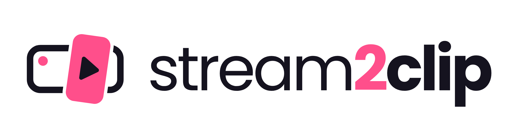
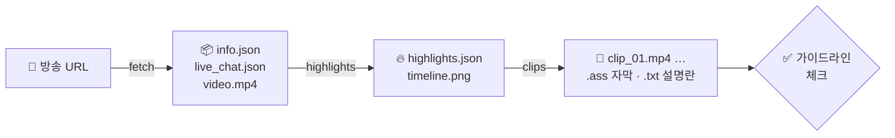
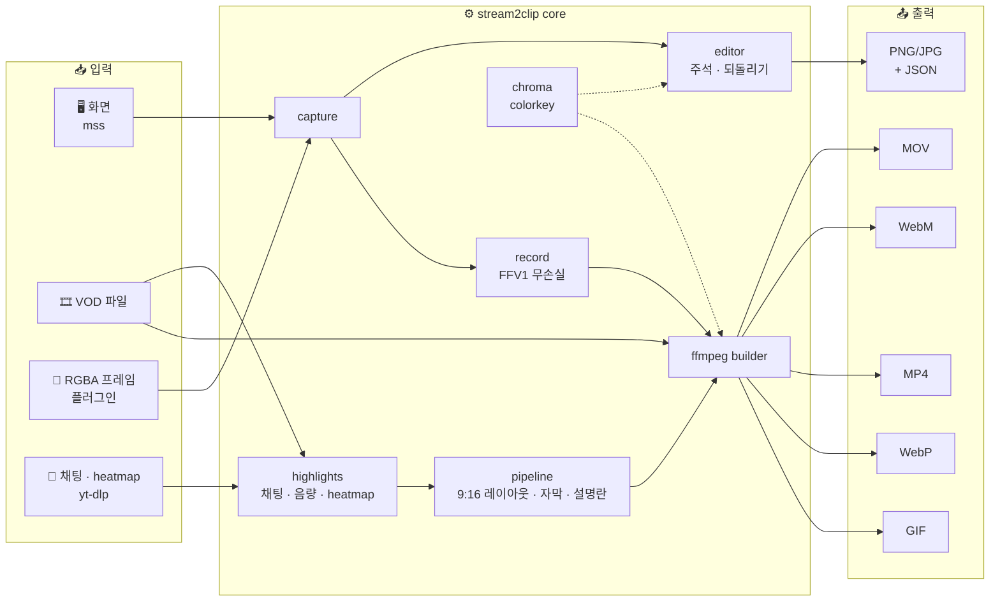

<div align="center">

<picture>
  <source media="(prefers-color-scheme: dark)" srcset="assets/brand/logo/png/lockup_on-dark.png">
  
</picture>

### Stream in. Clips out.

**긴 방송 속 레전드만 쏙.** — 버튜버를 위한 방송 → 클립 편집 도구<br>
캡쳐부터 움짤 녹화까지, 한 프로그램으로

<!-- 프로젝트 -->
<a href="#️-로드맵"></a>
<a href="LICENSE"></a>
<a href="https://github.com/BudongJW/stream2clip/actions/workflows/ci.yml"></a>
<a href="#️-알려진-제약"></a>

<!-- 기술 스택 -->
<a href="#️-기술-스펙"></a>
<a href="#️-기술-스펙"></a>
<a href="#️-기술-스펙"></a>
<a href="#️-기술-스펙"></a>
<a href="#️-기술-스펙"></a>
<a href="#️-기술-스펙"></a>
<a href="#️-기술-스펙"></a>
<a href="#️-기술-스펙"></a>
<a href="#️-기술-스펙"></a>
<a href="#-개발"></a>
<a href="#-개발"></a>

<!-- 기능 -->
<a href="#-출력-포맷"></a>
<a href="#-주요-기능"></a>
<a href="docs/PORTING.md"></a>
<a href="#-방송--클립-자동화"></a>
<a href="#-주요-기능"></a>
<a href="#"></a>

<br>

[✨ 기능](#-주요-기능) · [🔥 자동 클립](#-방송--클립-자동화) · [🖼️ 스크린샷](#️-스크린샷) · [🛠️ 스펙](#️-기술-스펙) · [🚀 설치](#-설치) · [⌨️ 사용법](#️-사용법) · [🧩 이식](#-라이브러리로-쓰기--다른-프로젝트에-이식) · [🏗️ 구조](#️-구조) · [🎨 브랜드](#-브랜드) · [🗺️ 로드맵](#️-로드맵)

<br>


</div>

<br>

**stream2clip**은 방송 화면과 다시보기(VOD)에서 장면을 **캡쳐**하고, **바로 편집**하고, **GIF · MP4 · WebP 움짤로 녹화**하는 도구입니다. 그린스크린을 지운 **투명 배경 녹화**도 됩니다. 데스크톱 앱(PySide6)으로 쓸 수 있고, GUI 없이 **다른 오픈소스 영상 프로젝트에 그대로 이식**할 수 있도록 코어를 작은 파이썬 라이브러리로 분리했습니다.

> [!NOTE]
> **v0.2** — 캡쳐 · 편집 · 움짤 녹화(v0.1)에 더해 **방송 → 클립 자동화**가 들어갔습니다. 채팅 · 음량 · "많이 다시 본 구간"으로 하이라이트를 찾고, 9:16 레이아웃 · 카라오케 자막 · 원본 표기 설명란까지 붙여 클립을 한 번에 뽑습니다. 다음 단계는 [로드맵](#️-로드맵)에 있습니다.

<br>

## ✨ 주요 기능

<table>
<tr>
<td width="33%" valign="top">

### 📸 영역 캡쳐 <kbd>F8</kbd>
화면을 멈춘 상태에서 드래그 → **보이는 그대로** 캡쳐. 실제 픽셀 크기 표시, <kbd>Enter</kbd> 전체 화면, <kbd>Esc</kbd> 취소. 전체 화면(모든 모니터)·이미지 파일 열기도 지원.

</td>
<td width="33%" valign="top">

### 🖍️ 캡쳐하고 바로 편집
**선택 · 펜 · 형광펜 · 네모 · 화살표 · 글자 · 모자이크 · 투명 · 자르기**<br>
8색 팔레트 + 임의 색 + 스포이드, 굵기, 되돌리기/다시 실행, 클립보드 복사, PNG · JPG · WebP · BMP 저장.

</td>
<td width="33%" valign="top">

### 🎬 움짤 녹화 <kbd>F9</kbd>
F9 → 영역 드래그 → **바로 녹화**, 다시 F9 → 저장.<br>
**GIF** 어디서나 재생 · **MP4** 가벼운 용량 · **WebP** 선명한 화질 · **WebM** 투명 영상 (CLI: MOV · APNG).

</td>
</tr>
<tr>
<td valign="top">

### 🔥 하이라이트 자동 검출 <sup>v0.2</sup>
채팅 급증 · 고유 채터 · 반응 어휘(草 · ｗｗ · ㅋㅋ · KEKW · 888) · 슈퍼챗 · 음량 · 많이 다시 본 구간을 **방송별 기준선**과 비교해 점수화. 채팅 지연 보정, 근처 구간 병합, 근거 문장까지.

</td>
<td valign="top">

### 📱 9:16 세로 클립 <sup>v0.2</sup>
**center** · **fit** · **blur**(블러 배경) · **stack**(아바타 위 / 게임 아래) 레이아웃 + 단어별로 불이 들어오는 **카라오케 자막**(SRT · YouTube 자동 자막 VTT · Whisper).

</td>
<td valign="top">

### ✅ 가이드라인 체크 <sup>v0.2</sup>
hololive · にじさんじ · ぶいすぽっ! · あおぎり高校 프로필로 **원본 URL·제목을 맨 위에** 둔 설명란을 만들고, 멤버십 · 아카이브 공개 · 채널 등록 · AI 표기를 업로드 전에 점검.

</td>
</tr>
<tr>
<td valign="top">

### 🟩 투명 배경 녹화
고른 색(그린스크린 등)을 지워 GIF · WebP · WebM · MOV · APNG를 **투명하게**. 화면 스포이드로 색을 고르고 허용 범위 조절. 움직여도 **잔상 없음**(테스트로 검증).

</td>
<td valign="top">

### ✂️ VOD → 클립 변환
다시보기 파일에서 **구간 · 크롭 · 크기 · fps**를 지정해 GIF/WebP/MP4 클립으로. `--print-command`로 ffmpeg 명령만 뽑아 다른 도구에 붙여 쓰기.

</td>
<td valign="top">

### 🧩 이식 가능한 코어
ffmpeg 명령 빌더 · ffmpeg `colorkey`와 **같은 수식**의 numpy 크로마키 · JSON 주석 포맷(스키마 제공) · 플러그인(캡처 백엔드 · OCR · 번역기).

</td>
</tr>
</table>

> 🌐 **번역 (한국어)** — 이미지 속 글자를 OCR → 번역해 덮어씁니다. OCR과 번역기는 [플러그인](docs/PORTING.md#5-플러그인-캡처-백엔드--ocr--번역기)으로 연결합니다(기본 내장 번역 서비스 없음).

<br>

## 🔥 방송 → 클립 자동화



<p align="center"></p>
<p align="center"><sub>3시간 방송(합성 채팅 데이터)에서 찾은 5개 구간 — 핑크 막대가 클립으로 뽑힌 구간, 노란 번호가 1위</sub></p>

<p align="center"></p>
<p align="center"><sub>키 비주얼을 방송 화면 삼아 렌더링한 9:16 레이아웃과 카라오케 자막 (노란색 = 이미 말한 단어)</sub></p>

**한 번에** — VOD와 채팅으로 하이라이트를 찾고 클립까지:

```bash
stream2clip auto video.mp4 --chat video.live_chat.json --info info.json --audio --agency hololive -o clips
```

**단계별로** — 받기 → 찾기 → 뽑기 → 점검:

```bash
stream2clip fetch "https://www.youtube.com/watch?v=VIDEO_ID" -o vod --video --subs ja
```

```bash
stream2clip highlights --chat vod/VIDEO_ID.live_chat.json --info vod/info.json --video vod/video.mp4 --audio -o highlights.json --plot timeline.png
```

```bash
stream2clip clips vod/video.mp4 --highlights highlights.json --layout stack --avatar 1280,0,640,720 --subtitles vod/VIDEO_ID.ja.vtt --info vod/info.json --agency hololive -o clips
```

```bash
stream2clip check --agency nijisanji --info vod/info.json --description clips/clip_01.txt
```

> [!TIP]
> YouTube가 "Sign in to confirm you're not a bot"으로 막으면 `fetch`에 `--cookies-from-browser chrome`(또는 `firefox`, `edge`)이나 `--cookies cookies.txt`를 붙이세요. CHZZK · SOOP 채팅은 다른 수집기로 받은 뒤 `time,author,text` CSV로 넘기면 됩니다.

<details>
<summary><b>🔬 하이라이트 점수는 이렇게 계산합니다</b></summary>

<br>

방송을 `--window`(기본 5초) 단위로 나누고, 신호마다 **그 방송 자신의 평소 수준**(중앙값 · MAD)과 비교한 robust z-점수를 가중합합니다. 조용한 채널과 북적이는 채널을 같은 기준으로 볼 수 있습니다.

| 신호 | 의미 | 가중치 |
|---|---|:---:|
| 채팅 속도 | 구간당 메시지 수 | 0.30 |
| 고유 채터 | 도배 한 명보다 여러 명의 반응 | 0.20 |
| 반응 어휘 | 草 · ｗｗ · 笑 · lol · KEKW · ㅋㅋ · ㄷㄷ · 888 · かわいい · ??? … (메시지당 1회) | 0.30 |
| 후원 | 슈퍼챗 · 비트 · 멤버십 · 선물 | 0.10 |
| 음량 | `--audio`: 영상 소리의 RMS(dB) | 0.15 |
| 많이 다시 본 구간 | `--info`: YouTube heatmap | 0.15 |

그다음 이동 평균 → 임계값(`--threshold`, 기본 2.0) 넘는 봉우리 선택 → **채팅 지연 보정**(`--delay`, 기본 8초 앞당김) → 앞뒤 여유(`--lead` 20초 / `--tail` 10초) → 15초 이내 구간 병합 → 15~90초로 길이 조정 → 점수순 `--top`개. 각 구간에는 "채팅 급증 268/분 (평소의 11.2배) / 반응 60개 (웃음 60) / 음량 +26 dB" 같은 근거가 붙습니다.

</details>

<details>
<summary><b>💬 지원하는 채팅 · 자막 형식, 출력 파일</b></summary>

<br>

| 입력 | 형식 |
|---|---|
| YouTube 채팅 다시보기 | yt-dlp `*.live_chat.json` (일반 채팅 · 슈퍼챗 · 스티커 · 멤버십 · 선물) |
| chat-downloader | xenova/chat-downloader JSON |
| Twitch | TwitchDownloader 채팅 JSON (비트 포함) |
| CHZZK · SOOP · 기타 | `time,author,text[,amount]` CSV / JSONL (`1:02:03` 같은 시각도 가능) |
| 자막 | SRT · WebVTT(YouTube 자동 자막의 단어별 시각 포함) · Whisper JSON · `--transcribe`로 faster-whisper 직접 실행 |

| 출력 | 내용 |
|---|---|
| `clip_01.mp4` … | 9:16 클립 (형식은 `-f gif/webp/webm/...`로 변경) |
| `clip_01.ass` | 클립 시간에 맞춘 카라오케 자막 (편집기에서 수정 가능) |
| `clip_01.txt` | 원본 제목 · 타임스탬프 링크를 맨 위에 둔 설명란 |
| `clips.json` | 구간 · 점수 · 근거 · 가이드라인 점검 결과 |
| `highlights.json` · `timeline.png` | 하이라이트 목록과 타임라인 그래프 (`auto`) |

</details>

> [!CAUTION]
> 기획사 프로필(hololive 2026-08-31 개정, にじさんじ 2025-05-23 개정 등)은 [레퍼런스 조사](reports/버튜버%20영상%20작업%20프로젝트%20레퍼런스.md) 시점의 **체크리스트**일 뿐 법적 판단이 아닙니다. 가이드라인은 바뀌고 탤런트마다 추가 규칙이 있으니 업로드 전에 원문을 꼭 확인하세요. 한국 기획사 가이드라인은 아직 확보하지 못해 `generic` 프로필만 있습니다.

<br>

## 🖼️ 스크린샷

<table>
<tr>
<td width="40%" align="center"><br><sub><b>런처</b> — 캡쳐 · 움짤 녹화 · 투명 배경 설정</sub></td>
<td width="60%" align="center"><br><sub><b>편집기</b> — 툴바 · 팔레트 · 굵기 · 번역 · 되돌리기 · 복사 · 저장</sub></td>
</tr>
<tr>
<td colspan="2" align="center"><br><sub><b>영역 선택 오버레이</b> — 화면을 멈춘 채 드래그, 선택 영역만 밝게, 실제 픽셀 크기 표시</sub></td>
</tr>
</table>

<sub>스크린샷은 Xvfb 가상 디스플레이에서 앱을 실제로 실행해 찍었습니다. 캡쳐 대상 이미지는 <a href="assets/brand">assets/brand</a>의 키 비주얼입니다.</sub>

<br>

## 🛠️ 기술 스펙

| 구분 | 사용 기술 | 요구 버전 | 검증 버전 | 비고 |
|---|---|---|---|---|
| 🐍 언어 | **Python** | 3.10+ | 3.13 | 타입 힌트, `src/` 레이아웃, `py.typed` |
| 🪟 GUI | **PySide6** (Qt for Python) | 6.6+ | 6.12 (Qt 6.12) | 선택 설치 `[gui]` · LGPLv3 |
| 🖥️ 화면 캡처 | **mss** | 9+ | 10.2 | Windows GDI · macOS CoreGraphics · X11, 스레드별 핸들 |
| 🖼️ 이미지 처리 | **Pillow** · **NumPy** | 10.1+ · 1.24+ | 13.0 · 2.5 | 렌더링(3배 슈퍼샘플링 안티에일리어싱), 크로마키 |
| 🎞️ 인코딩 | **FFmpeg** (외부 바이너리) | 5+ 권장 | 6.1 | `gif` · `libwebp_anim` · `libx264` · `libvpx-vp9` · `prores_ks` · `apng` · `ffv1` |
| 📥 VOD · 채팅 수집 | **yt-dlp** | 2024.1+ | 2026.10 | 선택 설치 `[ingest]`, 구간 다운로드 · 채팅 다시보기 · heatmap |
| 💬 자막 | **libass** (ffmpeg) · **faster-whisper** | — · 1.0+ | ffmpeg 6.1 내장 | 카라오케 ASS 입히기, 받아쓰기는 `[asr]` |
| ⌨️ 전역 단축키 | Win32 `RegisterHotKey` / **pynput** | — | — | Windows는 추가 설치 없음, 그 외 `[hotkey]` |
| 🔤 OCR (선택) | **Tesseract** + pytesseract | 0.3+ | — | `[ocr]`, 번역 플러그인과 함께 사용 |
| 🧪 테스트 | **pytest** · Xvfb | 8+ | 9.2 | 128개 · 실제 마우스 이벤트 · F8/F9 · VOD→클립 end-to-end · Windows 전역 단축키/배율 |
| ⚙️ CI | **GitHub Actions** | — | — | Ubuntu(Xvfb, GUI 포함) + Windows |
| 📦 패키징 | `pyproject.toml` · setuptools | 77+ | — | `stream2clip` / `stream2clip-gui` 실행 파일, entry point 플러그인 |
| 🗂️ 데이터 포맷 | **JSON Schema** 2020-12 | — | — | [`annotation.v1.schema.json`](src/stream2clip/schemas/annotation.v1.schema.json) |

<details>
<summary><b>📊 코드 규모 · 의존성 그래프</b></summary>

<br>

| | 줄 수 |
|---|---|
| 라이브러리 + 앱 (`src/`) | 약 6,200 |
| 테스트 (`tests/`) | 약 1,200 |

| 설치 옵션 | 추가되는 의존성 | 쓰는 곳 |
|---|---|---|
| `pip install .` | numpy, Pillow | 편집 · 크로마키 · VOD 변환 · ffmpeg 빌더 |
| `[capture]` | mss | 화면 캡쳐 · 녹화 |
| `[gui]` | PySide6, mss | 데스크톱 앱 |
| `[hotkey]` | pynput | 리눅스/맥 전역 단축키 |
| `[ocr]` | pytesseract | 번역용 글자 인식 |
| `[ingest]` | yt-dlp | `stream2clip fetch` (VOD · 채팅 · info) |
| `[asr]` | faster-whisper | `--transcribe` 자동 받아쓰기 |
| `[dev]` | pytest, jsonschema, mss, PySide6 | 테스트 |

</details>

### 📼 출력 포맷

| 포맷 | 코덱 | 투명 배경 | 오디오 | 이럴 때 |
|---|---|:---:|:---:|---|
| **GIF** | gif + 팔레트 최적화 | ✅ 1비트 | — | 어디서나 재생, 커뮤니티 업로드 |
| **WebP** | libwebp_anim | ✅ 8비트 | — | 같은 용량에 더 선명한 움짤 |
| **MP4** | H.264 (libx264), faststart | ❌ | ✅ AAC | 가벼운 용량, SNS 업로드 |
| **WebM** | VP9 (libvpx-vp9) | ✅ 8비트 | ✅ Opus | 투명 영상, 웹 |
| **MOV** | ProRes 4444 | ✅ 10비트 | ✅ PCM | 영상 편집기 오버레이 소스 |
| **APNG** | apng | ✅ 8비트 | — | 무손실 투명 움짤 |

<br>

## 🚀 설치

> [!IMPORTANT]
> **Python 3.10+** 와 **ffmpeg**가 필요합니다. ffmpeg는 PATH에 두거나 `STREAM2CLIP_FFMPEG` 환경 변수로 경로를 지정하세요.

```bash
git clone https://github.com/BudongJW/stream2clip.git
```

```bash
cd stream2clip
```

```bash
pip install -e ".[gui]"
```

| 이런 경우 | 설치 |
|---|---|
| 데스크톱 앱 | `pip install -e ".[gui]"` |
| 리눅스·맥에서 앱이 비활성일 때도 F8/F9 | `pip install -e ".[gui,hotkey]"` (Windows는 기본 지원) |
| 라이브러리 · CLI만 (화면 캡쳐 포함) | `pip install -e ".[capture]"` |
| 편집 · 변환만 (화면 캡쳐 없음) | `pip install -e .` |
| 번역용 OCR | `pip install -e ".[ocr]"` + tesseract 바이너리 |
| 방송 URL에서 VOD · 채팅 받기 | `pip install -e ".[ingest]"` |
| 자막 자동 받아쓰기 (Whisper) | `pip install -e ".[asr]"` |
| 전부 | `pip install -e ".[gui,hotkey,ingest,asr]"` |

<br>

## ⌨️ 사용법

### 데스크톱 앱

```bash
stream2clip gui
```

| 단축키 | 동작 |
|---|---|
| <kbd>F8</kbd> | 영역 캡쳐 → 편집기 |
| <kbd>F9</kbd> | 녹화할 영역 선택 후 바로 녹화 · 다시 누르면 정지 + 저장 |
| <kbd>V</kbd> <kbd>P</kbd> <kbd>H</kbd> <kbd>R</kbd> <kbd>A</kbd> <kbd>T</kbd> <kbd>M</kbd> <kbd>E</kbd> <kbd>C</kbd> | 선택 · 펜 · 형광펜 · 네모 · 화살표 · 글자 · 모자이크 · 투명 · 자르기 |
| <kbd>I</kbd> | 스포이드 |
| <kbd>[</kbd> <kbd>]</kbd> | 굵기 −/+ (글자 크기 = 굵기 × 3 + 12, 모자이크 블록 = 굵기 × 2) |
| <kbd>Ctrl</kbd>+<kbd>Z</kbd> / <kbd>Ctrl</kbd>+<kbd>Y</kbd> | 되돌리기 / 다시 실행 |
| <kbd>Ctrl</kbd>+<kbd>C</kbd> / <kbd>Ctrl</kbd>+<kbd>S</kbd> | 복사 / 저장 |
| <kbd>Ctrl</kbd>+휠, <kbd>Ctrl</kbd>+<kbd>0</kbd> | 확대 · 축소, 100% |
| <kbd>Delete</kbd> | 선택한 주석 삭제 |

> [!TIP]
> **투명** 도구는 드래그하면 그 영역을 지우고, 클릭하면 클릭한 색을 이미지 전체에서 투명하게 만듭니다. **자르기**는 원본을 보존한 채 남길 영역만 지정합니다. 저장할 때 `.json`을 고르면 주석만 따로 저장됩니다.

### CLI

```bash
stream2clip record --region 0,0,640,360 --duration 5 -o clip.gif
```

```bash
stream2clip convert vod.mp4 --start 1:02:03 --end 1:02:18 --crop 640,0,640,720 --width 480 -o highlight.webp
```

<details>
<summary><b>더 많은 CLI 예시</b></summary>

<br>

영역 캡쳐:

```bash
stream2clip capture --region 100,100,1280,720 -o shot.png
```

모니터 전체를 투명 배경 WebP로 녹화:

```bash
stream2clip record --monitor 0 --transparent --key-color "#00FF00" -o avatar.webp
```

그린스크린 영상을 투명 WebM으로:

```bash
stream2clip convert greenscreen.mp4 --transparent --similarity 0.15 -o avatar.webm
```

이미 알파가 있는 영상은 색을 지우지 않고 알파만 유지:

```bash
stream2clip convert avatar_alpha.mov --transparent --key-color none -o avatar.webm
```

주석 JSON 적용 / 주석만 투명 PNG로:

```bash
stream2clip annotate shot.png --annotations edits.json -o out.png
```

```bash
stream2clip annotate shot.png --annotations edits.json --overlay -o overlay.png
```

ffmpeg 명령만 출력:

```bash
stream2clip convert vod.mp4 -o clip.gif --start 60 --end 70 --print-command
```

전체 옵션은 `stream2clip <명령> --help`.

</details>

<br>

## 🧩 라이브러리로 쓰기 · 다른 프로젝트에 이식

코어는 **numpy + Pillow만** 필요하고 GUI와 완전히 분리되어 있습니다. autoclip · FunClip · biliup 같은 ffmpeg 기반 파이프라인, MoviePy · OpenCV · PyAV 프레임 처리, Kdenlive · Shotcut · OBS 오버레이, PySide6 앱 등에 붙이는 방법은 👉 **[docs/PORTING.md](docs/PORTING.md)**

```python
from stream2clip import ExportOptions, Region, build_export_command, export

opts = ExportOptions(format="webp", start=3723, end=3738, crop=Region(640, 0, 640, 720), width=480,
                     transparent=True, key_color="#00FF00")
print(build_export_command("vod.mp4", "clip.webp", opts))  # ffmpeg 명령만 (순수 함수)
export("vod.mp4", "clip.webp", opts)                         # 바로 실행
```

<details>
<summary><b>주석 편집 · 녹화 예시</b></summary>

<br>

```python
from PIL import Image
from stream2clip.editor import Arrow, Document, Mosaic, Text
from stream2clip.geometry import Region

doc = Document(Image.open("frame.png"))
doc.add(Arrow((40, 300), (220, 180), color="#FF4F8B", width=6))
doc.add(Text((240, 150), "레전드 장면", size=32, background="#FFD84D", color="#15131F"))
doc.add(Mosaic(Region(20, 20, 200, 60)))
doc.save("frame_annotated.png")
doc.render_overlay().save("overlay.png")       # 주석만 있는 투명 PNG
doc.save_annotations("frame.annotation.json")  # stream2clip.annotation/v1
```

```python
from stream2clip.capture import ArrayBackend
from stream2clip.ffmpeg import ExportOptions
from stream2clip.geometry import Region
from stream2clip.record import Recorder

# RGBA numpy 배열을 주는 것이면 무엇이든 녹화 (게임 엔진, 아바타 렌더러, OBS ...)
recorder = Recorder(Region(0, 0, 1080, 1920), fps=30, backend_factory=lambda: ArrayBackend(my_render_fn))
recorder.start(); ...; recording = recorder.stop()
recording.export("avatar.webm", ExportOptions(format="webm", transparent=True, key_color=None))
```

</details>

<br>

## 🏗️ 구조



```
src/stream2clip/
├── geometry.py · color.py · frames.py   기본 타입 (Region, 색, RGBA 프레임 규약)
├── ffmpeg.py      ffmpeg 명령/필터그래프 빌더 (프로세스 실행 없음, 순수 함수)
├── chroma.py      크로마키 — ffmpeg colorkey와 같은 수식 (미리보기 = 결과물)
├── export.py      ffmpeg 실행, ffprobe
├── chat.py        채팅 다시보기 → ChatMessage (YouTube · Twitch · chat-downloader · CSV/JSONL)
├── sources.py     yt-dlp: info · 채팅 · VOD 구간 · heatmap        audio.py  음량 곡선
├── highlights.py  하이라이트 검출 · 타임라인 그래프
├── layouts.py     9:16 레이아웃 (center · fit · blur · stack)
├── subtitles.py   SRT/VTT/JSON → 카라오케 ASS, faster-whisper 연결
├── compliance.py  기획사 가이드라인 프로필 · 설명란 · 업로드 전 점검
├── pipeline.py    하이라이트 → 완성 클립 일괄 생성
├── capture/       캡처 백엔드 (mss, numpy 배열, 플러그인) + 커서 합성
├── editor/        주석 모델 · 렌더러 · 되돌리기 · JSON 직렬화
├── record/        실시간 영역 녹화 (무손실 FFV1 중간 파일 → 원하는 포맷)
├── translate/     OCR + 번역 플러그인 인터페이스
├── plugins.py     entry point 기반 플러그인 레지스트리
├── schemas/       annotation.v1 JSON Schema
├── cli.py         stream2clip 명령
└── gui/           PySide6 앱 (런처, 영역 선택, 편집기, 녹화 오버레이, 전역 단축키)
```

설계 원칙 · 녹화 파이프라인 · 스레드 구조는 👉 **[docs/ARCHITECTURE.md](docs/ARCHITECTURE.md)**

<br>

## 🎨 브랜드

<p align="center"></p>

<table>
<tr>
<td width="50%" valign="top">

#### 💡 심볼
**가로 16:9 스트림 프레임에서 세로 9:16 클립 카드를 꺼내는 순간.**<br>
▭ 16:9 스트림 프레임 · ▮ 9:16 클립 카드 · ● REC 점, 라이브의 흔적

#### 🎨 컬러

| | 이름 | HEX |
|---|---|---|
|  | 잉크 | `#15131F` |
|  | 페이퍼 | `#F7F4FA` |
|  | 라이브 핑크 | `#FF4F8B` |
|  | 하이라이트 | `#FFD84D` |

</td>
<td width="50%" valign="top">

#### 🔤 서체

| 서체 | 용도 |
|---|---|
| **Outfit** | 워드마크 · 영문 헤드라인 |
| **Noto Sans KR** | 국문 헤드라인 · 본문 |
| **JetBrains Mono** | 타임코드 · 라벨 |

#### 📁 에셋

| 경로 | 내용 |
|---|---|
| [`logo/svg/`](assets/brand/logo/svg) | 벡터 원본 — 컬러 · 단색 · 16px용 · 앱 아이콘 |
| [`logo/png/`](assets/brand/logo/png) | 1024px PNG · 가로형 로크업 |
| [`logo/favicon/`](assets/brand/logo/favicon) | ico · 32/512px · apple-touch-icon |
| [`02_concept-image_keyvisual…`](assets/brand/02_concept-image_keyvisual_1920x1080.png) | 키 비주얼 (FHD · `@2x`) |
| [`03_github-social-preview…`](assets/brand/03_github-social-preview_1280x640.png) | GitHub 소셜 프리뷰 |

</td>
</tr>
</table>

<p align="center"></p>

<sub>데스크톱 앱도 같은 팔레트와 핑크 앱 아이콘을 씁니다. PNG 시안의 영문 워드마크는 Outfit 대신 Poppins로 렌더링되어 원본과 글자 모양이 약간 다릅니다(<a href="assets/brand/README.txt">assets/brand/README.txt</a>). 심볼 · 앱 아이콘 · 파비콘은 순수 도형이라 원본과 같습니다. 소셜 프리뷰는 저장소 Settings → General → Social preview에 업로드하면 적용됩니다.</sub>

<br>

## 🗺️ 로드맵

[외부 프로젝트 레퍼런스 조사](reports/버튜버%20영상%20작업%20프로젝트%20레퍼런스.md)를 바탕으로 한 다음 단계입니다.

- [x] 영역 · 전체 화면 캡쳐, 편집기(9개 도구 · 팔레트 · 스포이드 · 되돌리기)
- [x] F9 움짤 녹화 — GIF · MP4 · WebP · WebM · MOV · APNG
- [x] 투명 배경 녹화(크로마키), 알파 보존 내보내기
- [x] VOD 구간 · 크롭 변환, 주석 JSON 스키마, 플러그인 구조
- [x] 📥 VOD · 채팅 수집 — yt-dlp(구간 · `live_chat` · heatmap), chat-downloader, TwitchDownloader, CSV/JSONL <sup>v0.2</sup>
- [x] 🔥 하이라이트 검출 — 방송별 기준선 · 채팅 급증 · 고유 채터 · 반응 어휘 · 슈퍼챗 · 음량 · heatmap, 채팅 지연 보정 <sup>v0.2</sup>
- [x] 📱 9:16 레이아웃 — center · fit · blur · stack(아바타 박스 수동 지정) <sup>v0.2</sup>
- [x] 💬 카라오케 자막 — SRT · YouTube VTT 단어 시각 · Whisper JSON · faster-whisper <sup>v0.2</sup>
- [x] ✅ 기획사 가이드라인 설명란 생성 · 업로드 전 점검 <sup>v0.2</sup>
- [ ] 🤖 아바타 박스 자동 제안 — 애니메 얼굴 검출(deepghs/anime_face_detection, MIT)로 stack 레이아웃 자동화
- [ ] 🖥️ GUI에 하이라이트 타임라인 · 클립 미리보기 · 구간 미세 조정
- [ ] 🇰🇷 CHZZK · SOOP 채팅 수집기 내장, 한국 기획사 가이드라인 프로필
- [ ] 🌐 JP→KR 자막 번역 + 버튜버 이름 용어집 (Holodex 채널 메타)
- [ ] 😂 웃음소리 검출 · 노래 구간(歌枠) 검출
- [ ] 🧍 아바타 레이어 — Spout2/NDI 알파 레이어 녹화, VMC · VTube Studio 파라미터 기록 후 재렌더
- [ ] 🔁 OBS 리플레이 버퍼 연동 (obs-websocket `SaveReplayBuffer` → 바로 움짤 변환)
- [ ] ⬆️ YouTube 업로드 (Data API `videos.insert`) + Shorts 메타데이터

<br>

## 🧪 개발

```bash
pip install -e ".[dev]"
```

```bash
pytest
```

리눅스에서 실제 화면을 쓰는 end-to-end GUI 테스트(F8 캡쳐 → 편집기, F9 투명 녹화 → GIF 검증)까지 돌리려면:

```bash
xvfb-run -a pytest
```

| 테스트 | 범위 |
|---|---|
| `test_core.py` | Region · 색 · 프레임, 크로마키, ffmpeg 빌더 |
| `test_editor.py` | 도형별 렌더링, 직렬화 왕복, JSON 스키마, 되돌리기, 오버레이 |
| `test_export_record.py` | 6개 포맷, 구간 · 크롭, 투명 잔상 없음, WebM 알파, numpy↔ffmpeg 크로마키 일치, 실시간 녹화 |
| `test_chat_sources.py` | 채팅 형식 4종 파싱, 금액 파싱, yt-dlp 명령, info · heatmap, 음량 곡선 |
| `test_highlights.py` | 반응 어휘 분류, 심어 둔 장면 검출 · 지연 보정 · 병합 · 길이 제한, 음량/heatmap 단독, JSON · 타임라인 |
| `test_clips.py` | 레이아웃 4종 렌더링, 필터 경로 이스케이프, SRT/VTT/ASS, 자막이 정해진 시간에만 보이는지, 가이드라인 점검, 클립 파이프라인 |
| `test_cli.py` | CLI 명령 (`auto` 전체 흐름 포함) |
| `test_gui.py` | 실제 마우스 이벤트로 편집기 조작, HiDPI 좌표(125% · 150% · 175%에서 선택 크기 일정), 클립보드 복사, 녹화 테두리가 영역을 덮지 않음 |
| `test_gui_flow.py` | (디스플레이 필요) F8 → 편집기, F9 → 녹화 → 투명 GIF. Windows에서는 추가로 실제 F8/F9 입력 → 전역 단축키, 선택 영역 = 창의 물리 픽셀, 테두리 · REC 바가 녹화 영역 밖, 커서 합성 위치 |

> [!NOTE]
> Windows에서 `pytest`를 그냥 실행하면 `test_gui_flow.py`가 화면 왼쪽 위에 창을 띄우고, F8/F9를 실제로 누르고, 마우스 커서를 몇 초 동안 옮깁니다(끝나면 제자리로). 건너뛰려면 `QT_QPA_PLATFORM=offscreen`으로 실행하세요. 다른 프로그램이 F8/F9를 전역 단축키로 쓰고 있으면 그 테스트는 건너뜁니다.

<br>

## ⚠️ 알려진 제약

| 환경 | 상태 |
|---|---|
| 🐧 Linux (X11) | ✅ Xvfb에서 전체 흐름 테스트 |
| 🪟 Windows 11 | ✅ 실기기(1920×1080, 배율 125%, 모니터 1대)에서 전역 단축키 F8/F9(앱이 숨겨진 상태 포함) · 커서 합성 · 선택 영역과 캡쳐/녹화 결과 일치 · GIF/MP4/WebP/WebM · 투명 배경 · 클립보드 복사 확인. 100% · 150% · 175%는 같은 기기에서 Qt 배율 계수(`QT_SCALE_FACTOR`)로만 확인했고, 모니터 2대(배율 혼합)는 미검증 |
| 🪟 Windows 10 | 🟡 같은 Win32 API를 쓰지만 실기기 미검증 |
| 🍎 macOS | 🟡 시스템 설정의 화면 기록 권한 필요, 실기기 미검증 |
| 🌊 Wayland | ❌ 화면 캡쳐(mss)는 X11/XWayland에서만 동작 |
| 📺 YouTube 수집 | 🟡 이 저장소의 테스트 서버에서는 YouTube가 봇 확인으로 막아 실제 다운로드는 검증하지 못했습니다. 채팅 파서는 yt-dlp `live_chat.json` 구조로 만든 샘플로 테스트했습니다 |

- 배율이 다른 다중 모니터에서는 논리↔물리 좌표를 가상 화면 전체 비율로 환산하므로 선택 영역이 조금 어긋날 수 있습니다.
- 125% · 150% 같은 소수 배율에서는 선택 영역의 위치와 크기를 따로 반올림합니다(Qt가 창을 놓는 방식과 같음). 같은 크기로 드래그하면 어디서든 같은 픽셀 크기가 나오고, 화면 픽셀과의 차이는 최대 1px입니다.
- 녹화에 그려 넣는 커서는 화살표 모양 하나이며 화면 배율에 맞춰 크기만 조정합니다(손가락 · I빔 같은 실제 커서 모양은 따라가지 않음).
- GIF 투명도는 1비트입니다. 부드러운 가장자리가 필요하면 WebP · WebM · MOV를 쓰세요.

<br>

## 📄 라이선스

[Apache License 2.0](LICENSE)

GUI는 PySide6(LGPLv3), 화면 캡쳐는 mss(MIT)를 사용하며, 영상 인코딩은 시스템에 설치된 ffmpeg 빌드의 라이선스(LGPL/GPL)를 따릅니다. 브랜드 에셋(`assets/brand`)은 이 프로젝트의 로고 · 컨셉 이미지입니다.

<br>

<div align="center">
  
  <br>
  <sub><b>stream2clip</b> · Stream in. Clips out.</sub>
</div>
