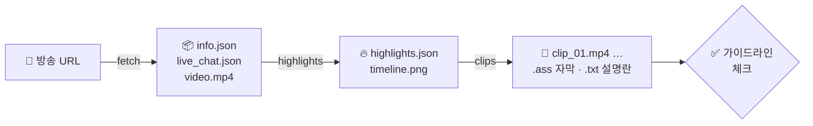
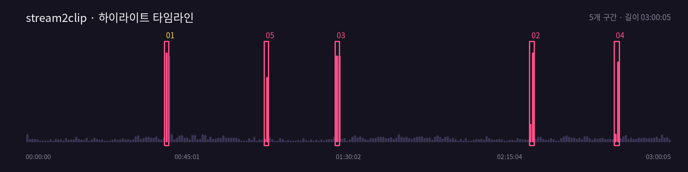
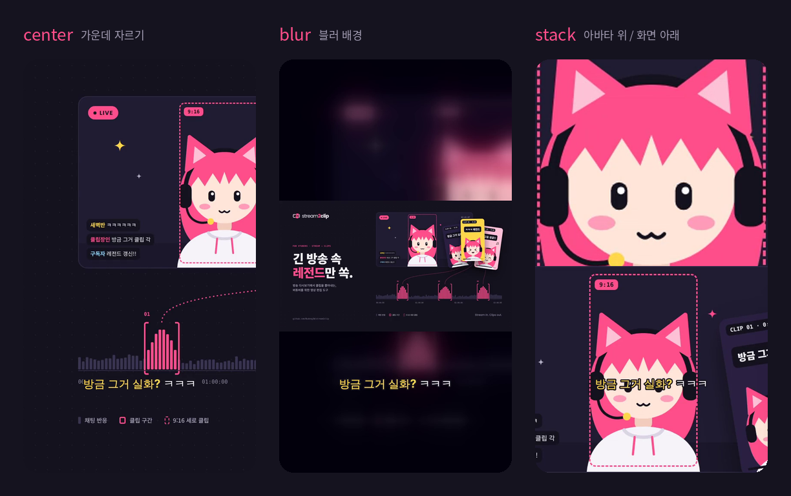
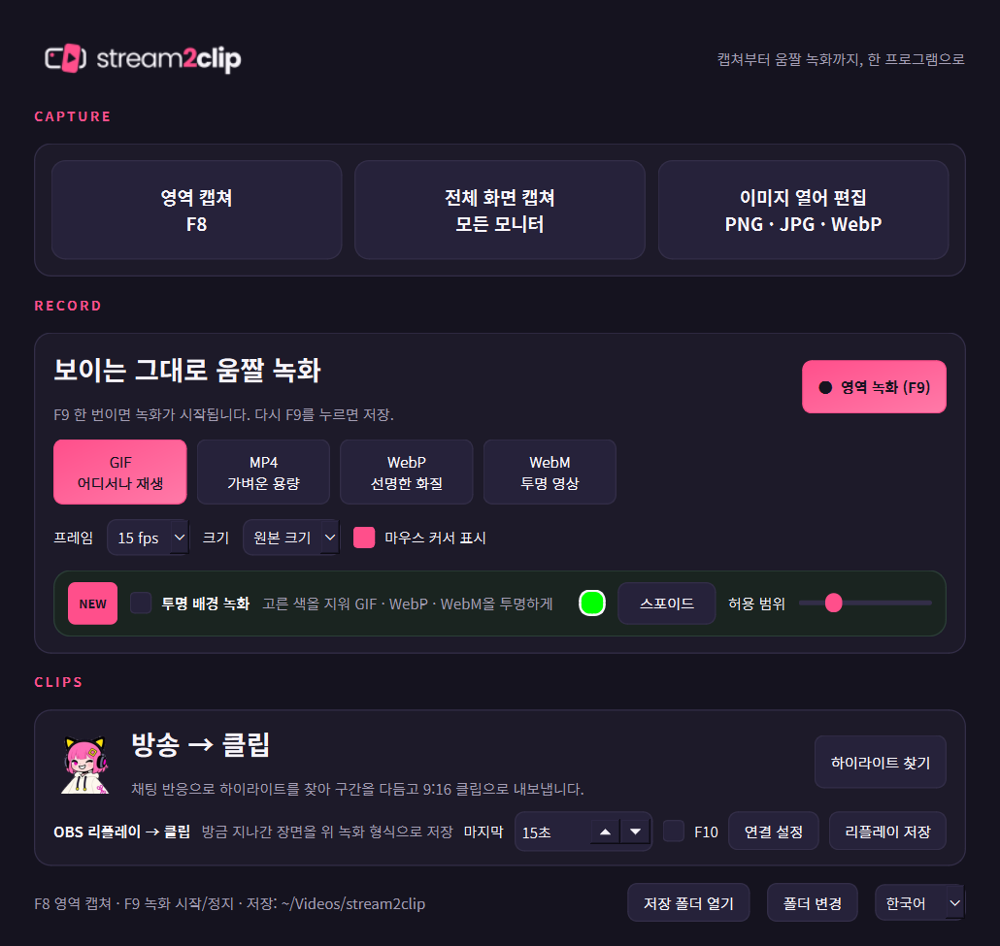
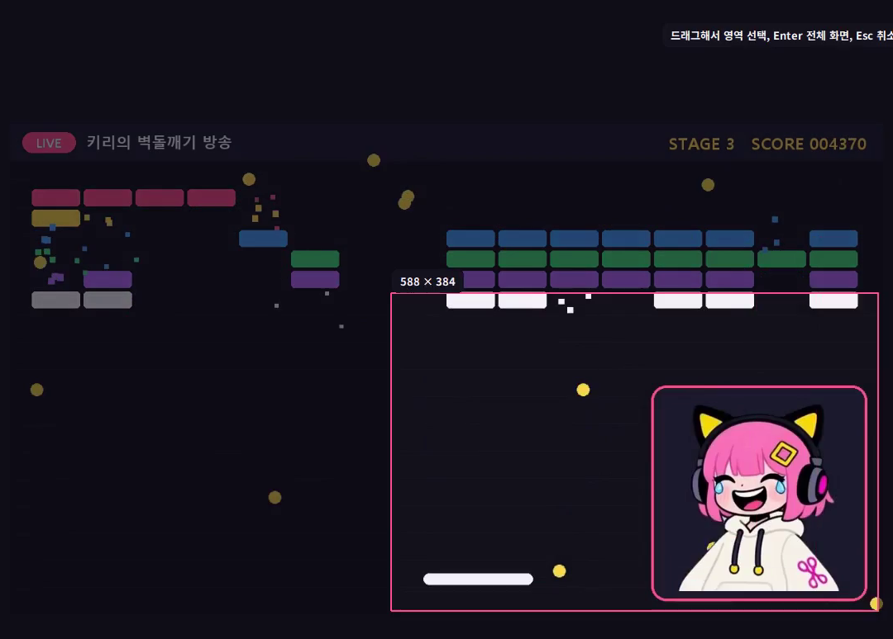
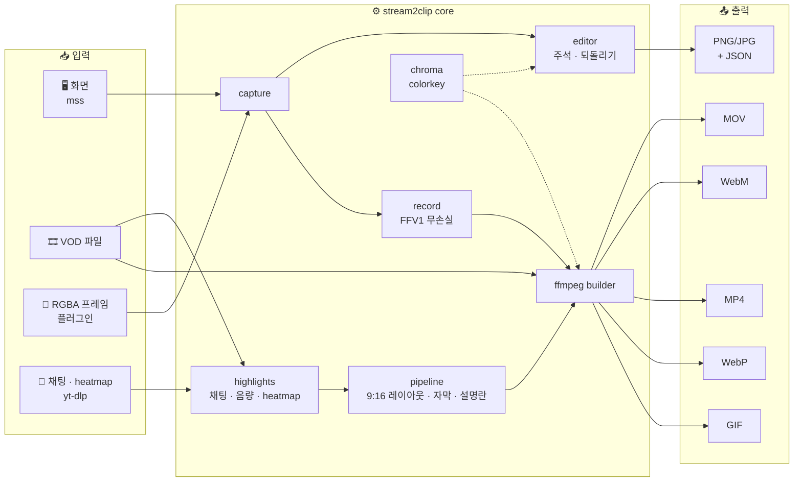
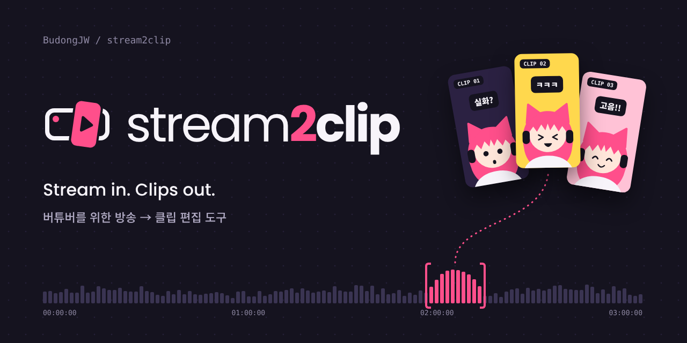
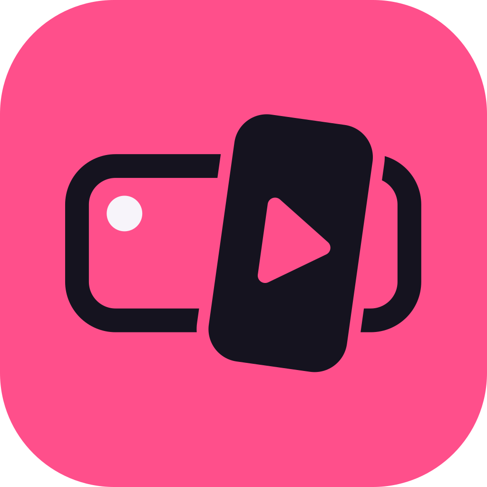

<div align="center">

<picture>
  <source media="(prefers-color-scheme: dark)" srcset="assets/brand/logo/png/lockup_on-dark.png">
  
</picture>

### Stream in. Clips out.

**긴 방송 속 레전드만 쏙.** — 버튜버를 위한 방송 → 클립 편집 도구<br>
캡쳐부터 움짤 녹화까지, 한 프로그램으로

<!-- 프로젝트 -->
<a href="#️-로드맵"></a>
<a href="LICENSE"></a>
<a href="https://github.com/BudongJW/stream2clip/actions/workflows/ci.yml"></a>
<a href="#️-알려진-제약"></a>

<!-- 기술 스택 -->
<a href="#️-기술-스펙"></a>
<a href="#️-기술-스펙"></a>
<a href="#️-기술-스펙"></a>
<a href="#️-기술-스펙"></a>
<a href="#️-기술-스펙"></a>
<a href="#️-기술-스펙"></a>
<a href="#️-기술-스펙"></a>
<a href="#️-기술-스펙"></a>
<a href="#️-기술-스펙"></a>
<a href="#-개발"></a>
<a href="#-개발"></a>

<!-- 기능 -->
<a href="#-출력-포맷"></a>
<a href="#-주요-기능"></a>
<a href="docs/PORTING.md"></a>
<a href="#-방송--클립-자동화"></a>
<a href="#-주요-기능"></a>
<a href="#"></a>

<br>

[✨ 기능](#-주요-기능) · [🔥 자동 클립](#-방송--클립-자동화) · [🖼️ 스크린샷](#️-스크린샷) · [🛠️ 스펙](#️-기술-스펙) · [🚀 설치](#-설치) · [⌨️ 사용법](#️-사용법) · [🧩 이식](#-라이브러리로-쓰기--다른-프로젝트에-이식) · [🏗️ 구조](#️-구조) · [🎨 브랜드](#-브랜드) · [🗺️ 로드맵](#️-로드맵)

<br>


</div>

<br>

**stream2clip**은 방송 화면과 다시보기(VOD)에서 장면을 **캡쳐**하고, **바로 편집**하고, **GIF · MP4 · WebP 움짤로 녹화**하는 도구입니다. 그린스크린을 지운 **투명 배경 녹화**도 됩니다. 데스크톱 앱(PySide6)으로 쓸 수 있고, GUI 없이 **다른 오픈소스 영상 프로젝트에 그대로 이식**할 수 있도록 코어를 작은 파이썬 라이브러리로 분리했습니다.

> [!NOTE]
> **v0.4** — **주소 하나로 클립까지**(하이라이트 구간의 영상만 내려받음), 앱 화면 **한국어 · 일본어 · 영어**, 앱에서 **번역 · 업로드 · OBS 리플레이**(F10), **번역기를 파일 하나로 연결**, 여러 방송으로 검출을 재는 **`evaluate`** 가 들어갔습니다. 실제 OBS · CHZZK · YouTube로 확인하며 찾은 문제도 고쳤습니다.
>
> **v0.3** — 앱에 **하이라이트 창**이 생겼고, **아바타 위치 자동 찾기**, **CHZZK · SOOP 채팅 수집**, **자막 번역 + 이름 용어집**, **노래 구간 검출**, **OBS 리플레이 버퍼 → 클립**, **YouTube 업로드**, **Windows 실행 파일**이 들어갔습니다. 바뀐 내용은 [CHANGELOG.md](CHANGELOG.md)에 있습니다.
>
> **v0.2** — 캡쳐 · 편집 · 움짤 녹화(v0.1)에 더해 **방송 → 클립 자동화**가 들어갔습니다. 채팅 · 음량 · "많이 다시 본 구간"으로 하이라이트를 찾고, 9:16 레이아웃 · 카라오케 자막 · 원본 표기 설명란까지 붙여 클립을 한 번에 뽑습니다. 다음 단계는 [로드맵](#️-로드맵)에 있습니다.

<br>

## ✨ 주요 기능

<table>
<tr>
<td width="33%" valign="top">

### 📸 영역 캡쳐 <kbd>F8</kbd>
화면을 멈춘 상태에서 드래그 → **보이는 그대로** 캡쳐. 실제 픽셀 크기 표시, <kbd>Enter</kbd> 전체 화면, <kbd>Esc</kbd> 취소. 전체 화면(모든 모니터)·이미지 파일 열기도 지원.

</td>
<td width="33%" valign="top">

### 🖍️ 캡쳐하고 바로 편집
**선택 · 펜 · 형광펜 · 네모 · 화살표 · 글자 · 모자이크 · 투명 · 자르기**<br>
8색 팔레트 + 임의 색 + 스포이드, 굵기, 되돌리기/다시 실행, 클립보드 복사, PNG · JPG · WebP · BMP 저장.

</td>
<td width="33%" valign="top">

### 🎬 움짤 녹화 <kbd>F9</kbd>
F9 → 영역 드래그 → **바로 녹화**, 다시 F9 → 저장.<br>
**GIF** 어디서나 재생 · **MP4** 가벼운 용량 · **WebP** 선명한 화질 · **WebM** 투명 영상 (CLI: MOV · APNG).

</td>
</tr>
<tr>
<td valign="top">

### 🔥 하이라이트 자동 검출 <sup>v0.2</sup>
채팅 급증 · 고유 채터 · 반응 어휘(草 · ｗｗ · ㅋㅋ · KEKW · 888) · 슈퍼챗 · 음량 · 많이 다시 본 구간을 **방송별 기준선**과 비교해 점수화. 채팅 지연 보정, 근처 구간 병합, 근거 문장까지.

</td>
<td valign="top">

### 📱 9:16 세로 클립 <sup>v0.2</sup>
**center** · **fit** · **blur**(블러 배경) · **stack**(아바타 위 / 게임 아래, `--avatar auto`로 아바타 위치 자동 찾기) 레이아웃 + 단어별로 불이 들어오는 **카라오케 자막**(SRT · YouTube 자동 자막 VTT · Whisper).

</td>
<td valign="top">

### ✅ 가이드라인 체크 <sup>v0.2</sup>
hololive · にじさんじ · ぶいすぽっ! · あおぎり高校 프로필로 **원본 URL·제목을 맨 위에** 둔 설명란을 만들고, 멤버십 · 아카이브 공개 · 채널 등록 · AI 표기를 업로드 전에 점검.

</td>
</tr>
<tr>
<td valign="top">

### 🟩 투명 배경 녹화
고른 색(그린스크린 등)을 지워 GIF · WebP · WebM · MOV · APNG를 **투명하게**. 화면 스포이드로 색을 고르고 허용 범위 조절. 움직여도 **잔상 없음**(테스트로 검증).

</td>
<td valign="top">

### ✂️ VOD → 클립 변환
다시보기 파일에서 **구간 · 크롭 · 크기 · fps**를 지정해 GIF/WebP/MP4 클립으로. `--print-command`로 ffmpeg 명령만 뽑아 다른 도구에 붙여 쓰기.

</td>
<td valign="top">

### 🧩 이식 가능한 코어
ffmpeg 명령 빌더 · ffmpeg `colorkey`와 **같은 수식**의 numpy 크로마키 · JSON 주석 포맷(스키마 제공) · 플러그인(캡처 백엔드 · OCR · 번역기).

</td>
</tr>
</table>

> 🌐 **번역 (한국어)** — 이미지 속 글자를 OCR → 번역해 덮어씁니다. OCR과 번역기는 [플러그인](docs/PORTING.md#5-플러그인-캡처-백엔드--ocr--번역기)으로 연결합니다(기본 내장 번역 서비스 없음).

<br>

## 🔥 방송 → 클립 자동화



<p align="center"></p>
<p align="center"><sub>3시간 방송(합성 채팅 데이터)에서 찾은 5개 구간 — 핑크 막대가 클립으로 뽑힌 구간, 노란 번호가 1위</sub></p>

<p align="center"></p>
<p align="center"><sub>키 비주얼을 방송 화면 삼아 렌더링한 9:16 레이아웃과 카라오케 자막 (노란색 = 이미 말한 단어)</sub></p>

**한 번에** — VOD와 채팅으로 하이라이트를 찾고 클립까지:

```bash
stream2clip auto video.mp4 --chat video.live_chat.json --info info.json --audio --agency hololive -o clips
```

**주소만으로** — 영상 파일 자리에 방송 주소를 주면 채팅 다시보기를 받아 하이라이트를 찾고, **그 구간의 영상만** 내려받아 클립을 만듭니다. 몇 시간짜리 방송을 통째로 받지 않습니다(YouTube · CHZZK · SOOP 등 yt-dlp가 구간 다운로드를 지원하는 곳).

```bash
stream2clip auto "https://chzzk.naver.com/video/VIDEO_NO" --top 5 -o clips
```

받은 구간은 `clips/sections`에 남고, 다시 실행하면 이미 받은 구간은 건너뜁니다. 음량 · 웃음소리 · 노래 구간(`--audio` · `--laughter` · `--skip-singing`)은 방송 전체의 소리가 필요해서 이 방식에서는 쓸 수 없습니다 — 그때는 `fetch --video`로 영상을 받아 파일을 주세요. `clips <주소> --highlights highlights.json`도 같은 방식으로 구간만 받습니다.

**단계별로** — 받기 → 찾기 → 뽑기 → 점검:

```bash
stream2clip fetch "https://www.youtube.com/watch?v=VIDEO_ID" -o vod --video --subs ja
```

```bash
stream2clip highlights --chat vod/VIDEO_ID.live_chat.json --info vod/info.json --video vod/video.mp4 --audio -o highlights.json --plot timeline.png
```

```bash
stream2clip clips vod/video.mp4 --highlights highlights.json --layout stack --avatar 1280,0,640,720 --subtitles vod/VIDEO_ID.ja.vtt --info vod/info.json --agency hololive -o clips
```

```bash
stream2clip check --agency nijisanji --info vod/info.json --description clips/clip_01.txt
```

**앱에서** — 런처의 **하이라이트 찾기**를 누르면 같은 흐름을 창 하나에서 합니다. 영상 · 채팅을 고르고 하이라이트를 찾은 뒤, 타임라인에서 구간을 끌어 다듬고(가운데 = 이동, 가장자리 = 시작 · 끝), 레이아웃을 입힌 미리보기를 보면서 체크한 구간만 내보냅니다. 긴 방송에서는 휠이나 구간 더블클릭으로 타임라인을 확대합니다. 웃음소리 신호, 노래 구간 표시 · 제외, 자막 번역(번역기 · 용어집 · 원문 병기)도 이 창에서 고르고, 내보낸 클립은 **업로드…** 버튼으로 YouTube 업로드 창에 넘깁니다. 고른 설정은 다음 실행 때 그대로 돌아옵니다.

<p align="center"></p>
<p align="center"><sub>하이라이트 창 — 키 비주얼로 만든 30분 영상과 합성 채팅 데이터로 실행한 화면 (노란 테두리 = 선택한 구간)</sub></p>

**자막 번역** — 클립 자막을 번역해 입힙니다. stream2clip에는 번역 서비스가 들어 있지 않고, 번역기는 직접 연결합니다. 가장 쉬운 길은 `translate(texts, target, source)` 함수가 있는 파이썬 파일 하나를 `--translator`로 가리키는 것입니다(플러그인 패키지를 만들 필요가 없습니다). [`examples/translators/openai_compatible.py`](examples/translators/openai_compatible.py)는 OpenAI 호환 주소면 어디든 쓰는 예제이고, 기본값은 내 PC의 Ollama입니다. 설치형 플러그인으로 만드는 방법은 [연결 방법](docs/PORTING.md#5-플러그인-캡처-백엔드--ocr--번역기)에 있습니다.

```bash
stream2clip clips vod/video.mp4 --highlights highlights.json --subtitles vod/VIDEO_ID.ja.vtt --translate ko --translator examples/translators/openai_compatible.py -o clips
```

예제의 설정은 환경 변수입니다: `S2C_TRANSLATE_URL`(기본 `http://127.0.0.1:11434/v1/chat/completions`), `S2C_TRANSLATE_MODEL`(기본 `qwen2.5:7b`), `S2C_TRANSLATE_KEY`(필요한 서비스만). `STREAM2CLIP_TRANSLATOR`에 파일 경로를 넣어 두면 `--translator`를 생략할 수 있습니다. 번역 품질은 고른 모델에 달려 있습니다 — 작은 로컬 모델은 다른 언어가 섞여 나오기도 하니 결과를 꼭 확인하세요.

```bash
stream2clip clips vod/video.mp4 --highlights highlights.json --subtitles vod/VIDEO_ID.ja.vtt --translate ko --glossary names.csv --bilingual -o clips
```

`--glossary`는 `source,target` CSV(또는 JSON)입니다. 버튜버 이름처럼 번역기가 자주 틀리는 말을 고정합니다 — 번역 전에 한 번, 번역 후 남은 것에 한 번 적용합니다. `--bilingual`은 원문 위에 번역을 한 줄 더 둡니다. 번역된 자막은 단어 시각이 맞지 않아 카라오케 없이 표시됩니다. Holodex API 키가 있으면 이름 목록 초안을 뽑을 수 있습니다(일본어 → 영어 이름이며, 한글 표기는 직접 고쳐 넣어야 합니다).

```bash
stream2clip glossary names.csv --holodex Hololive --api-key YOUR_KEY
```

**노래 구간** — 노래 방송(歌枠)에서 노래 부분을 오디오만으로 찾습니다. 음악 저작권이나 가이드라인 때문에 노래 부분을 피해야 할 때 씁니다.

```bash
stream2clip singing vod/video.mp4 -o singing.json
```

```bash
stream2clip auto vod/video.mp4 --chat vod/VIDEO_ID.live_chat.json --audio --skip-singing -o clips
```

`--mark-singing`은 각 하이라이트가 노래 구간과 얼마나 겹치는지 근거에 적고, `--skip-singing`은 절반 이상 겹치는 하이라이트를 뺍니다. `--laughter`는 웃음소리 같은 소리(크고 초당 4~8번 끊어지는 소리)를 점수에 더하는 실험 기능입니다.

**OBS 리플레이 버퍼** — 방송 중 "방금 그 장면"을 바로 움짤로. OBS의 리플레이 버퍼를 켜 두고(설정 → 출력 → 리플레이 버퍼, 도구 → WebSocket 서버 설정) 실행합니다. 앱에서는 런처의 **리플레이 저장** 버튼이 같은 일을 합니다(형식 · 크기는 녹화 설정을 따르고, 비밀번호는 저장하지 않습니다). 새로 설치한 OBS는 리플레이 버퍼가 꺼져 있으니 설정 → 출력에서 먼저 켜세요. 리플레이 줄의 **F10**을 켜 두면 방송 중 어느 프로그램에서든 F10으로 저장합니다(켜 둔 동안 다른 프로그램은 F10을 받지 못하므로 기본은 꺼짐). `--start-buffer`는 버퍼가 실제로 돌기 시작했는지 확인하며, 장면이 비어 있어 OBS가 "소스 없음"을 묻고 있으면 그렇게 알려 줍니다.

```bash
stream2clip replay -o moment.gif --last 15 --width 480
```

**YouTube 업로드** — 본인 Google Cloud 프로젝트의 OAuth 클라이언트 파일(데스크톱 앱)이 필요하고, 처음 한 번 브라우저에서 동의합니다. **기본은 비공개**입니다(API는 지정하지 않으면 공개로 올립니다). `--dry-run`은 보낼 내용만 보여 주고 올리지 않습니다. 앱에서는 하이라이트 창의 **업로드…** 가 같은 일을 합니다: 내보낸 클립과 설명란 파일이 채워진 채로 열리고, **보낼 내용 보기**로 먼저 확인할 수 있으며, 공개 범위는 열 때마다 비공개에서 시작합니다.

```bash
stream2clip upload clips/clip_01.mp4 --title "레전드 장면" --description-file clips/clip_01.txt --shorts --client-secrets client_secret.json
```

**아바타 위치 자동 찾기** — `--layout stack`에 `--avatar auto`를 주면 애니메 얼굴 검출로 아바타 박스를 정합니다. 박스만 먼저 확인하려면:

```bash
stream2clip avatar vod/video.mp4 --preview avatar.png
```

```bash
stream2clip clips vod/video.mp4 --highlights highlights.json --layout stack --avatar auto -o clips
```

<p align="center"> </p>
<p align="center"><sub>키 비주얼을 방송 화면 삼아 찾은 아바타 박스(분홍)와 얼굴(노랑), 그 박스로 만든 stack 클립</sub></p>

<details>
<summary><b>🤖 아바타 박스는 이렇게 정합니다</b></summary>

<br>

아바타는 방송 내내 같은 자리에 있으므로 프레임마다 따라가지 않고 **방송 하나에 박스 하나**를 정합니다.

1. 방송 길이의 8%~92% 구간에서 프레임 12장(`--avatar-samples`)을 고르게 뽑습니다.
2. 각 프레임에서 애니메 얼굴을 검출합니다([deepghs/anime_face_detection](https://huggingface.co/deepghs/anime_face_detection) `face_detect_v1.4_n`, ONNX 12MB, onnxruntime CPU).
3. 여러 프레임에서 **같은 자리에 계속 나오는 얼굴**을 아바타로 봅니다. 게임 캐릭터나 섬네일 속 얼굴은 나왔다 사라지지만 아바타는 남습니다. 뽑은 프레임의 40% 이상에서 나와야 합니다.
4. 머리가 움직인 범위를 덮도록 얼굴 높이의 약 3배 크기로 넓히고, 머리카락 · 귀 · 모자를 위해 위쪽에 여유를 더 둡니다. 가로세로 비율은 stack 레이아웃의 아바타 칸에 맞춥니다.

모델은 처음 쓸 때 한 번 내려받아 `~/.cache/stream2clip`(또는 `STREAM2CLIP_MODEL_DIR`)에 두고, 고정된 SHA-256과 다르면 쓰지 않습니다. 인터넷 없이 쓰려면 `--face-model model.onnx`로 파일을 지정하세요. 실제 방송 1개(480p, 85분)에서는 12장 모두에서 아바타 얼굴을 찾았고 2.9초 걸렸습니다. 아바타가 화면에 없거나 계속 돌아다니는 방송은 찾지 못하고, 그때는 `--avatar x,y,w,h`로 직접 지정하라고 안내합니다.

</details>

> [!TIP]
> YouTube가 "Sign in to confirm you're not a bot"으로 막으면 `fetch`에 `--cookies-from-browser chrome`(또는 `firefox`, `edge`)이나 `--cookies cookies.txt`를 붙이세요.

**CHZZK · SOOP 다시보기** — 같은 `fetch`에 다시보기 주소를 주면 채팅을 각 플랫폼의 다시보기 API에서 직접 받아 옵니다(로그인 불필요, 공개 다시보기 기준).

```bash
stream2clip fetch "https://chzzk.naver.com/video/VIDEO_NO" -o vod --video
```

```bash
stream2clip fetch "https://vod.sooplive.co.kr/player/TITLE_NO" -o vod --video
```

```bash
stream2clip auto vod/video.mp4 --chat vod/chzzk_VIDEO_NO.chat.jsonl --info vod/info.json --audio -o clips
```

채팅은 `chzzk_<번호>.chat.jsonl` · `soop_<번호>.chat.jsonl`로 저장됩니다. 한 줄에 메시지 하나(`time` · `text` · `author` · `kind` · `amount`)인 정규화 형식이고, **닉네임과 사용자 ID는 저장하지 않고** 해시만 남깁니다. 치즈 후원 · 별풍선 · 애드벌룬은 후원 신호로, 팬클럽 가입 · 구독은 멤버십으로 셉니다. 오래된 CHZZK 다시보기는 채팅이 남아 있지 않을 수 있습니다. CHZZK 영상은 `--start` · `--end` 구간 다운로드가 되지 않아 `--video`로 전체를 받아야 합니다.

<details>
<summary><b>🔬 하이라이트 점수는 이렇게 계산합니다</b></summary>

<br>

방송을 `--window`(기본 5초) 단위로 나누고, 신호마다 **그 방송 자신의 평소 수준**(중앙값 · MAD)과 비교한 robust z-점수를 가중합합니다. 조용한 채널과 북적이는 채널을 같은 기준으로 볼 수 있습니다.

| 신호 | 의미 | 가중치 |
|---|---|:---:|
| 채팅 속도 | 구간당 메시지 수 | 0.30 |
| 고유 채터 | 도배 한 명보다 여러 명의 반응 | 0.20 |
| 반응 어휘 | 草 · ｗｗ · 문장 끝 ｗ 하나 · 笑 · lol · KEKW · ㅋㅋ · ㄷㄷ · 888 · 👏 · かわいい · ??? · ！？ · "え？"처럼 감탄사 한마디 … (메시지당 1회) | 0.30 |
| 후원 | 슈퍼챗 · 비트 · 멤버십 · 선물 | 0.10 |
| 음량 | `--audio`: 영상 소리의 RMS(dB) | 0.15 |
| 많이 다시 본 구간 | `--info`: YouTube heatmap | 0.15 |

그다음 이동 평균 → 임계값(`--threshold`, 기본 2.0) 넘는 봉우리 선택 → **채팅 지연 보정**(`--delay`, 기본 8초 앞당김) → 앞뒤 여유(`--lead` 20초 / `--tail` 10초) → 15초 이내 구간 병합 → 15~90초로 길이 조정 → 점수순 `--top`개. 각 구간에는 "채팅 급증 268/분 (평소의 11.2배) / 반응 60개 (웃음 60) / 음량 +26 dB" 같은 근거가 붙습니다.

채팅 신호에서 빼는 것이 두 가지 있습니다. **인사 · 작별**("こんぺこ～", "おつかれ", "hello", "안녕하세요" …)은 방송 시작과 끝에 한꺼번에 몰려 하이라이트처럼 보이므로 세지 않습니다(`--keep-greetings`로 끌 수 있고, 슈퍼챗은 그대로 셉니다). **대기실 채팅**은 YouTube 다시보기에서 전부 0초로 기록되므로, 보낸 시각이 방송 시작 시각과 맞지 않으면 버립니다.

</details>

<details>
<summary><b>📏 실제 방송으로 확인한 기본값</b></summary>

<br>

공개 아카이브 1개(게임 방송 85분, 채팅 약 44,000개 = 분당 약 520개, YouTube 다시보기 + 자동 자막 + 480p 영상)에 `fetch` → `auto`를 그대로 돌려 본 결과입니다. **방송 하나**의 결과이므로 참고 수치로 보세요. 조용한 채널이나 다른 장르에서는 달라질 수 있습니다.

| 항목 | 확인한 것 | 조치 |
|---|---|---|
| 반응 어휘 | 처음에는 메시지의 11%만 반응으로 잡혔습니다. 실제 채팅은 문장 끝 `ｗ` 하나, "え？", "！？", 👏, 채널 이모티콘으로 반응합니다 | 어휘 추가 → 40% |
| 인사 · 작별 | 종료 인사("おつぺこ～" 등 마지막 2분에 약 300개)가 10개 중 8위로 뽑혔습니다 | 인사 · 작별 제외 → 그 자리에 실제 장면이 들어옴 |
| 대기실 채팅 | 방송 시작 전 메시지 49개가 0초에 몰려 있었습니다 | 보낸 시각으로 걸러냄 |
| `--delay` 8초 | 가장 큰 소리가 난 40개 순간을 기준으로 보면 채팅 반응은 약 6초 뒤에 최고조(평소의 3.5배), 3초 · 9초에도 2.8배 이상 | 분석 단위(5초) 안의 차이라 8초 유지. 초저지연 방송이면 `--delay 5` 정도 |
| `--threshold` 2.0 | 채팅이 많은 방송은 봉우리도 평소의 2~2.7배에 그쳐 최고 점수가 2.9였습니다. 임계값별 결과 수는 1.5 → 18개, 2.0 → 10개, 2.5 → 2개, 3.0 → 0개 | 유지. 더 높이면 이런 방송에서는 결과가 거의 없습니다 |
| `--lead` 20초 / `--tail` 10초 | 뽑힌 구간의 자동 자막을 보면 상황 설명부터 반응까지 한 구간에 들어 있었습니다(직접 시청해 확인한 것은 아님) | 유지 |
| 음량 가중치 0.15 | 방송 전체로 보면 음량과 채팅량의 상관은 약합니다(0.06). 큰 소리가 난 순간 직후에는 반응이 늘어납니다 | 보조 신호로 유지 |
| 많이 다시 본 구간 | 올라온 지 얼마 안 된 영상이라 heatmap이 비어 있었습니다 | 검증하지 못함 |
| `--transcribe small --language ja` | 처음에는 실패했습니다(faster-whisper 1.2.1이 PyAV 19로 파일을 열지 못함). 고친 뒤 90초 클립을 CPU에서 71초에 받아써 24개 자막, 단어 단위로 불이 들어오는 것을 프레임으로 확인 | 오디오를 ffmpeg로 디코딩해 넘기도록 수정. 첫 실행은 모델(약 460MB) 다운로드 시간이 추가됩니다 |
| YouTube 자동 자막 VTT | 단어 시각이 들어 있어 그대로 카라오케가 됩니다. 자막 한 줄이 다음 줄이 나올 때까지 화면에 남습니다(Whisper는 말이 끝나면 사라짐) | 유지 |

</details>

<details>
<summary><b>📊 여러 방송으로 평가하기 (시청자 타임스탬프 기준)</b></summary>

<br>

기본값을 방송 하나로만 정하면 그 방송에 맞춰질 뿐입니다. `evaluate`는 여러 방송에서 채팅만으로 하이라이트를 찾고, **시청자들이 댓글에 남긴 타임스탬프**("1:23:45 여기 웃김")와 비교합니다. 정답은 아니지만 사람이 고른 순간이고, 인기 아카이브에는 대부분 있으며, 따로 표시 작업을 하지 않아도 됩니다.

```bash
stream2clip fetch "https://www.youtube.com/watch?v=VIDEO_ID" -o data/VIDEO_ID --comments 150
```

```bash
stream2clip evaluate data/* --sweep threshold=1.5,2,2.5 --sweep delay=4,8,12
```

| 값 | 뜻 |
|---|---|
| precision | 뽑은 하이라이트 중 시청자가 표시한 순간이 들어 있는 비율 |
| recall | 시청자가 표시한 순간 중 하이라이트에 들어간 비율 |
| chance | 같은 길이의 구간을 아무 데나 놓았을 때 기대되는 precision |
| lift | precision ÷ chance — 1보다 크면 무작위보다 낫다는 뜻 |

**공개 아카이브 7개로 돌려 본 결과** (2026-11-19, 62~106분 방송, 일본어 5 · 영어 2, 채팅만 사용, 방송당 최대 10개, 허용 오차 10초, 인기 댓글 53~150개에서 얻은 표시 196곳):

| 설정 | 클립 | precision | chance | lift | recall |
|---|---|---|---|---|---|
| **기본값** (`--threshold 2.0`, `--delay 8`, `--lead 20`) | 60 | 52% | 40% | **1.28** | 23% |
| `threshold=1.5` | 70 | 51% | 45% | 1.13 | 26% |
| `threshold=2.5` | 52 | 52% | 37% | 1.40 | 19% |
| `threshold=3.0` | 41 | 51% | 34% | 1.49 | 14% |
| `delay=4` / `delay=12` | 60 | 53% / 52% | 40% | 1.33 / 1.28 | 23% / 22% |
| `lead=10` / `lead=30` | 61 / 59 | 49% / 51% | 37% / 42% | 1.32 / 1.21 | 21% / 23% |
| `window=10` | 46 | 57% | 39% | 1.43 | 18% |

두 명 이상이 같은 순간을 표시한 곳만 쓰면(`--min-votes 2`, 방송 5개 · 57곳) 기본값은 precision 23% · chance 16% · lift 1.42, `threshold=2.5`는 lift 1.94입니다.

읽는 법과 한계:

- 기본값은 무작위보다 낫지만 차이는 크지 않습니다(1.3~1.4배). 방송별 편차가 커서(lift 0.47~4.68) 방송 7개로는 설정값 사이의 0.1~0.2 차이를 가릴 수 없습니다. 그래서 **기본값은 바꾸지 않았습니다.**
- 임계값을 올리면 precision 대비 배수는 좋아지지만 클립 수가 줄고, 3.0에서는 방송 하나에서 결과가 0개였습니다. 확실한 장면만 원하면 `--threshold 2.5`가 근거 있는 선택입니다.
- `--delay`와 `--lead`는 이 자료에서 차이가 없었습니다.
- 타임스탬프 댓글은 거친 기준입니다. 방송의 목차처럼 화제가 바뀔 때마다 적은 댓글도 섞여 있어, 표시가 54~56곳인 두 방송은 아무 데나 골라도 70~81%가 맞습니다. 채팅 반응이 없는 조용한 명장면은 이 방법으로도 채팅 검출로도 잡히지 않습니다.
- CHZZK · SOOP 다시보기는 댓글 타임스탬프 문화가 달라 이 평가에 넣지 못했습니다.

</details>

<details>
<summary><b>💬 지원하는 채팅 · 자막 형식, 출력 파일</b></summary>

<br>

| 입력 | 형식 |
|---|---|
| YouTube 채팅 다시보기 | yt-dlp `*.live_chat.json` (일반 채팅 · 슈퍼챗 · 스티커 · 멤버십 · 선물) |
| chat-downloader | xenova/chat-downloader JSON |
| Twitch | TwitchDownloader 채팅 JSON (비트 포함) |
| CHZZK · SOOP | `fetch`가 받아 정규화한 `*.chat.jsonl`. 직접 받은 CHZZK 다시보기 채팅 API 응답(JSON)과 SOOP 채팅 XML도 그대로 읽습니다 |
| 기타 | `time,author,text[,amount]` CSV / JSONL (`1:02:03` 같은 시각도 가능) |
| 자막 | SRT · WebVTT(YouTube 자동 자막의 단어별 시각 포함) · Whisper JSON · `--transcribe`로 faster-whisper 직접 실행 |

| 출력 | 내용 |
|---|---|
| `clip_01.mp4` … | 9:16 클립 (형식은 `-f gif/webp/webm/...`로 변경) |
| `clip_01.ass` | 클립 시간에 맞춘 카라오케 자막 (편집기에서 수정 가능) |
| `clip_01.txt` | 원본 제목 · 타임스탬프 링크를 맨 위에 둔 설명란 |
| `clips.json` | 구간 · 점수 · 근거 · 가이드라인 점검 결과 |
| `highlights.json` · `timeline.png` | 하이라이트 목록과 타임라인 그래프 (`auto`) |

</details>

> [!CAUTION]
> 기획사 프로필(hololive 2026-08-31 개정, にじさんじ 2025-05-23 개정 등)은 [레퍼런스 조사](reports/버튜버%20영상%20작업%20프로젝트%20레퍼런스.md) 시점의 **체크리스트**일 뿐 법적 판단이 아닙니다. 가이드라인은 바뀌고 탤런트마다 추가 규칙이 있으니 업로드 전에 원문을 꼭 확인하세요. ぶいすぽっ!는 공식 가이드라인(2026-09-17 개정)을 확인해 반영했습니다. 한국 기획사(스텔라이브 · 이세계아이돌 등)는 공식 원문을 찾지 못해 프로필을 만들지 않았고 `generic`을 씁니다.

<br>

## 🖼️ 스크린샷

<table>
<tr>
<td width="40%" align="center"><br><sub><b>런처</b> — 캡쳐 · 움짤 녹화 · 투명 배경 설정 · 하이라이트 찾기</sub></td>
<td width="60%" align="center"><br><sub><b>편집기</b> — 툴바 · 팔레트 · 굵기 · 번역 · 되돌리기 · 복사 · 저장</sub></td>
</tr>
<tr>
<td colspan="2" align="center"><br><sub><b>영역 선택 오버레이</b> — 화면을 멈춘 채 드래그, 선택 영역만 밝게, 실제 픽셀 크기 표시</sub></td>
</tr>
</table>

<sub>스크린샷은 앱을 실제로 실행해 찍었습니다(편집기 · 영역 선택은 Xvfb 가상 디스플레이, 런처 · 하이라이트 창은 Windows 11). 캡쳐 대상 이미지는 <a href="assets/brand">assets/brand</a>의 키 비주얼입니다.</sub>

<br>

## 🛠️ 기술 스펙

| 구분 | 사용 기술 | 요구 버전 | 검증 버전 | 비고 |
|---|---|---|---|---|
| 🐍 언어 | **Python** | 3.10+ | 3.13 · 3.14 | 타입 힌트, `src/` 레이아웃, `py.typed` |
| 🪟 GUI | **PySide6** (Qt for Python) | 6.6+ | 6.12 (Qt 6.12) | 선택 설치 `[gui]` · LGPLv3 |
| 🖥️ 화면 캡처 | **mss** | 9+ | 10.2 | Windows GDI · macOS CoreGraphics · X11, 스레드별 핸들 |
| 🖼️ 이미지 처리 | **Pillow** · **NumPy** | 10.1+ · 1.24+ | 13.0 · 2.5 | 렌더링(3배 슈퍼샘플링 안티에일리어싱), 크로마키 |
| 🎞️ 인코딩 | **FFmpeg** (외부 바이너리) | 5+ 권장 | 6.1 · 8.1 | `gif` · `libwebp_anim` · `libx264` · `libvpx-vp9` · `prores_ks` · `apng` · `ffv1` |
| 📥 VOD · 채팅 수집 | **yt-dlp** · CHZZK/SOOP 다시보기 API | 2024.1+ | 2026.10 | 선택 설치 `[ingest]`, 구간 다운로드 · 채팅 다시보기 · heatmap. CHZZK · SOOP 채팅은 표준 라이브러리만으로 수집 |
| 💬 자막 | **libass** (ffmpeg) · **faster-whisper** | — · 1.0+ | ffmpeg 내장 · 1.2.1 | 카라오케 ASS 입히기, 받아쓰기는 `[asr]` (오디오는 ffmpeg로 직접 디코딩해 넘김) |
| ⌨️ 전역 단축키 | Win32 `RegisterHotKey` / **pynput** | — | — | Windows는 추가 설치 없음, 그 외 `[hotkey]` |
| 🤖 아바타 검출 (선택) | **onnxruntime** + deepghs/anime_face_detection | 1.16+ | 1.32 | `[detect]`, `--avatar auto` · 모델 12MB는 처음 쓸 때 다운로드 |
| 🔤 OCR (선택) | **Tesseract** + pytesseract | 0.3+ | — | `[ocr]`, 번역 플러그인과 함께 사용 |
| 🧪 테스트 | **pytest** · Xvfb | 8+ | 9.2 | 291개 · 실제 마우스 이벤트 · F8/F9 · VOD→클립 end-to-end · Windows 전역 단축키/배율 |
| ⚙️ CI | **GitHub Actions** | — | — | Ubuntu(Xvfb, GUI 포함) + Windows, 패키징이 바뀌면 Windows 실행 파일을 빌드해 실행 |
| 📦 패키징 | `pyproject.toml` · setuptools · **PyInstaller** | 77+ · 6.10+ | — · 6.22 | `stream2clip` / `stream2clip-gui` 실행 파일, entry point 플러그인, Windows용 폴더 · zip 빌드 |
| 🗂️ 데이터 포맷 | **JSON Schema** 2020-12 | — | — | [`annotation.v1.schema.json`](src/stream2clip/schemas/annotation.v1.schema.json) |

<details>
<summary><b>📊 코드 규모 · 의존성 그래프</b></summary>

<br>

| | 줄 수 |
|---|---|
| 라이브러리 + 앱 (`src/`) | 약 8,900 |
| 테스트 (`tests/`) | 약 3,000 |

| 설치 옵션 | 추가되는 의존성 | 쓰는 곳 |
|---|---|---|
| `pip install .` | numpy, Pillow | 편집 · 크로마키 · VOD 변환 · ffmpeg 빌더 |
| `[capture]` | mss | 화면 캡쳐 · 녹화 |
| `[gui]` | PySide6, mss | 데스크톱 앱 |
| `[hotkey]` | pynput | 리눅스/맥 전역 단축키 |
| `[ocr]` | pytesseract | 번역용 글자 인식 |
| `[ingest]` | yt-dlp | `stream2clip fetch` (VOD · 채팅 · info) |
| `[asr]` | faster-whisper | `--transcribe` 자동 받아쓰기 |
| `[detect]` | onnxruntime | `--avatar auto` · `stream2clip avatar` (아바타 박스 자동 제안) |
| `[build]` | pyinstaller | `packaging/build_windows.py` (Windows 실행 파일) |
| `[obs]` | websocket-client | `stream2clip replay` (OBS 리플레이 버퍼 → 클립) |
| `[upload]` | google-api-python-client, google-auth-oauthlib | `stream2clip upload` (YouTube 업로드) |
| `[dev]` | pytest, jsonschema, mss, PySide6 | 테스트 |

</details>

### 📼 출력 포맷

| 포맷 | 코덱 | 투명 배경 | 오디오 | 이럴 때 |
|---|---|:---:|:---:|---|
| **GIF** | gif + 팔레트 최적화 | ✅ 1비트 | — | 어디서나 재생, 커뮤니티 업로드 |
| **WebP** | libwebp_anim | ✅ 8비트 | — | 같은 용량에 더 선명한 움짤 |
| **MP4** | H.264 (libx264), faststart | ❌ | ✅ AAC | 가벼운 용량, SNS 업로드 |
| **WebM** | VP9 (libvpx-vp9) | ✅ 8비트 | ✅ Opus | 투명 영상, 웹 |
| **MOV** | ProRes 4444 | ✅ 10비트 | ✅ PCM | 영상 편집기 오버레이 소스 |
| **APNG** | apng | ✅ 8비트 | — | 무손실 투명 움짤 |

<br>

## 🚀 설치

> [!IMPORTANT]
> **Python 3.10+** 와 **ffmpeg**가 필요합니다. ffmpeg는 PATH에 두거나 `STREAM2CLIP_FFMPEG` 환경 변수로 경로를 지정하세요.

```bash
git clone https://github.com/BudongJW/stream2clip.git
```

```bash
cd stream2clip
```

```bash
pip install -e ".[gui]"
```

| 이런 경우 | 설치 |
|---|---|
| 데스크톱 앱 | `pip install -e ".[gui]"` |
| 리눅스·맥에서 앱이 비활성일 때도 F8/F9 | `pip install -e ".[gui,hotkey]"` (Windows는 기본 지원) |
| 라이브러리 · CLI만 (화면 캡쳐 포함) | `pip install -e ".[capture]"` |
| 편집 · 변환만 (화면 캡쳐 없음) | `pip install -e .` |
| 번역용 OCR | `pip install -e ".[ocr]"` + tesseract 바이너리 |
| 방송 URL에서 VOD · 채팅 받기 | `pip install -e ".[ingest]"` |
| 자막 자동 받아쓰기 (Whisper) | `pip install -e ".[asr]"` |
| 아바타 위치 자동 찾기 | `pip install -e ".[detect]"` |
| Windows 실행 파일 만들기 | `pip install -e ".[gui,ingest,detect,obs,build]"` |
| OBS 리플레이 버퍼 → 클립 | `pip install -e ".[obs]"` |
| YouTube 업로드 | `pip install -e ".[upload]"` |
| 전부 | `pip install -e ".[gui,hotkey,ingest,asr,detect,obs,upload]"` |

### 🪟 Windows 실행 파일 만들기

파이썬이 없는 PC에서도 쓸 수 있게 [PyInstaller](https://pyinstaller.org)로 폴더 하나에 묶습니다.

```bash
pip install -e ".[gui,ingest,detect,obs,build]"
```

```bash
python packaging/build_windows.py
```

| 결과 | 내용 |
|---|---|
| `dist/stream2clip/stream2clip-gui.exe` | 데스크톱 앱 (콘솔 창 없음) |
| `dist/stream2clip/stream2clip.exe` | 명령줄 — `fetch` · `auto` · `avatar` 등 전부 |
| `dist/stream2clip-0.4.0-windows-x64.zip` | 위 폴더를 묶은 배포용 zip |

| 옵션 | 동작 |
|---|---|
| `--ffmpeg auto` · `--ffmpeg 경로` | `ffmpeg.exe` · `ffprobe.exe`를 폴더에 복사합니다. 실행 파일은 **자기 옆의 ffmpeg를 먼저** 쓰므로 ffmpeg가 없는 PC에서도 동작합니다. 빼면 사용자가 ffmpeg를 PATH에 둬야 합니다 |
| `--icon kiri` | 실행 파일 아이콘을 키리형으로 (기본은 심볼형) |
| `--with-asr` | 받아쓰기(`--transcribe`)용 faster-whisper 포함 — 기본은 제외, 용량이 크게 늘어납니다 |

- 크기(Windows 11에서 빌드): 프로그램 폴더 약 230MB, zip 약 105MB. ffmpeg를 넣으면 그만큼 늘어납니다("full" 빌드는 ffmpeg · ffprobe 합쳐 약 450MB, "essentials" 빌드는 더 작습니다).
- 아바타 검출 모델(12MB)은 넣지 않고 처음 쓸 때 내려받습니다.
- YouTube 업로드(`upload`, 앱의 업로드 창)는 실행 파일에 넣지 않았습니다. 파이썬으로 설치해 쓰세요.
- 예제 번역기는 `translators` 폴더에 함께 들어갑니다: `stream2clip.exe clips … --translate ko --translator translators\openai_compatible.py`
- Chocolatey · Scoop의 `ffmpeg.exe`는 실제 프로그램을 부르는 작은 연결 파일이라 `--ffmpeg auto`가 거부합니다. 실제 파일 경로를 주세요.
- 설치 프로그램(.msi · setup.exe)과 코드 서명은 없습니다. 서명이 없어서 SmartScreen 경고가 뜰 수 있고, **Smart App Control이 켜진 PC에서는 실행이 차단될 수 있습니다** — Smart App Control이 켜진 PC에서 세 번 빌드해 보니 `stream2clip.exe`는 매번, `stream2clip-gui.exe`는 한 번 차단됐습니다(두 번은 실행됨). 그래서 두 프로그램의 실행 확인은 GitHub Actions의 Windows 러너에서 빌드해 직접 돌려 보는 것으로 합니다([`package.yml`](.github/workflows/package.yml)).

<br>

## ⌨️ 사용법

### 데스크톱 앱

```bash
stream2clip gui
```

| 단축키 | 동작 |
|---|---|
| <kbd>F8</kbd> | 영역 캡쳐 → 편집기 |
| <kbd>F9</kbd> | 녹화할 영역 선택 후 바로 녹화 · 다시 누르면 정지 + 저장 |
| <kbd>F10</kbd> | (런처에서 켰을 때) OBS 리플레이 버퍼 저장 → 클립 |
| <kbd>V</kbd> <kbd>P</kbd> <kbd>H</kbd> <kbd>R</kbd> <kbd>A</kbd> <kbd>T</kbd> <kbd>M</kbd> <kbd>E</kbd> <kbd>C</kbd> | 선택 · 펜 · 형광펜 · 네모 · 화살표 · 글자 · 모자이크 · 투명 · 자르기 |
| <kbd>I</kbd> | 스포이드 |
| <kbd>[</kbd> <kbd>]</kbd> | 굵기 −/+ (글자 크기 = 굵기 × 3 + 12, 모자이크 블록 = 굵기 × 2) |
| <kbd>Ctrl</kbd>+<kbd>Z</kbd> / <kbd>Ctrl</kbd>+<kbd>Y</kbd> | 되돌리기 / 다시 실행 |
| <kbd>Ctrl</kbd>+<kbd>C</kbd> / <kbd>Ctrl</kbd>+<kbd>S</kbd> | 복사 / 저장 |
| <kbd>Ctrl</kbd>+휠, <kbd>Ctrl</kbd>+<kbd>0</kbd> | 확대 · 축소, 100% |
| <kbd>Delete</kbd> | 선택한 주석 삭제 |

**화면 언어** — 한국어 · 日本語 · English. 런처 오른쪽 아래에서 고르면 다음 실행부터 적용됩니다. 처음에는 시스템 언어를 따르고(한국어 · 일본어가 아니면 영어), `STREAM2CLIP_LANG=ja`처럼 환경 변수로도 정할 수 있습니다.

하이라이트 창(런처 → **하이라이트 찾기**):

| 조작 | 동작 |
|---|---|
| 구간 가운데 끌기 / 가장자리 끌기 | 구간 이동 / 시작 · 끝 조정 (최소 5초) |
| 휠 · 구간 더블클릭 | 타임라인 확대 (빈 곳 더블클릭 = 전체 보기) |
| 목록의 체크 | 내보낼 구간 고르기 |
| 레이아웃 **stack** + **자동 찾기** | 아바타 박스를 얼굴 검출로 채우기 |
| **웃음소리 (실험)** · **노래 구간** | 웃음 같은 소리에 점수 더하기 · 노래와 겹치는 하이라이트 표시 또는 제외 |
| **번역** · **용어집** · **원문 병기** | 자막 번역기(플러그인 또는 `.py` 파일) 고르기 · 이름 고정 · 원문과 두 줄로 |
| **업로드…** | 고른 클립을 YouTube 업로드 창으로 (기본 비공개) |

런처의 **리플레이 저장**은 OBS 리플레이 버퍼를 저장해 마지막 N초를 클립으로 만듭니다.

앱의 설정(녹화 형식 · 저장 폴더 · 하이라이트 창의 선택 · OBS 주소 · OAuth 파일 경로)은 `settings.json` 한 파일에 기억됩니다 — Windows `%APPDATA%\stream2clip`, macOS `~/Library/Application Support/stream2clip`, Linux `~/.config/stream2clip`. 비밀번호는 저장하지 않습니다. `STREAM2CLIP_CONFIG_DIR`로 위치를 바꿀 수 있고, 파일을 지우면 기본값으로 돌아갑니다.

> [!TIP]
> **투명** 도구는 드래그하면 그 영역을 지우고, 클릭하면 클릭한 색을 이미지 전체에서 투명하게 만듭니다. **자르기**는 원본을 보존한 채 남길 영역만 지정합니다. 저장할 때 `.json`을 고르면 주석만 따로 저장됩니다.

### CLI

```bash
stream2clip record --region 0,0,640,360 --duration 5 -o clip.gif
```

```bash
stream2clip convert vod.mp4 --start 1:02:03 --end 1:02:18 --crop 640,0,640,720 --width 480 -o highlight.webp
```

<details>
<summary><b>더 많은 CLI 예시</b></summary>

<br>

영역 캡쳐:

```bash
stream2clip capture --region 100,100,1280,720 -o shot.png
```

모니터 전체를 투명 배경 WebP로 녹화:

```bash
stream2clip record --monitor 0 --transparent --key-color "#00FF00" -o avatar.webp
```

그린스크린 영상을 투명 WebM으로:

```bash
stream2clip convert greenscreen.mp4 --transparent --similarity 0.15 -o avatar.webm
```

이미 알파가 있는 영상은 색을 지우지 않고 알파만 유지:

```bash
stream2clip convert avatar_alpha.mov --transparent --key-color none -o avatar.webm
```

주석 JSON 적용 / 주석만 투명 PNG로:

```bash
stream2clip annotate shot.png --annotations edits.json -o out.png
```

```bash
stream2clip annotate shot.png --annotations edits.json --overlay -o overlay.png
```

ffmpeg 명령만 출력:

```bash
stream2clip convert vod.mp4 -o clip.gif --start 60 --end 70 --print-command
```

전체 옵션은 `stream2clip <명령> --help`.

</details>

<br>

## 🧩 라이브러리로 쓰기 · 다른 프로젝트에 이식

코어는 **numpy + Pillow만** 필요하고 GUI와 완전히 분리되어 있습니다. autoclip · FunClip · biliup 같은 ffmpeg 기반 파이프라인, MoviePy · OpenCV · PyAV 프레임 처리, Kdenlive · Shotcut · OBS 오버레이, PySide6 앱 등에 붙이는 방법은 👉 **[docs/PORTING.md](docs/PORTING.md)**

```python
from stream2clip import ExportOptions, Region, build_export_command, export

opts = ExportOptions(format="webp", start=3723, end=3738, crop=Region(640, 0, 640, 720), width=480,
                     transparent=True, key_color="#00FF00")
print(build_export_command("vod.mp4", "clip.webp", opts))  # ffmpeg 명령만 (순수 함수)
export("vod.mp4", "clip.webp", opts)                         # 바로 실행
```

<details>
<summary><b>주석 편집 · 녹화 예시</b></summary>

<br>

```python
from PIL import Image
from stream2clip.editor import Arrow, Document, Mosaic, Text
from stream2clip.geometry import Region

doc = Document(Image.open("frame.png"))
doc.add(Arrow((40, 300), (220, 180), color="#FF4F8B", width=6))
doc.add(Text((240, 150), "레전드 장면", size=32, background="#FFD84D", color="#15131F"))
doc.add(Mosaic(Region(20, 20, 200, 60)))
doc.save("frame_annotated.png")
doc.render_overlay().save("overlay.png")       # 주석만 있는 투명 PNG
doc.save_annotations("frame.annotation.json")  # stream2clip.annotation/v1
```

```python
from stream2clip.capture import ArrayBackend
from stream2clip.ffmpeg import ExportOptions
from stream2clip.geometry import Region
from stream2clip.record import Recorder

# RGBA numpy 배열을 주는 것이면 무엇이든 녹화 (게임 엔진, 아바타 렌더러, OBS ...)
recorder = Recorder(Region(0, 0, 1080, 1920), fps=30, backend_factory=lambda: ArrayBackend(my_render_fn))
recorder.start(); ...; recording = recorder.stop()
recording.export("avatar.webm", ExportOptions(format="webm", transparent=True, key_color=None))
```

</details>

<br>

## 🏗️ 구조



```
src/stream2clip/
├── geometry.py · color.py · frames.py   기본 타입 (Region, 색, RGBA 프레임 규약)
├── ffmpeg.py      ffmpeg 명령/필터그래프 빌더 (프로세스 실행 없음, 순수 함수)
├── chroma.py      크로마키 — ffmpeg colorkey와 같은 수식 (미리보기 = 결과물)
├── export.py      ffmpeg 실행, ffprobe
├── chat.py        채팅 다시보기 → ChatMessage (YouTube · Twitch · chat-downloader · CSV/JSONL)
├── sources.py     yt-dlp: info · 채팅 · VOD 구간 · heatmap        audio.py  음량 곡선
├── highlights.py  하이라이트 검출 · 타임라인 그래프
├── layouts.py     9:16 레이아웃 (center · fit · blur · stack)
├── detect.py      애니메 얼굴 검출 → stack 레이아웃 아바타 박스 제안
├── subtitles.py   SRT/VTT/JSON → 카라오케 ASS, faster-whisper 연결
├── compliance.py  기획사 가이드라인 프로필 · 설명란 · 업로드 전 점검
├── pipeline.py    하이라이트 → 완성 클립 일괄 생성
├── capture/       캡처 백엔드 (mss, numpy 배열, 플러그인) + 커서 합성
├── editor/        주석 모델 · 렌더러 · 되돌리기 · JSON 직렬화
├── record/        실시간 영역 녹화 (무손실 FFV1 중간 파일 → 원하는 포맷)
├── translate/     OCR + 번역 플러그인 인터페이스
├── plugins.py     entry point 기반 플러그인 레지스트리
├── schemas/       annotation.v1 JSON Schema
├── cli.py         stream2clip 명령
└── gui/           PySide6 앱 (런처, 영역 선택, 편집기, 녹화 오버레이, 전역 단축키, 하이라이트 창, 업로드 창, 설정 기억)
```

설계 원칙 · 녹화 파이프라인 · 스레드 구조는 👉 **[docs/ARCHITECTURE.md](docs/ARCHITECTURE.md)**

<br>

## 🎨 브랜드

<p align="center"></p>

<table>
<tr>
<td width="50%" valign="top">

#### 💡 심볼
**가로 16:9 스트림 프레임에서 세로 9:16 클립 카드를 꺼내는 순간.**<br>
▭ 16:9 스트림 프레임 · ▮ 9:16 클립 카드 · ● REC 점, 라이브의 흔적

#### 🎨 컬러

| | 이름 | HEX |
|---|---|---|
|  | 잉크 | `#15131F` |
|  | 페이퍼 | `#F7F4FA` |
|  | 라이브 핑크 | `#FF4F8B` |
|  | 하이라이트 | `#FFD84D` |

</td>
<td width="50%" valign="top">

#### 🔤 서체

| 서체 | 용도 |
|---|---|
| **Outfit** | 워드마크 · 영문 헤드라인 |
| **Noto Sans KR** | 국문 헤드라인 · 본문 |
| **JetBrains Mono** | 타임코드 · 라벨 |

#### 📁 에셋

| 경로 | 내용 |
|---|---|
| [`logo/svg/`](assets/brand/logo/svg) | 벡터 원본 — 컬러 · 단색 · 16px용 · 앱 아이콘 |
| [`logo/png/`](assets/brand/logo/png) | 1024px PNG · 가로형 로크업 |
| [`logo/favicon/`](assets/brand/logo/favicon) | ico · 32/512px · apple-touch-icon |
| [`02_concept-image_keyvisual…`](assets/brand/02_concept-image_keyvisual_1920x1080.png) | 키 비주얼 (FHD · `@2x`) |
| [`03_github-social-preview…`](assets/brand/03_github-social-preview_1280x640.png) | GitHub 소셜 프리뷰 |
| [`app-icons/`](assets/brand/app-icons) | 앱 아이콘 — Windows `.ico` · macOS `.icns` · Linux PNG · 웹 파비콘 (심볼형 / 키리형) |
| [`mascot/`](assets/brand/mascot) | 마스코트 키리 이모트 5종 (512 · 112 · 56 · 28px) |

</td>
</tr>
</table>

<p align="center"></p>

#### 🖼️ 앱 아이콘

<p align="center"></p>

**심볼형**(기본)과 **키리형** 두 가지입니다. 24px 이하에서는 REC 점과 재생 삼각형을 빼고 선을 굵게 한 단순화 심볼을 씁니다(키리형도 32px 이하는 심볼로 대체). 앱 창과 Windows 실행 파일은 심볼형을 쓰고, 실행 파일 빌드 때 `--icon kiri`로 키리형을 고를 수 있습니다.

#### 🐱 마스코트 키리

<table>
<tr>
<td align="center"><br><sub><b>wink</b><br>기본 · 인사</sub></td>
<td align="center"><br><sub><b>laugh</b><br>웃긴 장면</sub></td>
<td align="center"><br><sub><b>surprised</b><br>반전 · 사고</sub></td>
<td align="center"><br><sub><b>cut</b><br>클립 완성</sub></td>
<td align="center"><br><sub><b>focus</b><br>작업 중</sub></td>
</tr>
</table>

앱에서는 하이라이트 창이 키리를 씁니다. 상태 줄 옆 얼굴은 준비(wink) → 분석 · 내보내기 중(focus) → 하이라이트를 찾음(laugh) → 클립 완성(cut), 실패하면 surprised로 바뀌고, 구간 목록에는 그 장면에서 채팅이 가장 많이 보인 반응에 맞는 얼굴이 붙습니다(웃음 = laugh, 놀람 = surprised, 귀여움 = wink, 환호 = cut).

<sub>키리 이모트는 이미지 생성 모델로 만든 컨셉 시안(v0.1)입니다. 배경을 자동으로 지워 가장자리에 연보라색 테두리가 조금 남아 있을 수 있습니다. 방송 플랫폼 이모트로 올릴 때는 각 플랫폼의 이모트 규격과 AI 생성물 정책을 먼저 확인하세요(<a href="assets/brand/mascot/README.txt">mascot/README.txt</a>).</sub>

<sub>데스크톱 앱도 같은 팔레트와 심볼형 앱 아이콘을 씁니다. PNG 시안의 영문 워드마크는 Outfit 대신 Poppins로 렌더링되어 원본과 글자 모양이 약간 다릅니다(<a href="assets/brand/README.txt">assets/brand/README.txt</a>). 심볼 · 앱 아이콘 · 파비콘은 순수 도형이라 원본과 같습니다. 소셜 프리뷰는 저장소 Settings → General → Social preview에 업로드하면 적용됩니다.</sub>

<br>

## 🗺️ 로드맵

[외부 프로젝트 레퍼런스 조사](reports/버튜버%20영상%20작업%20프로젝트%20레퍼런스.md)를 바탕으로 한 다음 단계입니다.

- [x] 영역 · 전체 화면 캡쳐, 편집기(9개 도구 · 팔레트 · 스포이드 · 되돌리기)
- [x] F9 움짤 녹화 — GIF · MP4 · WebP · WebM · MOV · APNG
- [x] 투명 배경 녹화(크로마키), 알파 보존 내보내기
- [x] VOD 구간 · 크롭 변환, 주석 JSON 스키마, 플러그인 구조
- [x] 📥 VOD · 채팅 수집 — yt-dlp(구간 · `live_chat` · heatmap), chat-downloader, TwitchDownloader, CSV/JSONL <sup>v0.2</sup>
- [x] 🔥 하이라이트 검출 — 방송별 기준선 · 채팅 급증 · 고유 채터 · 반응 어휘 · 슈퍼챗 · 음량 · heatmap, 채팅 지연 보정 <sup>v0.2</sup>
- [x] 📱 9:16 레이아웃 — center · fit · blur · stack <sup>v0.2</sup>
- [x] 💬 카라오케 자막 — SRT · YouTube VTT 단어 시각 · Whisper JSON · faster-whisper <sup>v0.2</sup>
- [x] ✅ 기획사 가이드라인 설명란 생성 · 업로드 전 점검 <sup>v0.2</sup>
- [x] 🤖 아바타 박스 자동 제안 — 애니메 얼굴 검출(deepghs/anime_face_detection)로 `--layout stack --avatar auto`
- [x] 🖥️ GUI 하이라이트 창 — 타임라인 · 구간 드래그 조정 · 레이아웃 미리보기 · 내보내기 진행률
- [x] 📦 Windows 실행 파일 — PyInstaller로 GUI + 명령줄을 한 폴더 · zip으로 (`packaging/build_windows.py`)
- [x] 🇰🇷 CHZZK · SOOP 다시보기 채팅 수집 — `fetch`에 주소만 주면 정규화해서 저장
- [x] ✂️ 주소만으로 클립까지 — `auto <주소>` · `clips <주소>`가 하이라이트 구간의 영상만 내려받음 (CHZZK 구간 다운로드 수정 포함) <sup>v0.4</sup>
- [ ] 🖥️ 앱의 하이라이트 창에서 주소로 시작하기 (지금은 명령줄만)
- [x] 📊 여러 방송 평가 — `evaluate`: 시청자 댓글 타임스탬프와 비교해 precision · recall · 무작위 대비 배수 <sup>v0.4</sup>
- [x] ⌨️ F10으로 OBS 리플레이 저장 (선택 사항) <sup>v0.4</sup>
- [ ] 📡 라이브 모드 — 방송 중 채팅 급증을 보고 리플레이를 자동 저장
- [x] 🌏 앱 화면 일본어 · 영어 — 런처 · 하이라이트 창 · 업로드 창 · 편집기 · 녹화 화면의 문구 230개 <sup>v0.4</sup>
- [ ] 🌏 하이라이트 근거 · 가이드라인 점검 · 명령줄 출력의 일본어 · 영어 (지금은 한국어), 원어민 검수
- [ ] 🇰🇷 한국 기획사 가이드라인 프로필 — 공식 원문을 확인한 곳부터 (스텔라이브 · 이세계아이돌은 원문 미확보)
- [x] 🌐 자막 번역 + 이름 용어집 — 번역기 플러그인으로 번역, 용어집으로 이름 고정, 원문 + 번역 두 줄 자막, Holodex 이름 초안 <sup>v0.3</sup>
- [x] 😂 노래 구간(歌枠) 검출 · 웃음소리 신호(실험) <sup>v0.3</sup>
- [ ] 🧍 아바타 레이어 — Spout2/NDI 알파 레이어 녹화, VMC · VTube Studio 파라미터 기록 후 재렌더
- [x] 🔁 OBS 리플레이 버퍼 연동 — `stream2clip replay`로 저장 → 바로 움짤 변환 <sup>v0.3</sup>
- [x] ⬆️ YouTube 업로드 — `stream2clip upload`, 기본 비공개 · Shorts 점검 <sup>v0.3</sup>
- [x] 🖥️ 앱에서 번역 · 노래 구간 · 웃음소리 · 업로드 · OBS 리플레이 쓰기, 설정 기억 <sup>v0.4</sup>
- [x] 🔌 번역기를 파일 하나로 연결 (`--translator file.py`) + OpenAI 호환 예제 — 로컬 Ollama로 확인 <sup>v0.4</sup>
- [x] 🧪 실제 OBS로 리플레이 버퍼 확인 (OBS 33.0.1) <sup>v0.4</sup>
- [ ] 🧪 실제 서비스 검증 — 실제 YouTube 업로드, Holodex 키로 확인

<br>

## 🧪 개발

```bash
pip install -e ".[dev]"
```

```bash
ruff check .
```

```bash
pytest
```

CI는 린트(ruff), 리눅스(Python 3.10 · 3.12 · 3.14, Xvfb), Windows(3.12, 오프스크린)에서 같은 명령을 돌립니다. 기여 방법은 [CONTRIBUTING.md](CONTRIBUTING.md), 보안 문제는 [SECURITY.md](SECURITY.md)를 보세요.

리눅스에서 실제 화면을 쓰는 end-to-end GUI 테스트(F8 캡쳐 → 편집기, F9 투명 녹화 → GIF 검증)까지 돌리려면:

```bash
xvfb-run -a pytest
```

| 테스트 | 범위 |
|---|---|
| `test_core.py` | Region · 색 · 프레임, 크로마키, ffmpeg 빌더 |
| `test_editor.py` | 도형별 렌더링, 직렬화 왕복, JSON 스키마, 되돌리기, 오버레이 |
| `test_export_record.py` | 6개 포맷, 구간 · 크롭, 투명 잔상 없음, WebM 알파, numpy↔ffmpeg 크로마키 일치, 실시간 녹화 |
| `test_chat_sources.py` | 채팅 형식 4종 파싱, 실제 YouTube 다시보기 발췌본(익명화), 대기실 채팅 제거, 금액 파싱, yt-dlp 명령, info · heatmap, 음량 곡선, 받아쓰기용 오디오 디코딩 |
| `test_kr_chat.py` | CHZZK · SOOP 다시보기 채팅: 실제 응답의 익명화 발췌본 파싱(후원 · 별풍선 · 이모티콘 · 가려진 메시지), 주소 해석, 페이지 따라가기, 여러 파일로 나뉜 VOD의 시간 보정, 이름 없이 저장되는지 |
| `test_highlights.py` | 반응 어휘 분류(실제 채팅 어휘 포함), 인사 · 작별 제외, 심어 둔 장면 검출 · 지연 보정 · 병합 · 길이 제한, 음량/heatmap 단독, JSON · 타임라인 |
| `test_clips.py` | 레이아웃 4종 렌더링, 필터 경로 이스케이프, SRT/VTT/ASS, 자막이 정해진 시간에만 보이는지, 가이드라인 점검, 클립 파이프라인 |
| `test_detect.py` | 얼굴 검출 전처리 · 후처리, 계속 같은 자리에 있는 얼굴 고르기, 박스 모양, 모델 체크섬, `avatar` · `--avatar auto` (실제 모델은 파일이 있을 때만) |
| `test_cli.py` | CLI 명령 (`auto` 전체 흐름 포함) |
| `test_translation.py` | 용어집(긴 이름 우선), 번역 후 시간 유지 · 이름 고정 · 두 줄 자막 · 묶음 전송, Holodex 초안, `--translate` |
| `test_i18n.py` | 화면 문구와 일본어 · 영어 번역 목록이 빠짐없이 맞는지(자리 표시 · 줄바꿈 포함), 감싸지 않은 한국어 문구가 없는지, 언어 결정 순서(앱 설정 · 환경 변수 · 시스템), 영어 · 일본어로 실제 창 띄우기 |
| `test_evaluation.py` | 댓글에서 타임스탬프 읽기(시각이 아닌 숫자 제외), 가까운 표시 묶기 · 댓글 수 세기, precision · recall · 무작위 기대값 계산, 설정값 바꿔 가며 비교, `evaluate` · `fetch --comments` |
| `test_sections.py` | 주소로 시작하기: 하이라이트 구간만 내려받기(여유 시간 · 이미 받은 파일 재사용), 구간 파일에서 잘라도 자막 · 설명란은 방송 시각 기준, CHZZK 구간에서만 ffmpeg 확장자 검사 끄기, `clips <주소>` · `auto <주소>` |
| `test_translator_loading.py` | 번역기를 파일 · 모듈에서 불러오기(함수 · 클래스 · 객체, Windows 드라이브 경로), 잘못된 지정의 안내, 예제 번역기(가짜 응답: 목록 추출 · 줄 수가 틀리면 한 줄씩 다시), `--translator file.py` |
| `test_audio_signals.py` | 웃음소리 신호(크고 끊어지는 소리), 가산 신호가 다른 하이라이트를 줄이지 않는지, 노래 구간 검출(합성 음성 · 노래), 노래 표시 · 제외 |
| `test_obs_upload.py` | obs-websocket 인증 · 요청 · 이벤트(가짜 서버, 실제 소켓으로도), 리플레이 마지막 N초 변환, 업로드 본문 검증 · 기본 비공개 · 진행률 · `--dry-run` |
| `test_packaging.py` | 빌드 스크립트(이름 · 명령 · 아이콘 · ffmpeg 복사 · zip), 빌드된 실행 파일이 옆의 ffmpeg를 먼저 쓰는지, yt-dlp 실행 경로 |
| `test_gui.py` | 실제 마우스 이벤트로 편집기 조작, HiDPI 좌표(125% · 150% · 175%에서 선택 크기 일정), 클립보드 복사, 녹화 테두리가 영역을 덮지 않음, 앱 아이콘 크기 구성 · 마스코트 이미지 |
| `test_gui_highlights.py` | 하이라이트 창: 타임라인 막대가 시간축과 맞는지, 구간 이동 · 가장자리 조정 · 한계, 좁은 구간 확대, 분석 → 미리보기 → 내보내기(끌어서 바꾼 길이로 저장되는지), 아바타 자동 찾기, 실패 표시 |
| `test_gui_wiring.py` | 설정 파일(깨진 파일 · 쓸 수 없는 폴더 · 쓸 수 없는 값), 런처 · 하이라이트 창이 설정을 기억하는지(비밀번호는 저장 안 됨), 리플레이 저장 버튼(가짜 OBS), 창에서 번역 · 용어집 · 노래 구간 · 웃음소리, 업로드 창(보낼 내용 보기 · 가짜 업로드 · 기본 비공개) |
| `test_gui_flow.py` | (디스플레이 필요) F8 → 편집기, F9 → 녹화 → 투명 GIF. Windows에서는 추가로 실제 F8/F9 입력 → 전역 단축키, 선택 영역 = 창의 물리 픽셀, 테두리 · REC 바가 녹화 영역 밖, 커서 합성 위치 |

> [!NOTE]
> Windows에서 `pytest`를 그냥 실행하면 `test_gui_flow.py`가 화면 왼쪽 위에 창을 띄우고, F8/F9를 실제로 누르고, 마우스 커서를 몇 초 동안 옮깁니다(끝나면 제자리로). 건너뛰려면 `QT_QPA_PLATFORM=offscreen`으로 실행하세요. 다른 프로그램이 F8/F9를 전역 단축키로 쓰고 있으면 그 테스트는 건너뜁니다.

<br>

## ⚠️ 알려진 제약

| 환경 | 상태 |
|---|---|
| 🐧 Linux (X11) | ✅ Xvfb에서 전체 흐름 테스트 |
| 🪟 Windows 11 | ✅ 실기기(1920×1080, 배율 125%, 모니터 1대)에서 전역 단축키 F8/F9(앱이 숨겨진 상태 포함) · 커서 합성 · 선택 영역과 캡쳐/녹화 결과 일치 · GIF/MP4/WebP/WebM · 투명 배경 · 클립보드 복사 확인. 100% · 150% · 175%는 같은 기기에서 Qt 배율 계수(`QT_SCALE_FACTOR`)로만 확인했고, 모니터 2대(배율 혼합)는 미검증 |
| 🪟 Windows 10 | 🟡 같은 Win32 API를 쓰지만 실기기 미검증 |
| 🍎 macOS | 🟡 시스템 설정의 화면 기록 권한 필요, 실기기 미검증 |
| 🌊 Wayland | ❌ 화면 캡쳐(mss)는 X11/XWayland에서만 동작 |
| 🌏 화면 언어 | 🟡 앱 화면의 문구는 한국어 · 일본어 · 영어로 나옵니다(Windows 11에서 세 언어 모두 화면을 띄워 배치 확인). 하이라이트 근거("채팅 급증…"), 가이드라인 점검 문구, 설명란 양식, 명령줄 출력은 아직 한국어입니다. 일본어 · 영어 번역은 원어민 검수를 거치지 않았습니다 |
| 🌐 자막 번역 | ✅ 예제 번역기를 로컬 Ollama(qwen2.5:7b)에 연결해 실제 방송의 일본어 자동 자막 20초 구간을 한국어로 번역, 원문 + 번역 두 줄 자막 클립까지 확인(약 40초). 이 모델로는 한 줄에 영어 · 중국어가 섞여 나온 곳이 있었습니다 — 연결은 확인됐고 품질은 모델에 달려 있습니다. 유료 번역 서비스로는 확인하지 않았습니다. Holodex 이름 초안은 API 키가 없어 가짜 응답으로만 테스트 |
| 🎤 노래 구간 검출 | ✅ 실제 노래 방송 1개(94분)에서 노래 구간 11개, 실제 게임 방송 1개(85분)에서 0개. YouTube 자동 자막의 [音楽] 표시 중 86%가 검출 구간 안. 방송 둘로만 본 결과입니다 |
| 😂 웃음소리 신호 | 🟡 실험 기능(기본 꺼짐). 방송 하나에서 상위 순간 뒤 채팅의 웃음 반응이 평소의 2.1배(음량만 쓰면 1.9배). 실제로 웃음소리를 잡는지는 확인하지 못했습니다 |
| 🔁 OBS 연동 | ✅ 실제 OBS Studio 33.0.1(obs-websocket 5.7.6, Windows 11)로 확인: 비밀번호 인증(틀린 · 빠진 비밀번호 거절), 리플레이 버퍼 시작 → 저장 → 마지막 5초 GIF(명령줄), 마지막 3초 MP4(앱의 리플레이 저장 버튼). 이때 알게 된 두 가지를 안내 문구에 반영했습니다 — 새로 설치한 OBS는 리플레이 버퍼가 꺼져 있고(설정 → 출력에서 켜야 함), 장면에 소스가 없으면 OBS가 "소스 없음" 확인 창을 띄우고 버퍼를 시작하지 않습니다. OBS 28~32, 다른 PC의 OBS(원격)는 확인하지 못했습니다 |
| ⬆️ YouTube 업로드 | 🟡 실제 업로드는 하지 않았습니다(계정 · OAuth 필요, 게시되는 작업). 요청 본문과 진행 처리만 가짜 API로 테스트(앱의 업로드 창 포함). 쿼터는 공식 문서 기준(2026-11 확인) |
| 🇰🇷 CHZZK · SOOP 수집 | ✅ 실제 공개 다시보기 각 1개로 확인: CHZZK 채팅 983개(6초), SOOP 채팅 1,567개(8초, 별풍선 포함) → 하이라이트 검출까지. **주소만으로 클립까지**: CHZZK 4시간 39분 다시보기에서 `auto <주소> --top 2`가 약 3분 만에 90초 클립 2개를 만들었고, 내려받은 영상은 구간 두 개 11MB였습니다(480p). SOOP은 20초 구간 다운로드를 확인했습니다. CHZZK 구간 다운로드가 실패하던 원인은 ffmpeg 7.1 이후의 HLS 확장자 검사였고(`.m4s` 조각을 거부), CHZZK 구간을 받을 때만 그 검사를 끕니다. 비공개 · 성인 인증 · 구독자 전용 다시보기는 확인하지 못했습니다 |
| 📺 YouTube 수집 | ✅ 가정용 회선(Windows 11, yt-dlp 2026.10.26)에서 쿠키 없이 공개 아카이브 1개를 받아 확인: info · 채팅 다시보기(44,000개, 약 10분 소요) · 자동 자막 VTT · 480p 영상 → `auto`로 클립까지. 채팅 파서는 그 파일의 익명화 발췌본으로도 테스트합니다. 서버 IP에서는 봇 확인으로 막힐 수 있습니다(쿠키 옵션 사용) 주소만으로 클립까지(`auto <주소>`)도 같은 아카이브로 확인: 구간 2개(158초)를 받아 클립 2개를 만드는 데 1분 45초. 구간 다운로드는 HLS 형식을 먼저 고릅니다(DASH 형식은 64초 구간이 6분 넘게 끝나지 않음, HLS는 13초) |

- 배율이 다른 다중 모니터에서는 논리↔물리 좌표를 가상 화면 전체 비율로 환산하므로 선택 영역이 조금 어긋날 수 있습니다.
- 125% · 150% 같은 소수 배율에서는 선택 영역의 위치와 크기를 따로 반올림합니다(Qt가 창을 놓는 방식과 같음). 같은 크기로 드래그하면 어디서든 같은 픽셀 크기가 나오고, 화면 픽셀과의 차이는 최대 1px입니다.
- 녹화에 그려 넣는 커서는 화살표 모양 하나이며 화면 배율에 맞춰 크기만 조정합니다(손가락 · I빔 같은 실제 커서 모양은 따라가지 않음).
- GIF 투명도는 1비트입니다. 부드러운 가장자리가 필요하면 WebP · WebM · MOV를 쓰세요.

<br>

## 📄 라이선스

[Apache License 2.0](LICENSE)

GUI는 PySide6(LGPLv3), 화면 캡쳐는 mss(MIT)를 사용하며, 영상 인코딩은 시스템에 설치된 ffmpeg 빌드의 라이선스(LGPL/GPL)를 따릅니다. 브랜드 에셋(`assets/brand`)은 이 프로젝트의 로고 · 컨셉 이미지입니다.

<br>

<div align="center">
  
  <br>
  <sub><b>stream2clip</b> · Stream in. Clips out.</sub>
</div>
