<div align="center">

<picture>
  <source media="(prefers-color-scheme: dark)" srcset="assets/brand/logo/png/lockup_on-dark.png">
  
</picture>

### Stream in. Clips out.

**긴 방송 속 레전드만 쏙**<br>
방송 화면과 다시보기에서 장면을 캡쳐, 녹화하고 하이라이트 구간을 세로형 클립으로 제작하는 영상 편집 도구

<!-- 프로젝트 -->
<a href="#로드맵"></a>
<a href="LICENSE"></a>
<a href="https://github.com/BudongJW/stream2clip/actions/workflows/ci.yml"></a>
<a href="#알려진-제약"></a>

<!-- 기술 스택 -->
<a href="#기술-스펙"></a>
<a href="#기술-스펙"></a>
<a href="#기술-스펙"></a>
<a href="#기술-스펙"></a>
<a href="#기술-스펙"></a>
<a href="#기술-스펙"></a>
<a href="#기술-스펙"></a>
<a href="#기술-스펙"></a>
<a href="#기술-스펙"></a>
<a href="#개발"></a>
<a href="#개발"></a>

<!-- 기능 -->
<a href="#출력-포맷"></a>
<a href="#주요-기능"></a>
<a href="docs/PORTING.md"></a>
<a href="#방송-클립-자동화"></a>
<a href="#주요-기능"></a>
<a href="#데스크톱-앱"></a>

<br>

**[다운로드, 사용 설명서](https://budongjw.github.io/stream2clip/)** ([English](https://budongjw.github.io/stream2clip/en/), [日本語](https://budongjw.github.io/stream2clip/ja/)) | [빠른 시작](#빠른-시작) | [주요 기능](#주요-기능) | [자동 클립](#방송-클립-자동화) | [스크린샷](#스크린샷) | [기술 스펙](#기술-스펙) | [설치](#설치) | [사용법](#사용법) | [이식](#라이브러리로-쓰기-다른-프로젝트에-이식) | [구조](#구조) | [브랜드](#브랜드) | [로드맵](#로드맵)

<br>

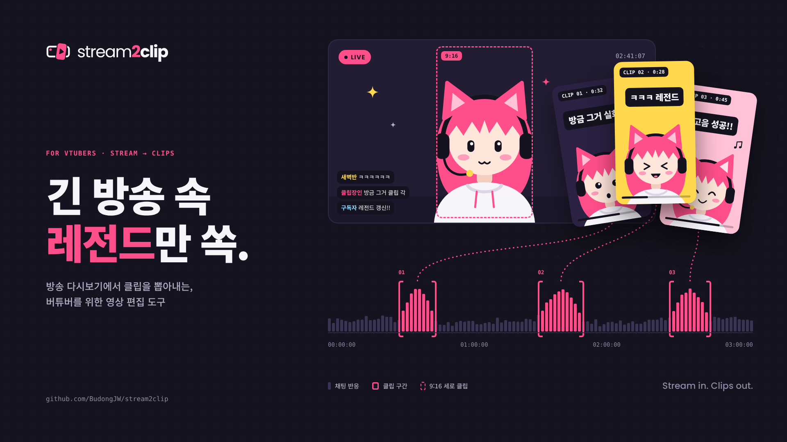

</div>

<br>

## 빠른 시작

Windows 앱 기준. 설치부터 첫 클립까지 4단계

| 순&NoBreak;서 | 작업 | 내용 |
|:---:|---|---|
| 1 | 설치 | [홈페이지](https://budongjw.github.io/stream2clip/)에서 설치 프로그램 다운로드 후 실행. ffmpeg는 설치 과정에서 내려받기 |
| 2 | 실행 | 시작 메뉴의 stream2clip 실행 후 클립 영역의 **하이라이트 찾기** 선택 |
| 3 | 검출 | 영상 칸에 방송 주소 또는 다시보기 파일 입력 후 **하이라이트 찾기**. 방송 주소는 채팅 다시보기로 구간을 찾고 그 구간의 영상만 다운로드 |
| 4 | 내보내기 | 검출된 구간 확인 후 **클립 내보내기**. 저장 칸의 폴더에 세로형 클립 생성 |

- 캡쳐와 움짤 녹화: 앱 실행 상태에서 <kbd>F8</kbd> 영역 캡쳐, <kbd>F9</kbd> 영역 녹화
- 방송 중 기록: 시작 화면의 **방송 기록기**. 상세는 [방송 기록기](#방송-기록기)

명령줄 기준(macOS, Linux 포함). Python 3.10 이상과 ffmpeg 필요

```bash
git clone https://github.com/BudongJW/stream2clip.git
```

```bash
cd stream2clip
```

```bash
pip install -e ".[gui]"
```

```bash
stream2clip auto "방송 주소" --top 5 -o clips
```

- 설치 방법별 상세: [설치](#설치)
- 앱과 명령줄 전체 사용법: [사용법](#사용법), [방송 클립 자동화](#방송-클립-자동화)

<br>

## 개요

| &numsp;&numsp;&numsp;&numsp;항&NoBreak;목&numsp;&numsp;&numsp;&numsp; | 내용 |
|:---:|---|
| 용도 | 방송 화면 및 다시보기(VOD)의 장면 캡쳐, 편집, 움짤 녹화, 하이라이트 클립 자동 제작 |
| 구성 | 데스크톱 앱(PySide6), 명령줄 도구, 파이썬 라이브러리 |
| 지원 환경 | Windows, macOS, Linux. ffmpeg 필요(Windows는 설치 과정 또는 앱에서 내려받기). 파이썬 패키지는 Python 3.10 이상 |
| 배포 형태 | Windows 설치 프로그램 및 zip([홈페이지](https://budongjw.github.io/stream2clip/)), 파이썬 패키지(소스 설치) |
| 화면 언어 | 한국어, 日本語, English |
| 사용 설명서 | [웹 페이지](https://budongjw.github.io/stream2clip/guide.html), [PDF](https://budongjw.github.io/stream2clip/stream2clip-guide.pdf) |
| 라이선스 | [Apache-2.0](LICENSE) |

- 코어는 numpy, Pillow만 사용하며 GUI와 분리. 다른 오픈소스 영상 프로젝트에 이식 가능
- 번역 서비스 미내장. OCR, 번역기는 플러그인으로 연결
- 기획사 가이드라인 프로필은 점검 목록이며 법적 판단이 아님

### 버전별 주요 변경

| &numsp;&numsp;버&NoBreak;전&numsp;&numsp; | 주요 변경 |
|:---:|---|
| v0.14 | 방송 기록기: 방송 중 채팅, 표시, OBS 장면, VTube Studio 아바타 기록, 세션 파일로 하이라이트 검출과 아바타 영역 지정 |
| v0.13 | 앱의 구성요소 점검 창 |
| v0.12 | 무음 구간 제거(`--trim-silence`), 앱의 새 버전 알림 |
| v0.11 | 편집 프로그램용 내보내기(EDL 컷 목록, 타임라인 마커, 타임스탬프), 모음 영상(`compile`), 출처 표기(`--credit`), 파일 끌어다 놓기 |
| v0.10 | ffmpeg 한 번에 설치(설치 프로그램의 내려받기 작업, 앱 시작 화면의 버튼), 구성요소 점검 명령 `setup` |
| v0.9 | 하이라이트 창의 아바타 영상 입력, 업로드 예약 게시, 자막 속 반응 표현 신호(실험) |
| v0.8 | CHZZK, SOOP 라이브 채팅 직접 수신, 하이라이트 근거와 점검 문구의 일본어 및 영어 지원 |
| v0.7 | 자막 개선(언어별 폰트 자동 선택, 문절 단위 줄바꿈, 스타일 프리셋과 위치), VRM 아바타 권리 검사 |
| v0.6 | 문장 경계 맞춤, 스트리머 표시 구간(`!clip` 등), pip 레이아웃과 별도 아바타 영상 합성, Twitch 라이브 채팅 |
| v0.5 | 라이브 모드(방송 중 채팅 급증 시 OBS 리플레이 자동 저장), 하이라이트 창의 방송 주소 입력, 언어 선택이 있는 Windows 설치 프로그램, 홈페이지 및 사용 설명서(한국어, 영어, 일본어) |
| v0.4 | 방송 주소만으로 클립 제작(하이라이트 구간만 다운로드), 화면 언어 3종, 앱의 번역, 업로드, OBS 리플레이(F10), 파일 하나로 번역기 연결, 여러 방송 평가(`evaluate`) |
| v0.3 | 하이라이트 창, 아바타 위치 자동 검출, CHZZK 및 SOOP 채팅 수집, 자막 번역 및 이름 용어집, 노래 구간 검출, OBS 리플레이 버퍼 클립 변환, YouTube 업로드, Windows 실행 파일 |
| v0.2 | 방송 클립 자동화: 하이라이트 검출, 9:16 레이아웃, 카라오케 자막, 원본 표기 설명란 |
| v0.1 | 영역 캡쳐, 편집기, 움짤 녹화, 투명 배경 녹화, VOD 구간 변환 |

세부 변경 내역: [CHANGELOG.md](CHANGELOG.md)

<br>

## 주요 기능

### 캡쳐 및 편집

| &numsp;&numsp;&numsp;&numsp;기&NoBreak;능&numsp;&numsp;&numsp;&numsp; | 내용 |
|:---:|---|
| 영역 캡쳐 <kbd>F8</kbd> | 화면을 정지한 상태에서 드래그한 영역 캡쳐. 실제 픽셀 크기 표시, <kbd>Enter</kbd> 전체 화면, <kbd>Esc</kbd> 취소. 모든 모니터 캡쳐, 이미지 파일 열기 지원 |
| 편집기 | 도구 9종: 선택, 펜, 형광펜, 네모, 화살표, 글자, 모자이크, 투명, 자르기. 8색 팔레트, 임의 색, 스포이드, 굵기, 되돌리기 및 다시 실행, 클립보드 복사. PNG, JPG, WebP, BMP 저장 |
| 이미지 번역 | 이미지 속 글자를 OCR로 인식 후 번역문으로 대체. OCR과 번역기는 [플러그인](docs/PORTING.md#5-플러그인-캡처-백엔드-ocr-번역기)으로 연결 |

### 녹화 및 변환

| &numsp;&numsp;&numsp;&numsp;&numsp;기&NoBreak;능&numsp;&numsp;&numsp;&numsp;&numsp; | 내용 |
|:---:|---|
| 움짤 녹화 <kbd>F9</kbd> | 영역 지정 후 즉시 녹화, 다시 누르면 정지 및 저장. 앱은 GIF, MP4, WebP, WebM, 명령줄은 MOV, APNG 추가 지원 |
| 투명 배경 녹화 | 지정한 색(그린스크린 등)을 제거하여 GIF, WebP, WebM, MOV, APNG를 투명 배경으로 저장. 화면 스포이드로 색 지정, 허용 범위 조절. 움직임에 따른 잔상 없음(테스트로 검증) |
| VOD 클립 변환 | 다시보기 파일에서 구간, 크롭, 크기, fps를 지정하여 GIF, WebP, MP4 클립으로 변환. `--print-command`로 ffmpeg 명령만 출력 가능 |

### 방송 클립 제작

| &numsp;&numsp;&numsp;&numsp;&numsp;&numsp;&numsp;기&NoBreak;능&numsp;&numsp;&numsp;&numsp;&numsp;&numsp;&numsp; | 내용 |
|:---:|---|
| 하이라이트 자동 검출 | 채팅 급증, 고유 채터, 반응 어휘(草, ｗｗ, ㅋㅋ, KEKW, 888), 슈퍼챗, 음량, 많이 다시 본 구간을 방송별 기준선과 비교하여 점수화. 채팅 지연 보정, 인접 구간 병합, 검출 근거 제공. 스트리머가 채팅에 남긴 표시 명령(`!clip` 등)의 시점은 항상 포함 |
| 9:16 세로 클립 | 레이아웃 5종: center, fit, blur(블러 배경), stack(아바타 위, 게임 아래), pip(게임 화면 구석에 아바타). `--avatar auto`로 아바타 위치 자동 검출, 별도 아바타 영상(그린스크린, 알파) 합성 |
| 카라오케 자막 | 단어 단위로 강조되는 자막. SRT, YouTube 자동 자막 VTT, Whisper 지원. 번역기 연결 시 번역 자막 및 원문 병기. 말이 끊기지 않도록 클립의 시작과 끝을 자막 줄의 경계로 이동. 언어별 폰트 자동 선택, 문절 단위 줄바꿈, 스타일 4종과 위치 선택 |
| 가이드라인 점검 | hololive, にじさんじ, ぶいすぽっ!, あおぎり高校 프로필 제공. 원본 URL과 제목을 최상단에 둔 설명란 생성, 멤버십, 아카이브 공개, 채널 등록, AI 표기 사전 점검. VRM 아바타 파일의 사용 조건(영리 사용, 크레딧 표기) 검사 |
| 라이브 모드 | 방송 중 채팅 급증 시 OBS 리플레이 버퍼를 저장하여 해당 장면을 클립으로 자동 저장. YouTube, Twitch, CHZZK, SOOP 채팅 직접 수신 |
| 방송 기록기 | 방송 중 채팅, 스트리머 표시(버튼, F11, VTube Studio 단축키), OBS 장면과 송출 시작, VTube Studio 아바타 외곽선과 파라미터를 세션 파일로 기록. 방송 후 채팅 다시보기 없이 하이라이트 검출, 대기 화면 장면 제외, 아바타 영역 자동 지정 |
| YouTube 업로드 | 제작한 클립과 설명란을 YouTube에 업로드. 공개 범위 기본값은 비공개 |
| 모음 영상, 출처 표기 | 클립을 이어 붙인 모음 영상과 챕터 목록 제작, 클립 구석에 원본 채널 표기 |
| 편집 프로그램 연계 | 하이라이트를 EDL 컷 목록, 타임라인 마커, 타임스탬프 목록으로 내보내어 DaVinci Resolve, Premiere Pro 등에서 이어서 편집 |

### 이식

| &numsp;&numsp;&numsp;&numsp;&numsp;기&NoBreak;능&numsp;&numsp;&numsp;&numsp;&numsp; | 내용 |
|:---:|---|
| 이식 가능한 코어 | ffmpeg 명령 빌더, ffmpeg `colorkey`와 동일 수식의 numpy 크로마키, JSON 주석 포맷(스키마 제공), 플러그인(캡처 백엔드, OCR, 번역기) |

<br>

## 방송 클립 자동화

### 처리 절차

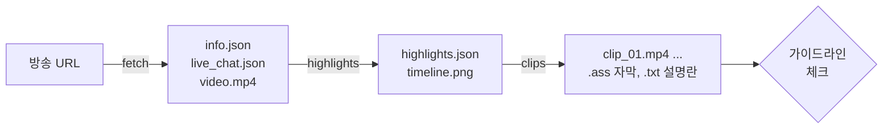

| &numsp;단&NoBreak;계&numsp; | 명령 | 입력 | 출력 |
|:---:|:---:|---|---|
| 수집 | `fetch` | 방송 주소 | 방송 정보, 채팅 다시보기, 자막, 영상 |
| 검출 | `highlights` | 채팅, 방송 정보, 영상(음량) | `highlights.json`, `timeline.png` |
| 제작 | `clips` | 영상, 하이라이트 목록, 자막 | 클립 영상, 자막 파일, 설명란 |
| 점검 | `check` | 방송 정보, 설명란 | 가이드라인 점검 결과 |
| 일괄 | `auto` | 영상 파일 또는 방송 주소 | 검출부터 제작까지의 결과 전체 |

<p align="center"></p>
<p align="center"><sub>3시간 방송(합성 채팅 데이터)에서 검출한 5개 구간. 분홍 막대는 클립으로 선정된 구간, 노란 번호는 순위</sub></p>

<p align="center"></p>
<p align="center"><sub>키 비주얼을 입력 영상으로 사용한 9:16 레이아웃 및 카라오케 자막. 노란색은 이미 발화된 단어</sub></p>

### 실행 방법

**일괄 실행**: 영상 파일과 채팅 파일로 하이라이트 검출부터 클립 제작까지 수행

```bash
stream2clip auto video.mp4 --chat video.live_chat.json --info info.json --audio --agency hololive -o clips
```

**방송 주소 입력**: 영상 파일 대신 방송 주소 지정

```bash
stream2clip auto "https://chzzk.naver.com/video/VIDEO_NO" --top 5 -o clips
```

- 채팅 다시보기 수신 후 하이라이트 구간의 영상만 다운로드. 방송 전체 다운로드 불필요
- 대상: YouTube, CHZZK, SOOP 등 yt-dlp가 구간 다운로드를 지원하는 플랫폼
- 수신한 구간은 `clips/sections`에 보관, 재실행 시 재사용
- 음량, 웃음소리, 노래 구간 옵션(`--audio`, `--laughter`, `--skip-singing`)은 방송 전체의 소리가 필요하여 사용 불가. 필요한 경우 `fetch --video`로 영상 수신 후 파일 지정
- `clips <주소> --highlights highlights.json`도 동일 방식으로 구간만 수신

**단계별 실행**: 수집, 검출, 제작, 점검 순서

```bash
stream2clip fetch "https://www.youtube.com/watch?v=VIDEO_ID" -o vod --video --subs ja
```

```bash
stream2clip highlights --chat vod/VIDEO_ID.live_chat.json --info vod/info.json --video vod/video.mp4 --audio -o highlights.json --plot timeline.png
```

```bash
stream2clip clips vod/video.mp4 --highlights highlights.json --layout stack --avatar 1280,0,640,720 --subtitles vod/VIDEO_ID.ja.vtt --info vod/info.json --agency hololive -o clips
```

```bash
stream2clip check --agency nijisanji --info vod/info.json --description clips/clip_01.txt
```

> [!TIP]
> YouTube가 "Sign in to confirm you're not a bot"으로 차단하는 경우 `fetch`에 `--cookies-from-browser chrome`(또는 `firefox`, `edge`)이나 `--cookies cookies.txt` 추가

### 앱의 하이라이트 창

런처의 **하이라이트 찾기**로 실행. 명령줄과 동일한 절차를 한 창에서 수행

| &numsp;&numsp;&numsp;항&NoBreak;목&numsp;&numsp;&numsp; | 내용 |
|:---:|---|
| 입력 | 영상 및 채팅 파일 선택 또는 영상 칸에 방송 주소 입력 |
| 구간 조정 | 타임라인에서 구간 가운데를 끌어 이동, 가장자리를 끌어 시작과 끝 조정. 휠 또는 구간 더블클릭으로 타임라인 확대 |
| 내보내기 | 레이아웃이 적용된 미리보기 확인 후 체크한 구간만 내보내기 |
| 부가 선택 | 문장 경계 맞춤, 웃음소리 신호, 노래 구간 표시 및 제외, 자막 번역(번역기, 용어집, 원문 병기) |
| 업로드 | 내보낸 클립을 **업로드** 버튼으로 YouTube 업로드 창에 전달 |
| 설정 | 선택한 설정은 다음 실행 시 복원 |

방송 주소로 시작하는 경우:

- 채팅 다시보기와 방송 정보만 먼저 수신하고, 영상은 내보낼 때 체크한 구간만 다운로드
- 수신 자료는 저장 폴더의 `sources/<플랫폼>_<영상 ID>/`에 방송별로 보관, 재검출 및 재내보내기 시 재사용
- 미리보기는 해당 구간 수신 후(내보내기 후)부터 표시. **자동 찾기**는 선택한 구간 1개를 먼저 수신하여 검출
- 음량, 웃음소리, 노래 구간은 영상 파일이 필요하여 사용 불가
- 로그인 쿠키가 필요한 방송은 명령줄(`--cookies`, `--cookies-from-browser`) 사용

<p align="center">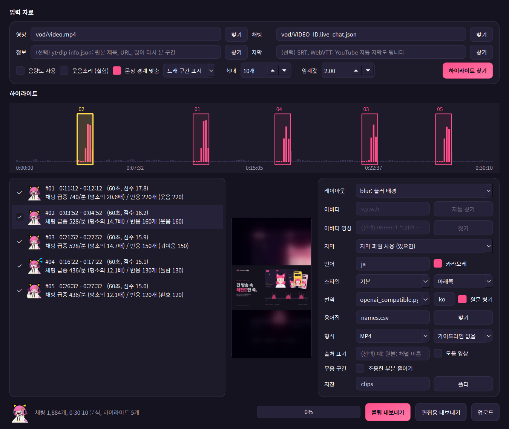</p>
<p align="center"><sub>하이라이트 창. 키 비주얼로 만든 30분 영상과 합성 채팅 데이터로 실행한 화면이며 노란 테두리는 선택한 구간</sub></p>

### 레이아웃

| &numsp;&numsp;이&NoBreak;름&numsp;&numsp; | 구성 | 아바타 지정 |
|:---:|---|:---:|
| `blur` | 방송 화면을 중앙에 두고 상하 여백을 흐린 배경으로 채움. 기본값 | 불필요 |
| `center` | 화면 중앙부를 세로 화면에 맞춰 확대. 좌우 영역 잘림 | 불필요 |
| `fit` | 화면 전체가 보이도록 축소하고 여백을 브랜드 배경색으로 채움 | 불필요 |
| `stack` | 상단 아바타, 하단 게임 화면 | 필요 |
| `pip` | 게임 화면을 전체에 채우고 구석에 아바타 삽입 | 필요 |
| `none` | 원본 화면 유지 | 불필요 |

```bash
stream2clip clips vod/video.mp4 --highlights highlights.json --layout pip --avatar auto --corner top-left -o clips
```

아바타 지정 방법:

| &numsp;&numsp;&numsp;&numsp;&numsp;방&NoBreak;법&numsp;&numsp;&numsp;&numsp;&numsp; | 옵션 | 내용 |
|:---:|---|---|
| 방송 화면의 영역 | `--avatar x,y,w,h`, `--avatar auto` | 방송 화면에서 아바타가 있는 사각 영역을 잘라 사용. `auto`는 얼굴 검출로 영역 결정 |
| 별도 아바타 영상 | `--avatar-video FILE`, 하이라이트 창의 **아바타 영상** | 아바타만 녹화한 그린스크린 또는 투명 배경 영상을 방송 영상 위에 합성. 사각 테두리 없이 아바타 형태 그대로 표시 |

```bash
stream2clip clips vod/video.mp4 --highlights highlights.json --layout pip --avatar-video vod/avatar.mp4 -o clips
```

| &numsp;&numsp;&numsp;&numsp;&numsp;옵&NoBreak;션&numsp;&numsp;&numsp;&numsp;&numsp; | 동작 |
|:---:|---|
| `--corner` | `pip`의 아바타 위치. `top-left`, `top-right`(기본값), `bottom-left`, `bottom-right` |
| `--inset` | `pip`의 아바타 폭. 화면 폭 대비 비율, 기본값 0.42 |
| `--avatar-key` | 아바타 영상에서 제거할 색. 기본값 `auto`: 영상에 투명 정보가 있으면(ProRes 4444 MOV, 알파 WebM 등) 그대로 사용하고, 없으면 `#00FF00` 제거. `none`은 영상 자체의 투명 정보만 사용 |
| `--avatar-offset` | 아바타 영상의 녹화가 방송보다 먼저 시작된 시간(초). 늦게 시작된 경우 음수 |
| `--game` | 게임 화면 영역 `x,y,w,h`. 미지정 시 화면 전체 |

- 아바타 영상은 방송 영상과 동일한 시간축으로 녹화된 것을 전제. 시작 시각이 다르면 `--avatar-offset`으로 보정
- `stack`에 아바타 영상을 지정하면 상단 영역의 브랜드 배경색 위에 아바타 표시
- 소리는 방송 영상의 것을 사용

### 문장 경계 맞춤

클립의 시작 또는 끝이 말하는 도중에 걸리면 해당 자막 줄의 경계로 이동. `--subtitles` 지정 시 기본 적용

| &numsp;&numsp;&numsp;항&NoBreak;목&numsp;&numsp;&numsp; | 내용 |
|:---:|---|
| 시작 | 줄의 시작으로 앞당김. 3초를 넘게 이동해야 하면 줄의 끝으로 늦춤 |
| 끝 | 줄의 끝까지 연장. 3초를 넘게 이동해야 하면 줄의 시작으로 당김 |
| 이동 한도 | `--snap SECONDS`, 기본값 3. 양쪽 모두 한도를 넘으면 원래 위치 유지. `--snap 0`은 사용 안 함 |
| 적용 시점 | 영상 다운로드와 절단 이전. `highlights.json`, `clips.json`에는 이동 후의 시각 기록 |
| 앱 | 하이라이트 창의 **문장 경계 맞춤**. 자막 파일이 지정된 경우 검출 직후 적용되며 이후 직접 조정 가능 |

- `--transcribe`로 클립별 받아쓰기만 사용하는 경우 방송 전체의 자막이 없어 적용되지 않음
- 측정: 실제 방송 1개(85분, YouTube 자동 자막)의 하이라이트 10개에서 줄 중간에 걸린 가장자리가 12곳에서 1곳으로 감소

### 스트리머 표시 구간

스트리머 또는 모더레이터가 채팅에 입력한 표시 명령의 시점은 점수와 무관하게 클립으로 포함

| &numsp;&numsp;&numsp;&numsp;항&NoBreak;목&numsp;&numsp;&numsp;&numsp; | 내용 |
|:---:|---|
| 기본 명령 | `!clip`, `!클립`, `!切り抜き`, `!ts`, `!mark`. 메시지가 명령과 같거나 명령으로 시작하는 경우 |
| 인정 대상 | 스트리머(채널 주인), 모더레이터. `--marker-anyone` 지정 시 모든 시청자 |
| 구간 | 일반 채팅과 동일하게 입력 8초 전을 장면 시점으로 간주하고 앞 20초, 뒤 10초 포함 |
| 순위 | 표시 구간을 방송 순서대로 앞 순위에 배치. `--top` 개수와 별도로 유지 |
| 옵션 | `--marker WORD`로 명령 지정(반복 가능), `--no-markers`로 사용 안 함 |
| 역할 판독 | YouTube, Twitch, CHZZK 채팅과 chat-downloader JSON에서 판독. CSV, JSONL은 `role` 열(`owner`, `moderator`) 사용. SOOP 다시보기는 미지원 |
| 라이브 모드 | 표시 명령 입력 시 준비 시간과 임계값에 관계없이 즉시 저장 |

- 표시 명령은 입력자와 관계없이 채팅 급증 계산에서 제외

### 자막 모양

| &numsp;&numsp;&numsp;항&NoBreak;목&numsp;&numsp;&numsp; | 내용 |
|:---:|---|
| 폰트 | 자막의 언어에 맞는 설치된 폰트를 자동 선택. 일본어는 Noto Sans JP, Yu Gothic, Meiryo 순, 한국어는 Noto Sans KR, Malgun Gothic 순. `--font FAMILY`로 직접 지정 |
| 원문 병기 | 원문 줄과 번역 줄에 각 언어의 폰트 적용. 일본어 한자가 한국어 자형으로 표시되지 않음 |
| 줄바꿈 | 전각 18자 기준으로 최대 3줄. 일본어는 문절 경계(조사 뒤, 문장 부호 뒤)에서, 한국어와 영어는 띄어쓰기에서 나눔. 영문자는 전각의 약 절반 폭으로 계산 |
| 긴 자막 | 3줄로도 화면 폭을 넘는 경우 해당 자막만 축소 표시(최소 55%) |

| &numsp;&numsp;&numsp;&numsp;&numsp;&numsp;옵&NoBreak;션&numsp;&numsp;&numsp;&numsp;&numsp;&numsp; | 값 | 동작 |
|:---:|---|---|
| `--subtitle-style` | `default` | 흰 글자, 노란 강조, 어두운 외곽선 |
| | `box` | 반투명 어두운 상자 위에 표시. 복잡한 게임 화면용 |
| | `pink` | 강조 색을 라이브 핑크로 변경 |
| | `small` | 작은 크기, 얇은 외곽선, 보통 굵기 |
| `--subtitle-position` | `bottom`, `middle`, `top` | 자막 위치. 기본값 `bottom`. 게임 자체의 대사 창이 아래에 있는 경우 `top` 사용 |
| `--font-size` | 픽셀 | 폭 1080px 화면 기준 글자 크기. 기본값 64 |

```bash
stream2clip clips vod/video.mp4 --highlights highlights.json --subtitles vod/VIDEO_ID.ja.vtt --subtitle-style box --subtitle-position top -o clips
```

- 앱: 하이라이트 창의 **스타일** 줄에서 모양과 위치 선택
- 라이브러리: `subtitle_style("box", position="top")` 또는 `SubtitleStyle(...)`을 `make_clips(subtitle_style=...)`에 전달

### 자막 번역

- 클립 자막을 번역하여 영상에 삽입. 번역 서비스 미내장, 번역기는 사용자가 연결
- 연결 방법: `translate(texts, target, source)` 함수가 있는 파이썬 파일을 `--translator`로 지정. 플러그인 패키지 제작 불필요
- 예제: [`examples/translators/openai_compatible.py`](examples/translators/openai_compatible.py). OpenAI 호환 주소를 사용하며 기본값은 로컬 Ollama
- 설치형 플러그인 제작 방법: [docs/PORTING.md](docs/PORTING.md#5-플러그인-캡처-백엔드-ocr-번역기)
- 번역 품질은 선택한 모델에 좌우. 소형 로컬 모델은 다른 언어가 혼입될 수 있으므로 결과 확인 필요

```bash
stream2clip clips vod/video.mp4 --highlights highlights.json --subtitles vod/VIDEO_ID.ja.vtt --translate ko --translator examples/translators/openai_compatible.py -o clips
```

| &numsp;&numsp;&numsp;&numsp;&numsp;환&NoBreak;경&nbsp;변&NoBreak;수&numsp;&numsp;&numsp;&numsp;&numsp; | 기본값 | 용도 |
|:---:|---|---|
| `S2C_TRANSLATE_URL` | `http://127.0.0.1:11434/v1/chat/completions` | 예제 번역기의 요청 주소 |
| `S2C_TRANSLATE_MODEL` | `qwen2.5:7b` | 예제 번역기의 모델 |
| `S2C_TRANSLATE_KEY` | 없음 | API 키. 필요한 서비스에 한함 |
| `STREAM2CLIP_TRANSLATOR` | 없음 | 기본 번역기 파일 경로. 지정 시 `--translator` 생략 가능 |

용어집 및 원문 병기:

```bash
stream2clip clips vod/video.mp4 --highlights highlights.json --subtitles vod/VIDEO_ID.ja.vtt --translate ko --glossary names.csv --bilingual -o clips
```

| &numsp;&numsp;&numsp;옵&NoBreak;션&numsp;&numsp;&numsp; | 동작 |
|:---:|---|
| `--glossary` | `source,target` CSV 또는 JSON. 버튜버 이름 등 오역이 잦은 용어 고정. 번역 전과 번역 후에 각 1회 적용 |
| `--bilingual` | 원문 위에 번역 1줄 추가 |

- 번역 자막은 단어 시각이 맞지 않아 카라오케 효과 없이 표시
- Holodex API 키 보유 시 이름 목록 초안 생성 가능. 일본어, 영어 이름만 제공되므로 한글 표기는 직접 입력

```bash
stream2clip glossary names.csv --holodex Hololive --api-key YOUR_KEY
```

### 출처 표기

클립 구석에 원본 채널을 작게 표시. 클립 전체 길이 동안 유지되며 자막과 함께 영상에 입혀짐

```bash
stream2clip clips vod/video.mp4 --highlights highlights.json --info vod/info.json --credit auto -o clips
```

| &numsp;&numsp;&numsp;&numsp;&numsp;옵&NoBreak;션&numsp;&numsp;&numsp;&numsp;&numsp; | 동작 |
|:---:|---|
| `--credit auto` | `원본: 채널 이름` 표시. 채널 이름은 `--info` 또는 `--channel`에서 가져오며 문구는 화면 언어를 따름 |
| `--credit "문구"` | 지정한 문구 표시 |
| `--credit-position` | `top-left`(기본값), `top-right`, `bottom-left`, `bottom-right`. 세로 클립의 아래쪽은 Shorts 버튼 영역을 피해 배치 |

- 앱: 하이라이트 창의 **출처 표기** 칸에 문구 입력
- 화면의 표기는 설명란의 출처 표기를 대신하지 않음. 설명란(`clip_01.txt`)은 종전과 같이 생성

### 모음 영상

제작한 클립을 방송 순서대로 이어 붙인 영상과 챕터 목록 제작

```bash
stream2clip auto video.mp4 --chat video.live_chat.json --info info.json --layout none --compile --fade 0.3 -o clips
```

```bash
stream2clip compile clips --order rank --ranks 1,2,5 -o best.mp4
```

| &numsp;&numsp;&numsp;&numsp;&numsp;항&NoBreak;목&numsp;&numsp;&numsp;&numsp;&numsp; | 내용 |
|:---:|---|
| 입력 | `clips.json`이 있는 폴더 또는 클립 파일 목록. 폴더는 방송 순서(`--order time`) 또는 순위 순서(`--order rank`), 파일 목록은 지정한 순서 |
| 화면 | 첫 클립의 크기와 프레임 속도 사용. 모양이 다른 클립은 여백을 두어 맞춤. `--size`, `--fps`로 지정 가능 |
| 전환 | 기본값은 바로 이어 붙임. `--fade 초`로 클립 사이 암전 |
| 소리 | 소리가 없는 클립은 무음으로 채움 |
| 출력 형식 | MP4, WebM, MOV |
| `compilation.txt` | 원본 방송의 제목과 주소, 구간별 챕터(`0:00 근거`), 구간별 원본 위치 링크. YouTube 설명란에 붙이면 챕터로 표시(첫 줄 0:00, 3개 이상, 각 10초 이상인 경우) |

- 앱: 하이라이트 창의 **모음 영상** 선택 후 **클립 내보내기**
- 가로 모음 영상은 `--layout none`으로 제작한 클립 사용
- 챕터 문구는 검출 근거의 첫 항목. 게시 전 직접 수정 필요

### 무음 구간 제거

클립 안에서 조용한 부분을 짧은 쉼으로 줄여 길이 단축. 자막과 출처 표기는 줄어든 길이에 맞춰 이동

```bash
stream2clip clips vod/video.mp4 --highlights highlights.json --subtitles vod/VIDEO_ID.ja.vtt --trim-silence -o clips
```

| &numsp;&numsp;&numsp;&numsp;&numsp;&numsp;옵&NoBreak;션&numsp;&numsp;&numsp;&numsp;&numsp;&numsp; | 동작 |
|:---:|---|
| `--trim-silence` | 0.7초 이상 조용한 부분을 앞뒤 0.25초씩만 남기고 제거 |
| `--trim-silence 초` | 지정한 길이 이상 조용한 부분만 제거 |
| `--silence-level dB` | 조용함의 기준. 클립의 큰 소리보다 이 값 이상 작은 부분이 대상(기본값 24). 값이 작을수록 더 많이 제거 |
| `--audio-track N` | 판정에 쓸 오디오 트랙(0부터). OBS 녹화에서 마이크만 별도 트랙에 둔 경우 게임 소리, 배경 음악과 무관하게 판정. 자막 인식, 음량, 웃음소리, 노래 구간 검출에도 적용. 클립의 소리는 첫 번째 트랙 유지 |

| &numsp;&numsp;&numsp;&numsp;항&NoBreak;목&numsp;&numsp;&numsp;&numsp; | 내용 |
|:---:|---|
| 판정 방식 | 음량 기준. 말소리를 인식하는 방식이 아니므로 말 없이 게임 소리만 작게 나는 장면도 줄어듦 |
| 배경 음악 | 음악이 계속 큰 방송은 조용한 부분이 적어 줄어드는 양이 적음 |
| 화면과 소리 | 화면은 프레임 번호, 소리는 샘플 개수 기준으로 같은 부분을 제거. 10곳 이상 자른 후에도 어긋남 1프레임 이내 |
| 기록 | `clips.json`의 `removed`에 클립별로 줄어든 길이(초) 기록 |

- 앱: 하이라이트 창의 **조용한 부분 줄이기** 선택 후 **클립 내보내기**
- 실제 방송 1개의 클립 4개 기준 길이의 29% 단축. 음성 인식으로 찾은 발화 시간 중 3.6%가 제거 구간에 포함(277개 단어 중 5개). 게시 전 결과 확인 필요

### 편집 프로그램용 내보내기

찾은 하이라이트를 편집 프로그램에서 이어서 작업할 수 있도록 컷 목록과 타임스탬프 목록으로 저장

```bash
stream2clip timeline highlights.json --video vod/video.mp4 --edl cuts.edl --markers markers.edl --timestamps times.txt
```

| &numsp;&numsp;&numsp;&numsp;출&NoBreak;력&numsp;&numsp;&numsp;&numsp; | 내용 | 사용처 |
|:---:|---|---|
| `--edl` | CMX3600 컷 목록. 하이라이트를 방송 영상의 컷으로 차례대로 배치 | DaVinci Resolve, Premiere Pro, Vegas 등에서 타임라인으로 가져오기 |
| `--markers` | 타임라인 마커 목록. 방송 전체를 올린 타임라인에 하이라이트 위치와 길이 표시 | DaVinci Resolve의 타임라인 마커 가져오기 |
| `--timestamps` | `0:07:02 근거` 형식의 목록. 파일을 지정하지 않으면 화면에 출력 | 댓글, 설명란 |

- 타임코드는 프레임 단위이므로 영상 파일(`--video`) 또는 프레임 속도(`--fps`) 필요. 29.97, 59.94fps는 30, 60 기준의 논드롭 타임코드로 기록
- `--order rank`로 순위 순서, `--ranks 1,2,5`로 일부만 내보내기
- `auto`는 `highlights.edl`(영상 파일 입력 시)과 `timestamps.txt`를 함께 저장
- 앱: 하이라이트 창의 **편집용 내보내기**. 체크한 구간을 저장 폴더에 저장하고 타임스탬프 목록을 클립보드에 복사

### 노래 구간 검출

노래 방송(歌枠)의 노래 구간을 오디오만으로 검출. 음악 저작권 또는 가이드라인에 따라 노래 구간을 제외해야 하는 경우 사용

```bash
stream2clip singing vod/video.mp4 -o singing.json
```

```bash
stream2clip auto vod/video.mp4 --chat vod/VIDEO_ID.live_chat.json --audio --skip-singing -o clips
```

| &numsp;&numsp;&numsp;&numsp;옵&NoBreak;션&numsp;&numsp;&numsp;&numsp; | 동작 |
|:---:|---|
| `--mark-singing` | 각 하이라이트와 노래 구간의 겹침 정도를 근거에 기재 |
| `--skip-singing` | 노래 구간과 절반 이상 겹치는 하이라이트 제외 |
| `--laughter` | 웃음소리 유형의 소리(크고 초당 4~8회 끊어지는 소리)를 점수에 가산. 실험 기능 |

### OBS 리플레이 버퍼

방송 중 직전 장면을 클립으로 저장

```bash
stream2clip replay -o moment.gif --last 15 --width 480
```

| &numsp;&numsp;&numsp;&numsp;항&NoBreak;목&numsp;&numsp;&numsp;&numsp; | 내용 |
|:---:|---|
| 사전 설정 | OBS 설정의 출력 메뉴에서 리플레이 버퍼 사용, 도구 메뉴에서 WebSocket 서버 사용. 신규 설치한 OBS는 리플레이 버퍼가 꺼진 상태 |
| 앱 | 런처의 **리플레이 저장** 버튼. 형식과 크기는 녹화 설정 적용, 비밀번호 미저장 |
| <kbd>F10</kbd> | 런처의 리플레이 줄에서 사용 설정 시 다른 프로그램 사용 중에도 F10으로 저장. 사용 중에는 다른 프로그램이 F10을 받지 못하므로 기본값은 사용 안 함 |
| `--start-buffer` | 버퍼의 실제 시작 여부 확인. 장면에 소스가 없어 OBS가 확인 창을 표시 중인 경우 해당 사실 안내 |

### 라이브 모드

방송 중 채팅을 감시하여 급증 시 OBS 리플레이 버퍼를 저장하고 해당 장면을 클립으로 저장. 키 입력 불필요

```bash
stream2clip live "https://www.youtube.com/watch?v=VIDEO_ID" -o clips
```

```bash
stream2clip live "https://www.twitch.tv/CHANNEL" -o clips
```

```bash
stream2clip live "https://chzzk.naver.com/live/CHANNEL_ID" -o clips
```

```bash
stream2clip live "https://play.sooplive.co.kr/STREAMER_ID" -o clips
```

| &numsp;&numsp;&numsp;항&NoBreak;목&numsp;&numsp;&numsp; | 내용 |
|:---:|---|
| 앱 | 런처의 **라이브 모드** 줄에 YouTube, Twitch, CHZZK, SOOP의 라이브 주소 입력, 민감도 선택(낮음 4.5, 보통 3.5, 높음 2.5) 후 **라이브 모드 시작**. 클립은 저장 폴더에 녹화 설정의 형식으로 저장 |
| 사전 설정 | OBS 리플레이 버퍼 사용, 최대 리플레이 시간 60초 이상. 기본값 20초에서는 장면 앞부분이 버퍼에 남지 않으며 저장 시 안내. 버퍼 미동작 시 대기 전에 안내하고 `--start-buffer`로 시작 가능 |
| 채팅 입력 | YouTube 라이브는 주소만으로 yt-dlp가 수신. 약 10초 단위 묶음으로 수신되어 그만큼 지연. Twitch, CHZZK, SOOP은 채널 주소만으로 채팅 서버에 로그인 없이(읽기 전용) 접속하여 지연 없이 수신. 그 외 플랫폼은 수집기가 한 줄에 JSON 하나씩(`{"text": ..., "author": ..., "time": ...}`) 추가하는 파일 지정 |
| 주소 형식 | Twitch `twitch.tv/채널`, CHZZK `chzzk.naver.com/live/채널 ID`, SOOP `play.sooplive.co.kr/스트리머 ID`. 성인 인증, 비밀번호 방송은 미지원 |
| 표시 명령 | 스트리머 또는 모더레이터가 채팅에 `!clip` 등을 입력하면 준비 시간과 임계값에 관계없이 즉시 저장. `--no-markers`로 사용 안 함 |
| 발동 조건 | 5초 단위로 채팅 수, 참여자 수, 반응 어휘, 후원을 직전 15분과 비교(다시보기 검출과 동일 점수). 시작 후 2분은 관찰만 수행, 클립 간 최소 간격 90초. `--threshold`(기본 3.5) 상향 시 저장 횟수 감소 |
| 절단 위치 | 급증 8초 전을 장면 시점으로 간주하고 앞 20초, 뒤 10초를 포함한 약 35초 클립 생성. 방송 송출자는 송출 지연만큼 `--delay` 상향. 채팅 시각과 PC 시계의 일치를 전제 |
| 사전 확인 | `--simulate`에 종료된 방송의 채팅 파일 지정 시 발동 시점 표시. `--no-obs`는 저장 없이 급증만 알림 |
| 결과물 | `live_날짜_시각.mp4`(형식, 크기는 `-f`, `--height` 등으로 지정), 시각, 점수, 근거를 기록한 `live.jsonl` |

기본값 산정 근거: [docs/DETECTION.md](docs/DETECTION.md#라이브-모드-기본값)

### 방송 기록기

방송 중에만 얻을 수 있는 신호를 세션 파일에 기록하고 방송 후 클립 제작에 사용. 영상은 OBS가 녹화

```bash
stream2clip session record --chat "https://chzzk.naver.com/live/CHANNEL_ID" --vts --vts-source "VTube Studio"
```

```bash
stream2clip auto vod.mp4 -o clips --session session.jsonl --skip-scene 대기 --layout stack --avatar session
```

| &numsp;&numsp;&numsp;&numsp;&numsp;항&NoBreak;목&numsp;&numsp;&numsp;&numsp;&numsp; | 내용 |
|:---:|---|
| 앱 | 시작 화면 클립 영역의 **방송 기록기**, 단독 실행은 `stream2clip-recorder`. 채팅, OBS, VTube Studio 연결 상태와 기록 개수 표시. 종료 후 **하이라이트 찾기**로 하이라이트 창에 세션 입력 |
| 기록 신호 | 채팅과 급증, 표시(**지금 표시** 버튼, F11, Enter, VTube Studio 단축키, 채팅 `!clip`), OBS 장면, 송출과 녹화 시작, 저장된 리플레이, VTube Studio 소스의 OBS 배치, 아바타 외곽선(0.5초 간격), 파라미터(0.2초 간격) |
| 방송 후 | `--session`으로 세션의 채팅과 표시로 하이라이트 검출(채팅 다시보기 불필요), `--skip-scene`으로 대기 화면 등 장면 제외, `--avatar session`으로 외곽선 기준 아바타 영역 지정, `--avatar-motion`(실험)으로 아바타 움직임을 보조 신호로 사용. `session show`로 장면과 표시 시점 확인 |
| 하이라이트 창 | **세션** 칸에 세션 파일 입력. 세션 지정 시 **0초 기준**, **제외 장면**, **아바타 움직임 (실험)** 설정 표시, 내보내기 설정 아바타 줄의 **세션에서**로 아바타 영역 입력. **오디오 트랙**은 OBS와 같이 1부터 |
| 아바타 별도 녹화 | `session record --avatar-record`: OBS의 Source Record 필터(별도 플러그인)에 시작과 중지를 요청하고 시작 시각 기록. `--avatar-video`와 `--session`을 함께 지정하면 `--avatar-offset` 자동 계산. 구성 방법은 [docs/RECORDER.md](docs/RECORDER.md) 참조. 실제 플러그인으로는 미검증 |
| 영상의 0초 | 기본값은 OBS 송출 시작(플랫폼 다시보기), 송출이 없으면 녹화 시작. `--session-origin`, `--session-offset`으로 변경 |
| VTube Studio | 설정에서 API 시작. 첫 연결 시 VTube Studio의 플러그인 허용 창에서 허용하면 이후 자동 연결 |
| 시청자 투표 | `--viewer-votes 3`(앱의 **시청자 투표**): 서로 다른 시청자 3명이 30초 안에 `!clip` 입력 시 표시 |
| OBS 위젯 | `--widget`(앱의 **OBS 위젯**): 투표 진행과 표시를 방송 화면에 띄우는 브라우저 소스 `http://127.0.0.1:8790/widget` |
| CHZZK 공식 API | `stream2clip chzzk login`으로 1회 로그인 후 `--chat chzzk-api`로 본인 채널의 채팅과 후원을 공식 Open API로 수신. CHZZK 개발자 센터의 애플리케이션 등록 필요 |
| 개인정보 | 채팅 작성자는 해시로만 기록. 파일은 로컬에만 저장 |

세션 형식, 좌표 변환, 옵션 전체: [docs/RECORDER.md](docs/RECORDER.md)

### YouTube 업로드

```bash
stream2clip upload clips/clip_01.mp4 --title "레전드 장면" --description-file clips/clip_01.txt --shorts --client-secrets client_secret.json
```

- 사전 준비: 본인 Google Cloud 프로젝트의 OAuth 클라이언트 파일(데스크톱 앱 유형). 최초 1회 브라우저에서 동의
- 공개 범위 기본값은 비공개. YouTube API는 미지정 시 공개로 게시하므로 항상 명시하여 전송
- `--dry-run`: 전송 내용만 표시하고 업로드 미수행
- `--publish-at "2026-12-24 18:00"`: 예약 게시. 비공개로 업로드한 후 지정한 시각(시간대 미표기 시 PC의 현지 시각)에 YouTube가 공개로 전환. 공개 범위를 비공개로 둔 경우에만 사용 가능
- 앱: 하이라이트 창의 **업로드**. 내보낸 클립과 설명란 파일이 입력된 상태로 열리며 **보낼 내용 보기**로 사전 확인. 공개 범위는 열 때마다 비공개에서 시작. **예약 게시**를 선택하면 공개 범위가 비공개로 고정되고 지정한 시각에 공개

### 아바타 위치 자동 검출

`--layout stack`에 `--avatar auto` 지정 시 애니메 얼굴 검출로 아바타 박스 결정

```bash
stream2clip avatar vod/video.mp4 --preview avatar.png
```

```bash
stream2clip clips vod/video.mp4 --highlights highlights.json --layout stack --avatar auto -o clips
```

<p align="center">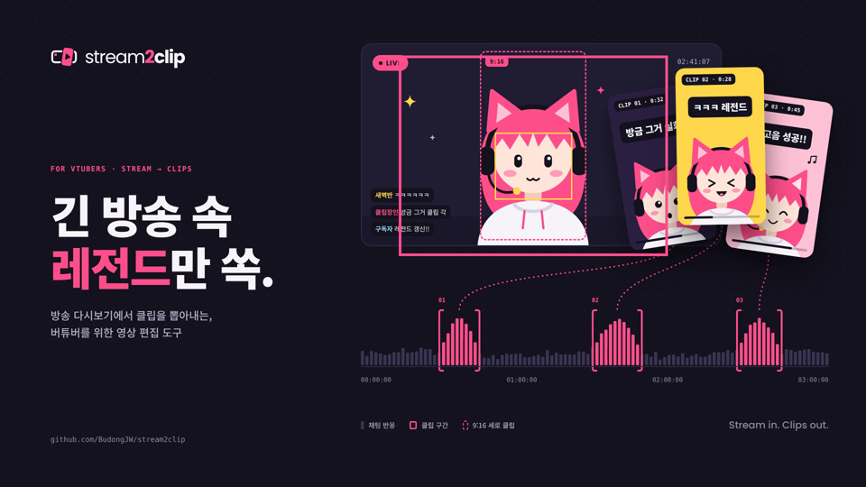 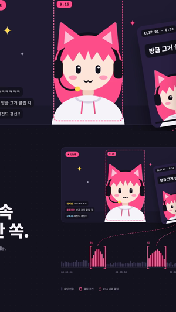</p>
<p align="center"><sub>키 비주얼을 입력 영상으로 사용하여 검출한 아바타 박스(분홍)와 얼굴(노랑), 해당 박스로 제작한 stack 클립</sub></p>

- 방송 1개에 고정 박스 1개 결정. 프레임 단위 추적 미수행
- 모델(12MB)은 최초 사용 시 다운로드하여 `~/.cache/stream2clip` 또는 `STREAM2CLIP_MODEL_DIR`에 보관. 고정된 SHA-256과 불일치 시 사용 안 함
- 오프라인 사용: `--face-model model.onnx`로 파일 지정
- 아바타가 화면에 없거나 계속 이동하는 방송은 검출 불가. 이 경우 `--avatar x,y,w,h`로 직접 지정
- 결정 방식: [docs/DETECTION.md](docs/DETECTION.md#아바타-박스-결정-방식)

### CHZZK, SOOP 다시보기

`fetch`에 다시보기 주소 지정 시 채팅을 각 플랫폼의 다시보기 API에서 직접 수신. 공개 다시보기는 로그인 불필요

```bash
stream2clip fetch "https://chzzk.naver.com/video/VIDEO_NO" -o vod --video
```

```bash
stream2clip fetch "https://vod.sooplive.co.kr/player/TITLE_NO" -o vod --video
```

```bash
stream2clip auto vod/video.mp4 --chat vod/chzzk_VIDEO_NO.chat.jsonl --info vod/info.json --audio -o clips
```

- 저장 파일: `chzzk_<번호>.chat.jsonl`, `soop_<번호>.chat.jsonl`. 한 줄에 메시지 하나(`time`, `text`, `author`, `kind`, `amount`)인 정규화 형식
- 닉네임과 사용자 ID는 저장하지 않고 해시만 보관
- 치즈 후원, 별풍선, 애드벌룬은 후원 신호로, 팬클럽 가입과 구독은 멤버십으로 집계
- 오래된 CHZZK 다시보기는 채팅이 남아 있지 않을 수 있음

### 입출력 형식

| &numsp;&numsp;&numsp;&numsp;&numsp;&numsp;&numsp;&numsp;입&NoBreak;력&numsp;&numsp;&numsp;&numsp;&numsp;&numsp;&numsp;&numsp; | 형식 |
|:---:|---|
| YouTube 채팅 다시보기 | yt-dlp `*.live_chat.json`(일반 채팅, 슈퍼챗, 스티커, 멤버십, 선물) |
| chat-downloader | xenova/chat-downloader JSON |
| Twitch | TwitchDownloader 채팅 JSON(비트 포함) |
| CHZZK, SOOP | `fetch`가 수신하여 정규화한 `*.chat.jsonl`. 직접 받은 CHZZK 다시보기 채팅 API 응답(JSON)과 SOOP 채팅 XML도 지원 |
| 기타 채팅 | `time,author,text[,amount][,role]` CSV, JSONL. `1:02:03` 형식의 시각 지원 |
| 세션 파일 | 방송 기록기의 `session-*.jsonl`. 채팅과 표시를 OBS 송출 시작 기준 시각으로 변환하여 읽음 |
| 자막 | SRT, WebVTT(YouTube 자동 자막의 단어별 시각 포함), Whisper JSON. `--transcribe`로 faster-whisper 직접 실행 |

| &numsp;&numsp;&numsp;&numsp;&numsp;&numsp;&numsp;&numsp;&numsp;&numsp;출&NoBreak;력&numsp;&numsp;&numsp;&numsp;&numsp;&numsp;&numsp;&numsp;&numsp;&numsp; | 내용 |
|:---:|---|
| `clip_01.mp4` | 9:16 클립. 형식은 `-f gif`, `-f webp`, `-f webm` 등으로 변경 |
| `clip_01.ass` | 클립 시간에 맞춘 카라오케 자막. 편집기에서 수정 가능 |
| `clip_01.txt` | 원본 제목과 타임스탬프 링크를 최상단에 둔 설명란 |
| `clips.json` | 구간, 점수, 근거, 가이드라인 점검 결과 |
| `highlights.json`, `timeline.png` | 하이라이트 목록과 타임라인 그래프(`auto`) |
| `highlights.edl`, `timestamps.txt` | 편집 프로그램용 컷 목록(영상 파일 입력 시), 타임스탬프 목록(`auto`, `timeline`) |
| `compilation.mp4`, `compilation.txt` | 클립을 이어 붙인 모음 영상, 챕터 목록과 원본 표기(`--compile`, `compile`) |

### 검출 방식 및 평가

| &numsp;&numsp;&numsp;&numsp;&numsp;항&NoBreak;목&numsp;&numsp;&numsp;&numsp;&numsp; | 요약 |
|:---:|---|
| 점수 계산 | 방송을 5초 단위로 분할, 신호별로 해당 방송의 평소 수준(중앙값, MAD)과 비교한 robust z-점수를 가중합 |
| 제외 신호 | 인사 및 작별 메시지, YouTube 대기실 채팅 |
| 평가 방법 | `evaluate` 명령으로 시청자 댓글의 타임스탬프와 비교 |
| 평가 결과 | 공개 아카이브 7개 기준 기본값의 precision 52%, 무작위 대비 1.28배 |
| 채팅 없는 방송 | `--speech 자막 파일`로 자막 속 반응 표현(스트리머의 발화)을 신호로 사용. 실험 기능이며 방송 5개 기준 무작위 대비 1.07배로 효과가 뚜렷하지 않음 |

신호별 가중치, 기본값 산정 근거, 평가 결과 전체: [docs/DETECTION.md](docs/DETECTION.md)

### 가이드라인 점검

| &numsp;&numsp;프&NoBreak;로&NoBreak;필&numsp;&numsp; | 기준 |
|:---:|---|
| `hololive` | 2026-08-31 개정 |
| `nijisanji` | 2025-05-23 개정 |
| `vspo` | 2026-09-17 개정. 공식 가이드라인 원문 확인 후 반영 |
| `aogiri` | 2026-02 개정 |
| `generic` | 기획사 프로필이 없는 경우의 공통 점검 |

### VRM 아바타 권리 검사

VRM 모델 파일에 기록된 사용 조건을 읽어 계획한 사용과 대조

```bash
stream2clip check --vrm model.vrm --monetized
```

| &numsp;&numsp;&numsp;&numsp;항&NoBreak;목&numsp;&numsp;&numsp;&numsp; | 내용 |
|:---:|---|
| 표시 내용 | 모델명과 제작자, 아바타 사용 허용 범위, 영리 사용 범위, 크레딧 표기 여부, 개변과 재배포, 폭력 및 성적 표현 허용 여부, 라이선스 주소 |
| 지원 형식 | VRM 1.0(`VRMC_vrm`), VRM 0.x(`VRM`). 0.x의 라이선스 이름(`CC_BY_NC` 등)은 1.0의 항목으로 환산 |
| `--monetized` | 수익이 발생하는 채널에서의 사용. 비영리 전용 모델이면 오류 |
| `--corporation` | 법인이 운영하는 채널에서의 사용. 개인 사용만 허용된 모델이면 오류 |
| 경고 | 제작자 본인 전용, 별도 허락 필요, 크레딧 표기 필요, 조건 미기재 |
| 종료 코드 | 오류가 있으면 1 |

- 기획사 프로필과 함께 사용 가능: `check --vrm model.vrm --info vod/info.json --agency hololive`
- 파일의 JSON 부분만 읽으며 3D 라이브러리 불필요
- 파일의 메타는 모델 제작자가 입력한 값. 판매 페이지에 별도 약관이 있을 수 있으므로 함께 확인 필요

> [!CAUTION]
> 기획사 프로필은 [레퍼런스 조사](reports/버튜버%20영상%20작업%20프로젝트%20레퍼런스.md) 시점의 점검 목록이며 법적 판단이 아님. 가이드라인은 개정될 수 있고 탤런트별 추가 규칙이 있으므로 업로드 전 원문 확인 필요. 한국 기획사(스텔라이브, 이세계아이돌 등)는 공식 원문 미확보로 프로필을 제공하지 않으며 `generic` 사용

<br>

## 스크린샷

<table>
<tr>
<td width="40%" align="center"><br><sub><b>런처</b>: 캡쳐, 움짤 녹화, 투명 배경 설정, 하이라이트 찾기</sub></td>
<td width="60%" align="center">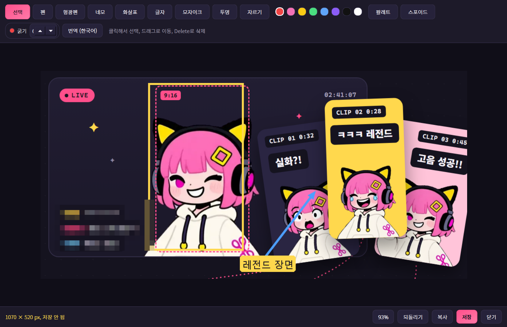<br><sub><b>편집기</b>: 툴바, 팔레트, 굵기, 번역, 되돌리기, 복사, 저장</sub></td>
</tr>
<tr>
<td colspan="2" align="center"><br><sub><b>영역 선택 오버레이</b>: 화면 정지 상태에서 드래그, 선택 영역만 밝게 표시, 실제 픽셀 크기 표시</sub></td>
</tr>
</table>

- 스크린샷은 앱을 실제로 실행하여 촬영. 편집기는 Xvfb 가상 디스플레이, 런처, 하이라이트 창, 영역 선택은 Windows 11
- 캡쳐 대상 이미지는 [assets/brand](assets/brand)의 키 비주얼. 영역 선택 화면은 키 비주얼을 화면 이미지로 입력하여 실행
- 영어, 일본어 화면: [docs/images/en](docs/images/en), [docs/images/ja](docs/images/ja)

<br>

## 기술 스펙

| &numsp;&numsp;&numsp;&numsp;&numsp;구&NoBreak;분&numsp;&numsp;&numsp;&numsp;&numsp; | 사용 기술 | 요구 버전 | 검증 버전 | 비고 |
|:---:|---|:---:|:---:|---|
| 언어 | **Python** | 3.10 이상 | 3.13, 3.14 | 타입 힌트, `src/` 레이아웃, `py.typed` |
| GUI | **PySide6** (Qt for Python) | 6.6 이상 | 6.12 | 선택 설치 `[gui]`, LGPLv3 |
| 화면 캡처 | **mss** | 9 이상 | 10.2 | Windows GDI, macOS CoreGraphics, X11. 스레드별 핸들 |
| 이미지 처리 | **Pillow**, **NumPy** | 10.1 이상, 1.24 이상 | 13.0, 2.5 | 렌더링(3배 슈퍼샘플링 안티에일리어싱), 크로마키 |
| 인코딩 | **FFmpeg** (외부 바이너리) | 5 이상 권장 | 6.1, 8.1 | `gif`, `libwebp_anim`, `libx264`, `libvpx-vp9`, `prores_ks`, `apng`, `ffv1` |
| VOD, 채팅 수집 | **yt-dlp**, CHZZK 및 SOOP 다시보기 API | 2024.1 이상 | 2026.10 | 선택 설치 `[ingest]`. 구간 다운로드, 채팅 다시보기, heatmap. CHZZK, SOOP 채팅은 표준 라이브러리만으로 수집 |
| 자막 | **libass** (ffmpeg), **faster-whisper** | 1.0 이상(faster-whisper) | 1.2.1 | 카라오케 ASS 삽입. 받아쓰기는 `[asr]`, 오디오는 ffmpeg로 디코딩하여 전달 |
| 전역 단축키 | Win32 `RegisterHotKey`, **pynput** | - | - | Windows는 추가 설치 불필요, 그 외 `[hotkey]` |
| 아바타 검출 | **onnxruntime**, deepghs/anime_face_detection | 1.16 이상 | 1.32 | 선택 설치 `[detect]`. 모델 12MB는 최초 사용 시 다운로드 |
| OCR | **Tesseract**, pytesseract | 0.3 이상 | - | 선택 설치 `[ocr]`. 번역 플러그인과 함께 사용 |
| 테스트 | **pytest**, Xvfb | 8 이상 | 9.2 | 577개. 실제 마우스 이벤트, F8 및 F9, VOD 클립 전체 절차, Windows 전역 단축키와 배율 |
| CI | **GitHub Actions** | - | - | Ubuntu(Xvfb, GUI 포함), Windows. 패키징 변경 시 Windows 실행 파일과 설치 프로그램을 빌드하여 실행 |
| 패키징 | setuptools, **PyInstaller**, Inno Setup | 77 이상, 6.10 이상, 6 | 6.22(PyInstaller) | `stream2clip`, `stream2clip-gui` 실행 파일, `stream2clip-recorder` 명령(파이썬 패키지), entry point 플러그인, Windows용 zip 및 설치 프로그램 |
| 데이터 포맷 | **JSON Schema** 2020-12 | - | - | [`annotation.v1.schema.json`](src/stream2clip/schemas/annotation.v1.schema.json), [`session.v1.schema.json`](src/stream2clip/schemas/session.v1.schema.json) |

### 출력 포맷

| &numsp;포&NoBreak;맷&numsp; | 코덱 | 투명 배경 | 오디오 | 용도 |
|:---:|---|:---:|:---:|---|
| **GIF** | gif, 팔레트 최적화 | 1비트 | 미지원 | 범용 재생, 커뮤니티 업로드 |
| **WebP** | libwebp_anim | 8비트 | 미지원 | 동일 용량 대비 선명한 움짤 |
| **MP4** | H.264 (libx264), faststart | 미지원 | AAC | 작은 용량, SNS 업로드 |
| **WebM** | VP9 (libvpx-vp9) | 8비트 | Opus | 투명 영상, 웹 |
| **MOV** | ProRes 4444 | 10비트 | PCM | 영상 편집기 오버레이 소스 |
| **APNG** | apng | 8비트 | 미지원 | 무손실 투명 움짤 |

<br>

## 설치

### 설치 방법 선택

| 대상 | 방법 | 사전 준비 |
|---|---|---|
| 처음 사용, 파이썬 미사용 | [Windows 설치 프로그램](#windows-설치-프로그램) | 없음. ffmpeg는 설치 과정에서 내려받기 |
| 설치 없이 사용 | [zip](#zip-사용) | 없음. ffmpeg는 앱 시작 화면에서 내려받기 |
| 명령줄, 라이브러리, macOS, Linux | [파이썬 패키지](#파이썬-패키지) | Python 3.10 이상, ffmpeg |

### Windows 설치 프로그램

설치 프로그램 하나로 앱 실행에 필요한 구성요소를 모두 준비

| 순&NoBreak;서 | 화면 | 조작 |
|:---:|---|---|
| 1 | [홈페이지](https://budongjw.github.io/stream2clip/) | 설치 프로그램 다운로드 후 실행 |
| 2 | 언어 선택 | 한국어, 日本語, English 중 선택. 설치 화면과 앱의 표시 언어로 적용 |
| 3 | 설치 위치 | 확인 후 다음. 관리자 권한 불필요 |
| 4 | 추가 작업 | **ffmpeg 내려받기** 선택 유지(115MB). ffmpeg가 없는 PC에서만 표시 |
| 5 | 설치 | ffmpeg 내려받기와 설치 진행. 인터넷 속도에 따라 몇 분 소요 |
| 6 | 완료 | 시작 메뉴 또는 완료 화면에서 stream2clip 실행 |

- 내려받기를 해제하였거나 실패한 경우에도 설치는 완료되며, 앱 시작 화면의 **ffmpeg 내려받기** 버튼으로 다시 진행
- 제거: Windows 설정의 설치된 앱 목록에서 제거. 내려받은 ffmpeg도 함께 삭제
- 화면별 설명: [사용 설명서](https://budongjw.github.io/stream2clip/guide.html)

### zip 사용

- [홈페이지](https://budongjw.github.io/stream2clip/)에서 zip 다운로드 후 원하는 폴더에 압축 해제, `stream2clip-gui.exe` 실행
- ffmpeg가 없는 경우 시작 화면 상단에 안내와 **ffmpeg 내려받기** 버튼 표시. 버튼을 누르면 내려받기 후 바로 사용 가능
- 내려받은 ffmpeg는 사용자 폴더에 보관되므로 새 버전의 zip으로 교체하여도 다시 받지 않음

<p align="center">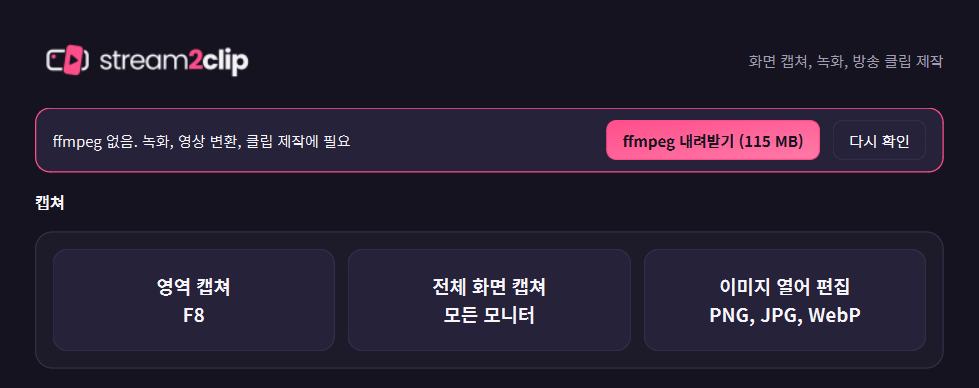<br><sub>ffmpeg가 없는 PC의 시작 화면. 안내는 ffmpeg가 준비되면 사라짐</sub></p>

### 구성요소

| &numsp;&numsp;&numsp;&numsp;&numsp;&numsp;구&NoBreak;성&NoBreak;요&NoBreak;소&numsp;&numsp;&numsp;&numsp;&numsp;&numsp; | 용도 | 설치 프로그램, zip | 파이썬 패키지 |
|:---:|---|---|---|
| ffmpeg, ffprobe | 녹화, 영상 변환, 클립 제작 | 설치 과정 또는 앱에서 내려받기 | 직접 설치. Windows는 `stream2clip setup --ffmpeg` |
| yt-dlp | 방송 주소에서 영상과 채팅 받기 | 포함 | `[ingest]` |
| 얼굴 검출 모델 | 아바타 위치 자동 검출 | 최초 사용 시 자동 내려받기(12MB) | `[detect]`, 최초 사용 시 자동 내려받기 |
| WebSocket 클라이언트 | OBS 리플레이 버퍼, Twitch, CHZZK, SOOP 라이브 채팅 | 포함 | `[obs]` |
| OBS Studio | 리플레이 버퍼 저장, 라이브 모드 | 해당 기능 사용 시 별도 설치. **도구**의 **WebSocket 서버 설정**에서 서버 사용 | 동일 |
| 자막 글꼴 | 클립에 자막 입히기 | 시스템에 설치된 글꼴 사용 | 동일 |
| faster-whisper | 자막 받아쓰기 | 미포함. 파이썬 패키지에서 제공 | `[asr]` |
| Google API 클라이언트 | YouTube 업로드 | 미포함. 파이썬 패키지에서 제공 | `[upload]` |

현재 PC의 구성요소 유무는 앱 시작 화면의 **구성요소 점검** 또는 `setup` 명령으로 확인

<p align="center">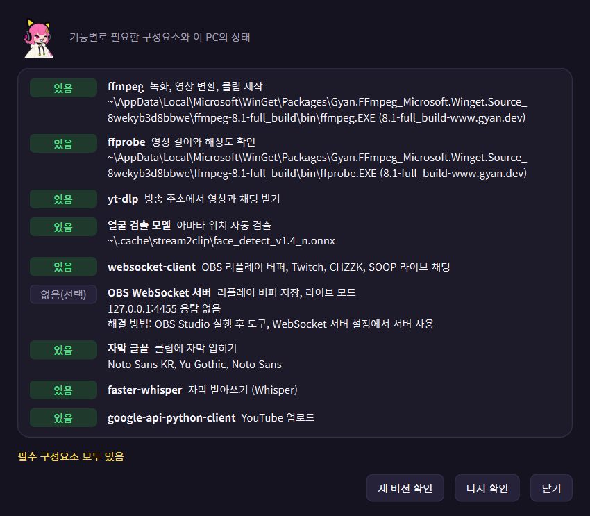<br><sub>구성요소 점검 창. ffmpeg와 얼굴 검출 모델은 이 창에서 내려받기 가능</sub></p>

| &numsp;&numsp;항&NoBreak;목&numsp;&numsp; | 내용 |
|:---:|---|
| 표시 | 구성요소별 상태(있음, 없음, 없음(선택), 자동), 용도, 위치와 버전, 해결 방법. 사용자 폴더는 `~`로 표기 |
| 내려받기 | ffmpeg가 없으면 **ffmpeg 내려받기**, 얼굴 검출 모델이 없으면 **지금 내려받기** 제공 |
| OBS | 런처의 OBS 연결 설정에 지정한 주소와 포트로 응답 확인 |
| 버튼 | **다시 확인**(직접 설치한 후 재확인), **새 버전 확인**(누를 때만 조회) |

명령줄에서는 `setup` 명령 사용

```bash
stream2clip setup
```

```text
[있음] ffmpeg: 녹화, 영상 변환, 클립 제작
    C:\Users\사용자\.cache\stream2clip\tools\ffmpeg.exe (9.0.2-essentials_build-www.gyan.dev)
[있음] ffprobe: 영상 길이와 해상도 확인
    C:\Users\사용자\.cache\stream2clip\tools\ffprobe.exe (9.0.2-essentials_build-www.gyan.dev)
[있음] yt-dlp: 방송 주소에서 영상과 채팅 받기
    프로그램에 포함
[자동] 얼굴 검출 모델: 아바타 위치 자동 검출
    첫 사용 시 자동으로 내려받음 (12 MB). 미리 받으려면 stream2clip setup --model
[없음(선택)] OBS WebSocket 서버: 리플레이 버퍼 저장, 라이브 모드
    127.0.0.1:4455 응답 없음
    해결 방법: OBS Studio 실행 후 도구, WebSocket 서버 설정에서 서버 사용

필수 구성요소 모두 있음
```

| &numsp;&numsp;&numsp;&numsp;&numsp;&numsp;&numsp;&numsp;옵&NoBreak;션&numsp;&numsp;&numsp;&numsp;&numsp;&numsp;&numsp;&numsp; | 동작 |
|:---:|---|
| 옵션 없음 | 구성요소별 유무, 위치, 해결 방법 표시. 필수 구성요소가 없으면 종료 코드 1 |
| `--ffmpeg` | Windows에서 ffmpeg, ffprobe 내려받기. 이미 있으면 내려받지 않음(`--force`로 다시 받기) |
| `--from 파일.zip` | 내려받는 대신 이미 받아 둔 압축 파일 사용. 고정된 빌드의 파일만 허용 |
| `--model` | 얼굴 검출 모델을 미리 내려받기 |
| `--check-update` | 새 버전 유무 확인. 요청할 때만 조회 |
| `--no-obs`, `--obs-port 포트` | OBS 확인 생략, 확인할 포트 지정 |

### ffmpeg 내려받기

| &numsp;&numsp;&numsp;&numsp;&numsp;항&NoBreak;목&numsp;&numsp;&numsp;&numsp;&numsp; | 내용 |
|:---:|---|
| 내려받는 빌드 | ffmpeg 9.0.2 essentials(gyan.dev). [ffmpeg.org](https://ffmpeg.org/download.html)가 안내하는 Windows용 빌드이며 `winget install Gyan.FFmpeg`와 동일한 배포처 |
| 내려받는 곳 | 해당 빌드의 [GitHub 릴리즈](https://github.com/GyanD/codexffmpeg/releases/tag/9.0.2). 압축 파일 115MB |
| 무결성 확인 | 주소, 크기, SHA-256을 [`tools.py`](src/stream2clip/tools.py)에 고정. 값이 다른 파일은 사용하지 않고 삭제 |
| 저장 위치 | 사용자 폴더의 `.cache\stream2clip\tools`. `ffmpeg.exe`, `ffprobe.exe`, 라이선스 문서만 보관. `STREAM2CLIP_TOOLS_DIR`로 변경 |
| 탐색 순서 | `STREAM2CLIP_FFMPEG` 환경 변수, 실행 파일과 같은 폴더, 내려받은 폴더, PATH |
| 배포 방식 | stream2clip의 설치 프로그램과 zip에는 ffmpeg 미포함. 사용자의 PC에서 배포처로부터 직접 내려받음 |
| macOS, Linux | 내려받기 미제공. `brew install ffmpeg`, `sudo apt install ffmpeg` 등 패키지 관리자 사용 |

### 파이썬 패키지

> [!IMPORTANT]
> Python 3.10 이상과 ffmpeg 필요. ffmpeg는 PATH에 두거나 `STREAM2CLIP_FFMPEG` 환경 변수로 경로 지정. Windows는 설치 후 `stream2clip setup --ffmpeg`로 내려받기 가능

```bash
git clone https://github.com/BudongJW/stream2clip.git
```

```bash
cd stream2clip
```

```bash
pip install -e ".[gui]"
```

| 용도 | 설치 명령 | 추가 의존성 |
|---|---|---|
| 데스크톱 앱 | `pip install -e ".[gui]"` | PySide6, mss |
| 라이브러리, 명령줄(화면 캡쳐 포함) | `pip install -e ".[capture]"` | mss |
| 편집, 변환만(화면 캡쳐 제외) | `pip install -e .` | numpy, Pillow |
| Linux, macOS의 전역 단축키(Windows는 기본 지원) | `pip install -e ".[gui,hotkey]"` | pynput |
| 방송 주소에서 VOD, 채팅 수집 | `pip install -e ".[ingest]"` | yt-dlp |
| 자막 자동 받아쓰기(Whisper) | `pip install -e ".[asr]"` | faster-whisper |
| 아바타 위치 자동 검출 | `pip install -e ".[detect]"` | onnxruntime |
| OBS 리플레이 버퍼 클립 변환, 라이브 모드 | `pip install -e ".[obs,ingest]"` | websocket-client, yt-dlp |
| YouTube 업로드 | `pip install -e ".[upload]"` | google-api-python-client, google-auth-oauthlib |
| 번역용 OCR | `pip install -e ".[ocr]"` | pytesseract, tesseract 바이너리 |
| Windows 실행 파일 빌드 | `pip install -e ".[gui,ingest,detect,obs,build]"` | pyinstaller |
| 전체 | `pip install -e ".[gui,hotkey,ingest,asr,detect,obs,upload]"` | 위 항목 전체 |
| 개발, 테스트 | `pip install -e ".[dev]"` | pytest, ruff, jsonschema, PySide6, mss, websocket-client, websockets |

### Windows 실행 파일 만들기

파이썬이 없는 PC에서 사용할 수 있도록 [PyInstaller](https://pyinstaller.org)로 한 폴더에 묶는 절차

```bash
pip install -e ".[gui,ingest,detect,obs,build]"
```

```bash
python packaging/build_windows.py
```

| 결과물 | 내용 |
|---|---|
| `dist/stream2clip/stream2clip-gui.exe` | 데스크톱 앱. 콘솔 창 없음 |
| `dist/stream2clip/stream2clip.exe` | 명령줄 도구. `fetch`, `auto`, `avatar` 등 전체 명령 |
| `dist/stream2clip-0.14.1-windows-x64.zip` | 위 폴더를 묶은 배포용 zip |
| `dist/stream2clip-0.14.1-windows-x64-setup.exe` | 설치 프로그램(`--installer`, Inno Setup 6.1 이상 필요). 첫 화면에서 언어(한국어, 일본어, 영어) 선택, 선택한 언어로 앱 시작. ffmpeg가 없는 PC에서는 ffmpeg 내려받기 작업 제공 |

| &numsp;&numsp;&numsp;&numsp;&numsp;&numsp;&numsp;&numsp;&numsp;옵&NoBreak;션&numsp;&numsp;&numsp;&numsp;&numsp;&numsp;&numsp;&numsp;&numsp; | 동작 |
|:---:|---|
| `--ffmpeg auto`, `--ffmpeg 경로` | `ffmpeg.exe`, `ffprobe.exe`를 폴더에 복사. 실행 파일은 같은 폴더의 ffmpeg를 우선 사용하므로 ffmpeg가 없는 PC에서도 동작. 미지정 시 사용자의 PC에서 설치 프로그램 또는 앱이 내려받음 |
| `--icon kiri` | 실행 파일 아이콘을 키리형으로 지정. 기본값은 심볼형 |
| `--installer` | zip과 함께 설치 프로그램 생성. 관리자 권한 없이 현재 사용자에게 설치, 시작 메뉴 바로 가기 생성 |
| `--with-asr` | 받아쓰기(`--transcribe`)용 faster-whisper 포함. 기본값은 제외이며 용량이 크게 증가 |

유의 사항:

- 크기(Windows 11 빌드 기준): 프로그램 폴더 약 230MB, zip 약 105MB. ffmpeg 포함 시 그만큼 증가(full 빌드는 ffmpeg, ffprobe 합계 약 450MB)
- 아바타 검출 모델(12MB)은 포함하지 않으며 최초 사용 시 다운로드
- YouTube 업로드(`upload`, 앱의 업로드 창)는 실행 파일에 미포함. 파이썬 패키지로 사용
- 예제 번역기는 `translators` 폴더에 포함: `stream2clip.exe clips ... --translate ko --translator translators\openai_compatible.py`
- Chocolatey, Scoop의 `ffmpeg.exe`는 실제 프로그램을 호출하는 연결 파일이므로 `--ffmpeg auto`가 거부. 실제 파일 경로 지정 필요
- 코드 서명 미적용(zip, 설치 프로그램 공통). SmartScreen 경고가 표시될 수 있으며 Smart App Control 사용 환경에서는 실행이 차단될 수 있음
- 실행 파일의 동작 확인: 릴리즈마다 GitHub Actions의 Windows 러너에서 빌드 후 직접 실행([`package.yml`](.github/workflows/package.yml)). Windows 11 실기기에서의 실행과 화면 단계별 설치 결과는 [docs/VERIFICATION.md](docs/VERIFICATION.md#설치-프로그램) 참조

<br>

## 사용법

### 데스크톱 앱

```bash
stream2clip gui
```

| &numsp;&numsp;&numsp;&numsp;&numsp;&numsp;&numsp;&numsp;&numsp;단&NoBreak;축&NoBreak;키&numsp;&numsp;&numsp;&numsp;&numsp;&numsp;&numsp;&numsp;&numsp; | 동작 |
|:---:|---|
| <kbd>F8</kbd> | 영역 캡쳐 후 편집기 실행 |
| <kbd>F9</kbd> | 녹화 영역 선택 후 즉시 녹화. 다시 누르면 정지 및 저장 |
| <kbd>F10</kbd> | OBS 리플레이 버퍼 저장 및 클립 변환. 런처에서 사용 설정한 경우에 한함 |
| <kbd>V</kbd> <kbd>P</kbd> <kbd>H</kbd> <kbd>R</kbd> <kbd>A</kbd> <kbd>T</kbd> <kbd>M</kbd> <kbd>E</kbd> <kbd>C</kbd> | 선택, 펜, 형광펜, 네모, 화살표, 글자, 모자이크, 투명, 자르기 |
| <kbd>I</kbd> | 스포이드 |
| <kbd>[</kbd> <kbd>]</kbd> | 굵기 감소, 증가. 글자 크기 = 굵기 × 3 + 12, 모자이크 블록 = 굵기 × 2 |
| <kbd>Ctrl</kbd>+<kbd>Z</kbd>, <kbd>Ctrl</kbd>+<kbd>Y</kbd> | 되돌리기, 다시 실행 |
| <kbd>Ctrl</kbd>+<kbd>C</kbd>, <kbd>Ctrl</kbd>+<kbd>S</kbd> | 복사, 저장 |
| <kbd>Ctrl</kbd>+휠, <kbd>Ctrl</kbd>+<kbd>0</kbd> | 확대 및 축소, 100% |
| <kbd>Delete</kbd> | 선택한 주석 삭제 |

하이라이트 창(런처의 **하이라이트 찾기**):

| 조작 | 동작 |
|---|---|
| 구간 가운데 끌기, 가장자리 끌기 | 구간 이동, 시작과 끝 조정(최소 5초) |
| 휠, 구간 더블클릭 | 타임라인 확대. 빈 곳 더블클릭 시 전체 보기 |
| 목록의 체크 | 내보낼 구간 선택 |
| 레이아웃 **stack**, **pip**, **자동 찾기** | 얼굴 검출로 아바타 박스 입력 |
| **아바타 영상** | 아바타만 녹화한 영상을 stack, pip 레이아웃의 아바타로 사용. 초록 배경 제거, 투명 배경 영상은 그대로 사용 |
| **문장 경계 맞춤** | 자막 파일이 있는 경우 구간의 시작과 끝을 자막 줄의 경계로 이동(최대 3초) |
| **스타일** | 자막 모양(기본, 상자, 분홍 강조, 작게)과 위치(아래쪽, 가운데, 위쪽) 선택 |
| **웃음소리 (실험)**, **노래 구간** | 웃음소리 유형의 소리에 점수 가산, 노래와 겹치는 하이라이트 표시 또는 제외 |
| **번역**, **용어집**, **원문 병기** | 자막 번역기(플러그인 또는 `.py` 파일) 선택, 이름 고정, 원문과 2줄 표시 |
| **조용한 부분 줄이기** | 클립 안에서 0.7초 넘게 조용한 부분을 짧은 쉼으로 단축. 자막도 함께 이동 |
| **출처 표기**, **모음 영상** | 클립 구석에 넣을 문구 입력, 내보낸 클립을 이어 붙인 영상과 챕터 목록 함께 저장 |
| **편집용 내보내기** | 체크한 구간을 EDL 컷 목록, 타임라인 마커, 타임스탬프 목록으로 저장. 타임스탬프 목록은 클립보드에도 복사 |
| 파일 끌어다 놓기 | 영상, 채팅, 정보, 자막 파일 또는 방송 주소를 창에 놓으면 해당 칸에 입력. 런처에 이미지를 놓으면 편집기 실행 |
| **업로드** | 선택한 클립을 YouTube 업로드 창으로 전달. 기본값 비공개 |

| &numsp;&numsp;&numsp;&numsp;&numsp;항&NoBreak;목&numsp;&numsp;&numsp;&numsp;&numsp; | 내용 |
|:---:|---|
| 화면 언어 | 한국어, 日本語, English. 런처 우측 하단에서 선택, 다음 실행부터 적용 |
| 언어 결정 순서 | 앱에서 선택한 언어, 환경 변수 `STREAM2CLIP_LANG`, 설치 시 선택한 언어, 시스템 언어(한국어, 일본어 외에는 영어) |
| 리플레이 저장 | 런처의 **리플레이 저장**으로 OBS 리플레이 버퍼를 저장하여 마지막 N초를 클립으로 변환 |
| 설정 저장 | 녹화 형식, 저장 폴더, 하이라이트 창의 선택, OBS 주소, OAuth 파일 경로를 `settings.json`에 보관. 비밀번호 미저장 |
| 설정 위치 | Windows `%APPDATA%\stream2clip`, macOS `~/Library/Application Support/stream2clip`, Linux `~/.config/stream2clip`. `STREAM2CLIP_CONFIG_DIR`로 변경, 파일 삭제 시 기본값 복원 |
| 새 버전 알림 | 앱 시작 시 하루 1회 이내로 GitHub의 최신 릴리즈 번호 조회. 새 버전이 있으면 시작 화면 상단에 표시. 사용자와 PC에 관한 정보는 전송하지 않음 |
| 알림 끄기 | 알림의 **알림 끄기**, 또는 환경 변수 `STREAM2CLIP_NO_UPDATE_CHECK=1`. **이 버전 건너뛰기**는 해당 버전만 제외. 다시 켜려면 `settings.json`의 `update_check` 항목 삭제 |

> [!TIP]
> **투명** 도구는 드래그 시 해당 영역 삭제, 클릭 시 클릭한 색을 이미지 전체에서 투명 처리. **자르기**는 원본을 보존한 상태로 남길 영역만 지정. 저장 시 `.json` 선택 시 주석만 별도 저장

### CLI

| &numsp;&numsp;&numsp;&numsp;&numsp;&numsp;&numsp;&numsp;&numsp;명&NoBreak;령&numsp;&numsp;&numsp;&numsp;&numsp;&numsp;&numsp;&numsp;&numsp; | 기능 |
|:---:|---|
| `gui` | 데스크톱 앱 실행 |
| `monitors` | 모니터 목록과 좌표 표시 |
| `capture` | 영역, 모니터, 전체 화면 캡쳐 |
| `record` | 화면 영역 녹화(GIF, WebP, MP4, WebM, MOV, APNG) |
| `convert` | 영상의 구간, 크롭, 형식 변환 |
| `annotate` | 주석 JSON을 이미지에 적용 |
| `fetch` | 방송 정보, 채팅 다시보기, 자막, 영상 수집 |
| `highlights` | 채팅, 음량, 많이 다시 본 구간으로 하이라이트 검출 |
| `clips` | 하이라이트를 자막과 설명란이 포함된 세로 클립으로 내보내기 |
| `auto` | 검출부터 클립 제작까지 일괄 수행 |
| `avatar` | stack 레이아웃용 아바타 박스 제안 |
| `singing` | 오디오로 노래 구간 검출 |
| `glossary` | 자막 번역용 이름 용어집 초안 생성 및 점검 |
| `check` | 기획사 가이드라인 기준 업로드 전 점검, VRM 아바타의 사용 조건 검사 |
| `evaluate` | 시청자 댓글 타임스탬프 기준 검출 성능 평가 |
| `replay` | OBS 리플레이 버퍼 저장 및 클립 변환 |
| `live` | 라이브 채팅 감시, 급증 시 OBS 리플레이를 클립으로 저장 |
| `session record`, `session show` | 방송 중 채팅, 표시, OBS 장면, VTube Studio 아바타를 세션 파일로 기록, 기록 내용 표시 |
| `chzzk login`, `chzzk logout` | CHZZK 공식 Open API 로그인(본인 채널), 보관한 토큰 삭제 |
| `upload` | 클립을 YouTube에 업로드. 기본값 비공개 |
| `language` | 앱 시작 시 적용되는 화면 언어 표시 |
| `setup` | 기능별 필요 구성요소의 유무와 해결 방법 표시. `--ffmpeg`로 ffmpeg 내려받기 |
| `compile` | 제작한 클립을 이어 붙인 모음 영상과 챕터 목록 제작 |
| `timeline` | 하이라이트를 편집 프로그램용 EDL 컷 목록, 타임라인 마커, 타임스탬프 목록으로 내보내기 |

전체 옵션: `stream2clip <명령> --help`

```bash
stream2clip record --region 0,0,640,360 --duration 5 -o clip.gif
```

```bash
stream2clip convert vod.mp4 --start 1:02:03 --end 1:02:18 --crop 640,0,640,720 --width 480 -o highlight.webp
```

<details>
<summary><b>CLI 예시 더 보기</b></summary>

<br>

영역 캡쳐:

```bash
stream2clip capture --region 100,100,1280,720 -o shot.png
```

모니터 전체를 투명 배경 WebP로 녹화:

```bash
stream2clip record --monitor 0 --transparent --key-color "#00FF00" -o avatar.webp
```

그린스크린 영상을 투명 WebM으로 변환:

```bash
stream2clip convert greenscreen.mp4 --transparent --similarity 0.15 -o avatar.webm
```

알파가 있는 영상의 알파 유지(색 제거 없음):

```bash
stream2clip convert avatar_alpha.mov --transparent --key-color none -o avatar.webm
```

주석 JSON 적용, 주석만 투명 PNG로 출력:

```bash
stream2clip annotate shot.png --annotations edits.json -o out.png
```

```bash
stream2clip annotate shot.png --annotations edits.json --overlay -o overlay.png
```

ffmpeg 명령만 출력:

```bash
stream2clip convert vod.mp4 -o clip.gif --start 60 --end 70 --print-command
```

</details>

<br>

## 라이브러리로 쓰기, 다른 프로젝트에 이식

- 코어는 numpy, Pillow만 필요하며 GUI와 완전히 분리
- 적용 대상: autoclip, FunClip, biliup 등 ffmpeg 기반 파이프라인, MoviePy, OpenCV, PyAV 프레임 처리, Kdenlive, Shotcut, OBS 오버레이, PySide6 앱
- 연결 방법: [docs/PORTING.md](docs/PORTING.md)

```python
from stream2clip import ExportOptions, Region, build_export_command, export

opts = ExportOptions(format="webp", start=3723, end=3738, crop=Region(640, 0, 640, 720), width=480,
                     transparent=True, key_color="#00FF00")
print(build_export_command("vod.mp4", "clip.webp", opts))  # ffmpeg 명령만 (순수 함수)
export("vod.mp4", "clip.webp", opts)                         # 바로 실행
```

<details>
<summary><b>주석 편집, 녹화 예시</b></summary>

<br>

```python
from PIL import Image
from stream2clip.editor import Arrow, Document, Mosaic, Text
from stream2clip.geometry import Region

doc = Document(Image.open("frame.png"))
doc.add(Arrow((40, 300), (220, 180), color="#FF4F8B", width=6))
doc.add(Text((240, 150), "레전드 장면", size=32, background="#FFD84D", color="#15131F"))
doc.add(Mosaic(Region(20, 20, 200, 60)))
doc.save("frame_annotated.png")
doc.render_overlay().save("overlay.png")       # 주석만 있는 투명 PNG
doc.save_annotations("frame.annotation.json")  # stream2clip.annotation/v1
```

```python
from stream2clip.capture import ArrayBackend
from stream2clip.ffmpeg import ExportOptions
from stream2clip.geometry import Region
from stream2clip.record import Recorder

# RGBA numpy 배열을 주는 것이면 무엇이든 녹화 (게임 엔진, 아바타 렌더러, OBS ...)
recorder = Recorder(Region(0, 0, 1080, 1920), fps=30, backend_factory=lambda: ArrayBackend(my_render_fn))
recorder.start(); ...; recording = recorder.stop()
recording.export("avatar.webm", ExportOptions(format="webm", transparent=True, key_color=None))
```

</details>

<br>

## 구조

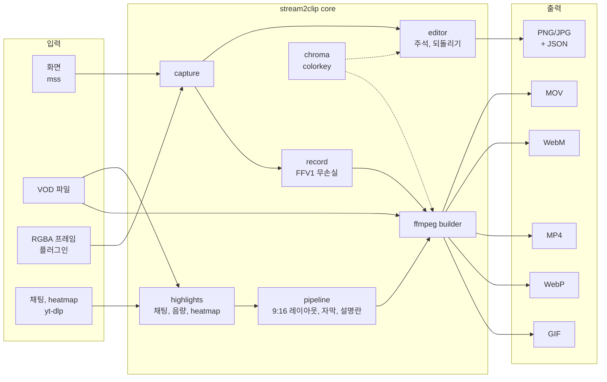

```
src/stream2clip/
├── geometry.py, color.py, frames.py   기본 타입 (Region, 색, RGBA 프레임 규약)
├── ffmpeg.py      ffmpeg 명령/필터그래프 빌더 (프로세스 실행 없음, 순수 함수)
├── chroma.py      크로마키: ffmpeg colorkey와 같은 수식 (미리보기 = 결과물)
├── export.py      ffmpeg 실행, ffprobe
├── chat.py        채팅 다시보기를 ChatMessage로 변환 (YouTube, Twitch, chat-downloader, CSV/JSONL)
├── sources.py     yt-dlp: info, 채팅, VOD 구간, heatmap        audio.py  음량 곡선
├── highlights.py  하이라이트 검출, 타임라인 그래프
├── live.py        라이브 모드: 실시간 급증 검출, 채팅 따라 읽기 (파일, yt-dlp, Twitch, CHZZK, SOOP), 리플레이 클립 변환
├── session.py     세션 파일 쓰기와 읽기, 영상의 0초, 장면 구간, OBS 배치 좌표 변환, 아바타 박스
├── recorder.py    방송 기록기: 채팅, OBS, VTube Studio 폴링 루프
├── vts.py         VTube Studio 공개 API 클라이언트
├── layouts.py     9:16 레이아웃 (center, fit, blur, stack, pip), 별도 아바타 영상 합성
├── detect.py      애니메 얼굴 검출, stack 레이아웃 아바타 박스 제안
├── subtitles.py   SRT/VTT/JSON을 카라오케 ASS로 변환, 언어별 폰트, 줄바꿈, 스타일 프리셋, faster-whisper 연결
├── compliance.py  기획사 가이드라인 프로필, 설명란, 업로드 전 점검
├── vrm.py         VRM 모델의 사용 조건 판독, 사용 계획 대조
├── tools.py       ffmpeg 내려받기(고정 빌드, SHA-256 확인), 구성요소 점검
├── handoff.py     편집 프로그램용 내보내기: EDL 컷 목록, 타임라인 마커, 타임스탬프 목록
├── updates.py     새 버전 확인 (GitHub 최신 릴리즈 번호 조회)
├── pipeline.py    하이라이트에서 완성 클립 일괄 생성
├── capture/       캡처 백엔드 (mss, numpy 배열, 플러그인) + 커서 합성
├── editor/        주석 모델, 렌더러, 되돌리기, JSON 직렬화
├── record/        실시간 영역 녹화 (무손실 FFV1 중간 파일을 원하는 포맷으로 변환)
├── translate/     OCR + 번역 플러그인 인터페이스
├── plugins.py     entry point 기반 플러그인 레지스트리
├── schemas/       annotation.v1, session.v1 JSON Schema
├── cli.py         stream2clip 명령
└── gui/           PySide6 앱 (런처, 영역 선택, 편집기, 녹화 오버레이, 전역 단축키, 하이라이트 창, 업로드 창, 방송 기록기 창, 설정 기억)
```

설계 원칙, 녹화 파이프라인, 스레드 구조: [docs/ARCHITECTURE.md](docs/ARCHITECTURE.md)

<br>

## 브랜드

<p align="center">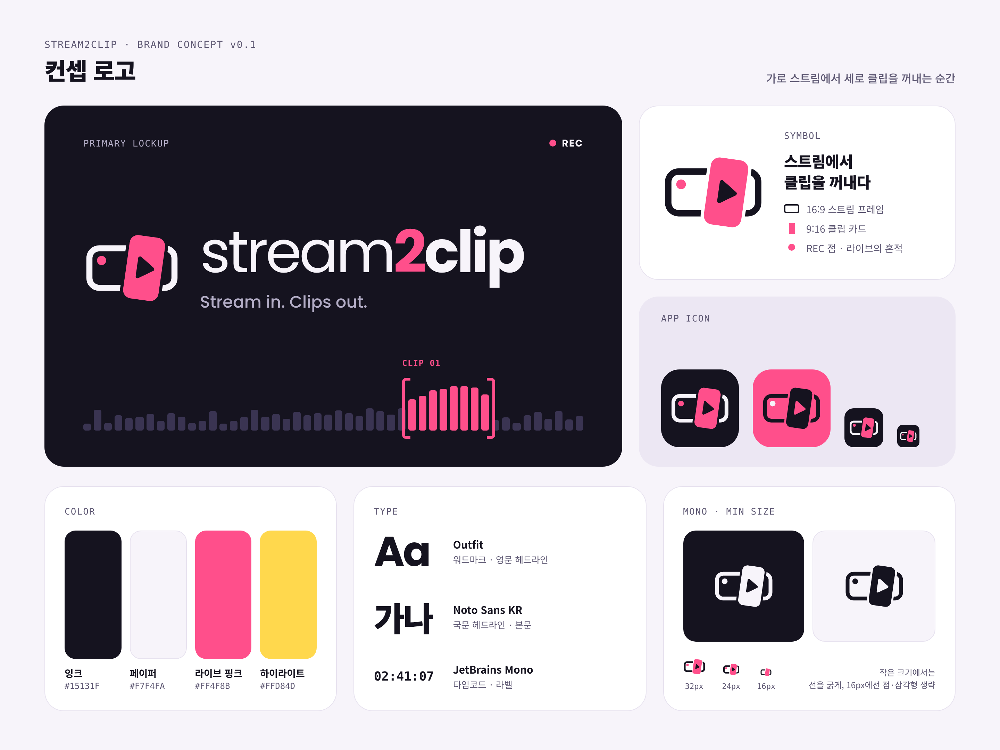</p>

심볼: 가로 16:9 스트림 프레임에서 세로 9:16 클립 카드를 꺼내는 순간. 구성 요소는 16:9 스트림 프레임, 9:16 클립 카드, REC 점

| 색&NoBreak;상 | 이름 | HEX |
|:---:|:---:|:---:|
|  | 잉크 | `#15131F` |
|  | 페이퍼 | `#F7F4FA` |
|  | 라이브 핑크 | `#FF4F8B` |
|  | 하이라이트 | `#FFD84D` |

| &numsp;&numsp;&numsp;&numsp;&numsp;&numsp;서&NoBreak;체&numsp;&numsp;&numsp;&numsp;&numsp;&numsp; | 용도 |
|:---:|---|
| **Outfit** | 워드마크, 영문 헤드라인 |
| **Noto Sans KR** | 국문 헤드라인, 본문 |
| **JetBrains Mono** | 타임코드, 코드 |

| 에셋 경로 | 내용 |
|---|---|
| [`logo/svg/`](assets/brand/logo/svg) | 벡터 원본: 컬러, 단색, 16px용, 앱 아이콘 |
| [`logo/png/`](assets/brand/logo/png) | 1024px PNG, 가로형 로크업 |
| [`logo/favicon/`](assets/brand/logo/favicon) | ico, 32px, 512px, apple-touch-icon |
| [`02_concept-image_keyvisual_1920x1080.png`](assets/brand/02_concept-image_keyvisual_1920x1080.png) | 키 비주얼(FHD, `@2x`) |
| [`03_github-social-preview_1280x640.png`](assets/brand/03_github-social-preview_1280x640.png) | GitHub 소셜 프리뷰 |
| [`app-icons/`](assets/brand/app-icons) | 앱 아이콘: Windows `.ico`, macOS `.icns`, Linux PNG, 웹 파비콘(심볼형, 키리형) |
| [`mascot/`](assets/brand/mascot) | 마스코트 키리 이모트 5종과 각도 3종(512, 112, 56, 28px) |
| [`source/`](assets/brand/source) | 키 비주얼과 소셜 프리뷰의 원본 페이지(`keyvisual.html`, `social.html`, `brand.css`). 문구와 배치 수정 위치 |
| [`mascot/source/`](assets/brand/mascot/source) | 이모트별 원본 1장과 제작 기록(`manifest.json`: 생성 도구, 프롬프트, 시드, 배경 처리) |

### 앱 아이콘

<p align="center">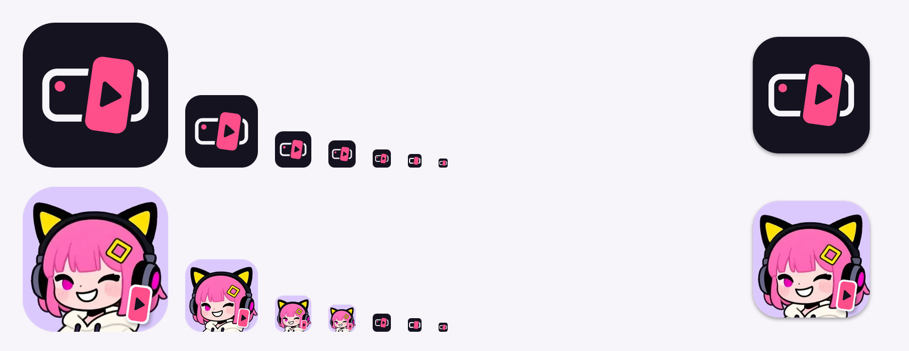</p>

- 종류: 심볼형(기본), 키리형
- 24px 이하는 REC 점과 재생 삼각형을 제외하고 선을 굵게 한 단순화 심볼 사용. 키리형도 32px 이하는 심볼로 대체
- 앱 창과 Windows 실행 파일은 심볼형 사용. 실행 파일 빌드 시 `--icon kiri`로 키리형 선택 가능

### 마스코트 키리

<table>
<tr>
<td align="center"><br><sub><b>wink</b><br>기본, 인사</sub></td>
<td align="center"><br><sub><b>laugh</b><br>웃긴 장면</sub></td>
<td align="center"><br><sub><b>surprised</b><br>반전, 사고</sub></td>
<td align="center"><br><sub><b>cut</b><br>클립 완성</sub></td>
<td align="center"><br><sub><b>focus</b><br>작업 중</sub></td>
</tr>
</table>

<table>
<tr>
<td align="center"><br><sub><b>turn_left</b><br>왼쪽을 바라봄</sub></td>
<td align="center"><br><sub><b>turn_right</b><br>오른쪽을 바라봄</sub></td>
<td align="center"><br><sub><b>side</b><br>옆모습, 진행 중</sub></td>
</tr>
</table>

| &numsp;&numsp;&numsp;&numsp;&numsp;&numsp;&numsp;&numsp;사&NoBreak;용&nbsp;위&NoBreak;치&numsp;&numsp;&numsp;&numsp;&numsp;&numsp;&numsp;&numsp; | 표시 |
|:---:|---|
| 하이라이트 창 상태 줄 | 준비 wink, 분석 및 내보내기 중 side(진행 표시줄 쪽을 바라봄), 하이라이트 검출 laugh, 클립 완성 cut, 실패 surprised |
| 하이라이트 창 구간 목록 | 해당 장면에서 가장 많이 나온 채팅 반응에 따라 표시. 웃음 laugh, 놀람 surprised, 귀여움 wink, 환호 cut |
| 런처의 안내(ffmpeg, 새 버전), 구성요소 점검 창 | turn_right. 안내 문구 쪽을 바라보도록 문구 앞에 배치 |
| 홈페이지 메인 화면 | 다운로드 구역 제목 끝에 turn_left, 사용 설명서 구역에 turn_right. 글 쪽을 바라보는 방향 |

**제작 절차**: 이모트 PNG는 원본에서 스크립트로 생성하며 직접 수정하지 않음

```bash
python packaging/build_mascot.py --sheet sheet.png
```

| &numsp;&numsp;&numsp;&numsp;단&NoBreak;계&numsp;&numsp;&numsp;&numsp; | 내용 |
|:---:|---|
| 원본 생성 | 이미지 생성 모델로 이모트별 1장 제작. 정사각형, 512px 이상, 캐릭터에 없는 단색 배경(초록 `#00FF00` 권장). GPU가 있는 환경에서 수행 |
| 등록 | `--add 이름 원본.png --background #00FF00 --generator ... --prompt ... --seed ...`로 원본과 제작 기록을 `source/`에 보관 |
| 배경 제거 | 단색 배경을 테두리에서 안쪽으로 제거. 색을 지정하면 팔과 몸 사이처럼 막힌 틈까지 제거 |
| 가장자리 정리 | 반투명 가장자리의 색을 캐릭터 쪽 색으로 교체하여 어두운 창에서 보이는 밝은 테두리 제거 |
| 크기별 생성 | 512, 112, 56, 28px. 투명도를 반영하여 축소 |
| 적용 | 앱에 넣는 크기(112, 56px)를 패키지에 복사. 홈페이지는 빌드 시 반영 |
| 검사 | `--check`로 원본과 생성물의 일치 확인(테스트에 포함) |

- 이 PC와 같이 GPU가 없는 환경에서도 생성 이후의 모든 단계 수행 가능(numpy, Pillow만 사용, 5종 전체 약 2초)
- 흰색, 크림색 배경의 원본은 후드와 구분되지 않아 함께 지워지므로 등록 단계에서 거부
- 새 이모트 추가 방법과 캐릭터 기준: [mascot/README.txt](assets/brand/mascot/README.txt)

**캐릭터 적용 위치**: 캐릭터가 바뀌면 원본 교체 후 아래 순서로 실행

```bash
python packaging/build_mascot.py
```

```bash
python packaging/build_brand.py
```

| &numsp;&numsp;&numsp;&numsp;&numsp;&numsp;&numsp;&numsp;&numsp;&numsp;위&NoBreak;치&numsp;&numsp;&numsp;&numsp;&numsp;&numsp;&numsp;&numsp;&numsp;&numsp; | 사용하는 그림 | 갱신 방법 |
|:---:|---|---|
| 앱(런처, 하이라이트 창) | 이모트 112, 56px | `build_mascot.py`가 패키지에 복사 |
| README 최상단 | 키 비주얼. 방송 화면과 클립 카드 3장에 이모트 사용 | `build_brand.py` |
| GitHub 소셜 프리뷰, 홈페이지 링크 미리보기 | 소셜 프리뷰. 클립 카드 3장에 이모트 사용 | `build_brand.py`. GitHub 저장소 설정에는 직접 업로드 |
| 홈페이지 메인 화면, 사용 설명서 | 이모트 512, 112px | `build_site.py`가 빌드 시 복사(main 반영 시 자동 배포) |
| README 브랜드 항목 | 이모트 112px | 파일을 직접 참조하므로 별도 작업 없음 |
| 키리형 앱 아이콘 | `app-icons`의 아이콘 파일 | 스크립트 없음. 캐릭터 변경 시 다시 제작 필요 |

- 키 비주얼과 소셜 프리뷰는 저장소의 페이지를 브라우저(Chrome 또는 Edge)로 그린 결과이며 이모트 파일을 그대로 사용. 외부 자료는 불러오지 않음
- 그리는 PC에 설치된 글꼴 사용: Noto Sans KR, 고정폭 글꼴(JetBrains Mono, 없으면 Cascadia Mono 또는 Consolas). 결과는 눈으로 확인한 후 반영

유의 사항:

- 키리 이모트는 이미지 생성 모델로 제작한 컨셉 시안(v0.2). v0.1의 가장자리 연보라색 테두리는 가장자리 정리로 제거. 화면 밖으로 잘린 부분(깜짝의 효과선 등)은 원본 그대로이며 다시 생성해야 해결
- 방송 플랫폼 이모트로 등록하는 경우 각 플랫폼의 이모트 규격과 AI 생성물 정책 사전 확인 필요([mascot/README.txt](assets/brand/mascot/README.txt))
- PNG 시안의 영문 워드마크는 Outfit 대신 Poppins로 렌더링되어 원본과 글자 형태가 일부 다름([assets/brand/README.txt](assets/brand/README.txt)). 심볼, 앱 아이콘, 파비콘은 순수 도형이므로 원본과 동일
- 소셜 프리뷰는 저장소 Settings의 General, Social preview에 업로드 시 적용

<br>

## 로드맵

[외부 프로젝트 레퍼런스 조사](reports/버튜버%20영상%20작업%20프로젝트%20레퍼런스.md)에 근거한 단계별 계획

### 예정

| &numsp;&numsp;&numsp;&numsp;항&NoBreak;목&numsp;&numsp;&numsp;&numsp; | 내용 |
|:---:|---|
| 화면 언어 | 일본어, 영어 문구의 원어민 검수. 명령줄의 진행 출력은 영어만 제공 |
| 가이드라인 | 한국 기획사 프로필. 공식 원문이 확인된 곳부터 추가(스텔라이브, 이세계아이돌은 원문 미확보) |
| 아바타 레이어 | Spout2, NDI 알파 레이어 녹화, VMC 수신 기록, 기록한 VTube Studio 파라미터로 세로 화면용 재렌더 |
| 방송 기록기 | 아바타 움직임 신호(`--avatar-motion`)의 실제 방송 검출 성능 평가, 실제 OBS, VTube Studio, CHZZK Open API 연결 검증. SOOP 공식 Chat SDK는 브라우저 전용이라 대상 외 |
| 실서비스 검증 | 실제 YouTube 업로드, Holodex API 키 사용 검증 |
| 편집 연계 | 편집 프로그램에서의 EDL 가져오기 실측, FCPXML 내보내기, 말소리 인식 기반의 무음 구간 판정 |
| 검출 신호 | SOOP 구독 및 팔로우 알림, Streamer.bot 이벤트, 사용자가 연결하는 판정 플러그인(LLM 등) |

### 완료

<details>
<summary><b>버전별 완료 항목 49건</b></summary>

<br>

| &numsp;&numsp;버&NoBreak;전&numsp;&numsp; | 항목 |
|:---:|---|
| v0.1 | 영역 및 전체 화면 캡쳐, 편집기(도구 9종, 팔레트, 스포이드, 되돌리기) |
| v0.1 | F9 움짤 녹화: GIF, MP4, WebP, WebM, MOV, APNG |
| v0.1 | 투명 배경 녹화(크로마키), 알파 보존 내보내기 |
| v0.1 | VOD 구간 및 크롭 변환, 주석 JSON 스키마, 플러그인 구조 |
| v0.2 | VOD, 채팅 수집: yt-dlp(구간, `live_chat`, heatmap), chat-downloader, TwitchDownloader, CSV, JSONL |
| v0.2 | 하이라이트 검출: 방송별 기준선, 채팅 급증, 고유 채터, 반응 어휘, 슈퍼챗, 음량, heatmap, 채팅 지연 보정 |
| v0.2 | 9:16 레이아웃(center, fit, blur, stack), 카라오케 자막(SRT, YouTube VTT 단어 시각, Whisper JSON, faster-whisper) |
| v0.2 | 기획사 가이드라인 설명란 생성, 업로드 전 점검 |
| v0.3 | 아바타 박스 자동 제안: 애니메 얼굴 검출로 `--layout stack --avatar auto` |
| v0.3 | 하이라이트 창: 타임라인, 구간 드래그 조정, 레이아웃 미리보기, 내보내기 진행률 |
| v0.3 | Windows 실행 파일: PyInstaller로 GUI와 명령줄 도구를 한 폴더 및 zip으로 구성 |
| v0.3 | CHZZK, SOOP 다시보기 채팅 수집 |
| v0.3 | 자막 번역 및 이름 용어집, 원문 병기 자막, Holodex 이름 초안 |
| v0.3 | 노래 구간(歌枠) 검출, 웃음소리 신호(실험) |
| v0.3 | OBS 리플레이 버퍼 연동(`replay`), YouTube 업로드(`upload`, 기본 비공개, Shorts 점검) |
| v0.4 | 방송 주소만으로 클립 제작: `auto <주소>`, `clips <주소>`가 하이라이트 구간의 영상만 다운로드 |
| v0.4 | 여러 방송 평가(`evaluate`): 시청자 댓글 타임스탬프 기준 precision, recall, 무작위 대비 배수 |
| v0.4 | 화면 언어 일본어, 영어 지원 |
| v0.4 | 앱의 번역, 노래 구간, 웃음소리, 업로드, OBS 리플레이(F10 포함), 설정 저장 |
| v0.4 | 파일 하나로 번역기 연결(`--translator file.py`), OpenAI 호환 예제 |
| v0.4 | 실제 OBS(33.0.1)로 리플레이 버퍼 검증 |
| v0.5 | 라이브 모드: 명령줄(`live`) 및 런처 |
| v0.5 | 하이라이트 창의 방송 주소 입력 |
| v0.5 | 홈페이지 및 사용 설명서(한국어, 영어, 일본어, PDF 포함), GitHub Pages 배포 |
| v0.5 | 언어 선택이 있는 Windows 설치 프로그램 |
| v0.6 | 문장 경계 맞춤: 클립의 시작과 끝을 자막 줄의 경계로 이동 |
| v0.6 | 스트리머 표시 구간: 스트리머, 모더레이터의 `!clip` 등 명령 시점을 항상 클립으로 포함 |
| v0.6 | pip 레이아웃, 별도 아바타 영상(그린스크린, 알파) 합성 |
| v0.6 | Twitch 라이브 채팅으로 라이브 모드 사용 |
| v0.7 | 자막 폰트의 언어별 자동 선택, 문절 단위 줄바꿈, 긴 자막의 자동 축소 |
| v0.7 | 자막 스타일 프리셋(`default`, `box`, `pink`, `small`)과 위치 선택 |
| v0.7 | VRM 아바타 권리 검사(`check --vrm`) |
| v0.8 | CHZZK, SOOP 라이브 채팅 직접 수신으로 라이브 모드 사용 |
| v0.8 | 하이라이트 근거, 가이드라인 점검, VRM 검사, 업로드 경고 문구의 일본어 및 영어 지원 |
| v0.9 | 하이라이트 창의 아바타 영상 입력, 투명 배경 아바타 영상의 자동 인식 |
| v0.9 | YouTube 업로드 예약 게시(`--publish-at`, 업로드 창의 예약 게시) |
| v0.9 | 자막 속 반응 표현 신호(`--speech`, 실험): 채팅이 없는 방송용 |
| v0.10 | ffmpeg 한 번에 설치: 설치 프로그램의 내려받기 작업, 앱 시작 화면의 내려받기 버튼 |
| v0.11 | 편집 프로그램용 내보내기(`timeline`): EDL 컷 목록, 타임라인 마커, 타임스탬프 목록 |
| v0.11 | 모음 영상(`compile`, `--compile`): 클립을 이어 붙인 영상과 챕터 목록 |
| v0.11 | 출처 표기(`--credit`): 클립 구석에 원본 채널 표시 |
| v0.11 | 파일 끌어다 놓기: 하이라이트 창과 런처 |
| v0.12 | 무음 구간 제거(`--trim-silence`, 하이라이트 창의 조용한 부분 줄이기) |
| v0.12 | 새 버전 알림: 시작 화면의 안내, `setup --check-update` |
| v0.13 | 앱의 구성요소 점검 창: 구성요소별 상태와 해결 방법, ffmpeg와 얼굴 검출 모델 내려받기 |
| v0.14 | 방송 기록기(`session record`, 앱 창, `stream2clip-recorder`): 채팅, 표시, OBS 장면과 송출 시작, VTube Studio 외곽선과 파라미터를 세션 파일로 기록 |
| v0.14 | 세션 파일 사용: `--session`으로 하이라이트 검출, `--skip-scene`으로 장면 제외, `--avatar session`으로 아바타 영역 지정, `session show` |
| v0.14 | CHZZK 공식 Open API 수신(`chzzk login`, `--chat chzzk-api`), 시청자 `!clip` 투표 표시 |
| v0.10 | 구성요소 점검 명령(`setup`): 기능별 필요 구성요소의 유무와 해결 방법 |

</details>

<br>

## 개발

| &numsp;&numsp;&numsp;&numsp;&numsp;&numsp;&numsp;&numsp;&numsp;&numsp;작&NoBreak;업&numsp;&numsp;&numsp;&numsp;&numsp;&numsp;&numsp;&numsp;&numsp;&numsp; | 명령 |
|:---:|---|
| 개발 환경 설치 | `pip install -e ".[dev]"` |
| 린트 | `ruff check .` |
| 테스트 | `pytest` |
| 테스트(Linux, 실제 화면 사용 GUI 테스트 포함) | `xvfb-run -a pytest` |
| 홈페이지 조립 및 설명서 PDF 생성 | `python packaging/build_site.py --pdf` |

- CI: 린트(ruff), Linux(Python 3.10, 3.12, 3.14, Xvfb), Windows(3.12, 오프스크린)에서 동일 명령 실행
- 홈페이지(`site/`)의 그림은 `assets/brand`, `docs/images`에서 가져오며 PDF는 Chrome 또는 Edge로 인쇄
- 테스트 구성과 파일별 범위: [docs/TESTING.md](docs/TESTING.md)
- 기여 절차: [CONTRIBUTING.md](CONTRIBUTING.md), 보안 문제 제보: [SECURITY.md](SECURITY.md)

> [!NOTE]
> Windows에서 `pytest`를 옵션 없이 실행하면 `test_gui_flow.py`가 화면 좌측 상단에 창을 표시하고 F8, F9를 실제로 입력하며 마우스 커서를 수 초간 이동(종료 후 원위치). 제외하려면 `QT_QPA_PLATFORM=offscreen` 지정. 다른 프로그램이 F8, F9를 전역 단축키로 사용 중이면 해당 테스트는 건너뜀

<br>

## 알려진 제약

| &numsp;&numsp;&numsp;&numsp;환&NoBreak;경&numsp;&numsp;&numsp;&numsp; | 상태 |
|:---:|---|
| Windows 11 | 실기기(1920×1080, 배율 125%, 모니터 1대)에서 전역 단축키, 캡쳐, 녹화, 투명 배경, 클립보드 복사 검증 완료. 배율 100%, 150%, 175%는 Qt 배율 계수로만 확인, 배율이 다른 모니터 2대는 미검증 |
| Windows 10 | 동일한 Win32 API 사용. 실기기 미검증 |
| macOS | 시스템 설정의 화면 기록 권한 필요. 실기기 미검증 |
| Linux (X11) | Xvfb에서 전체 절차 테스트 |
| Wayland | 화면 캡쳐(mss)는 X11, XWayland에서만 동작 |

| &numsp;&numsp;&numsp;&numsp;&numsp;&numsp;&numsp;&numsp;&numsp;기&NoBreak;능&numsp;&numsp;&numsp;&numsp;&numsp;&numsp;&numsp;&numsp;&numsp; | 제약 |
|:---:|---|
| 다중 모니터 | 배율이 다른 모니터 구성에서는 논리 좌표와 물리 좌표를 가상 화면 전체 비율로 환산하므로 선택 영역에 오차 발생 가능 |
| 소수 배율 | 125%, 150% 등에서는 선택 영역의 위치와 크기를 각각 반올림. 동일 크기로 드래그하면 위치와 무관하게 동일 픽셀 크기이며 화면 픽셀과의 차이는 최대 1px |
| 녹화 커서 | 화살표 모양 1종만 합성하며 화면 배율에 따라 크기만 조정. 실제 커서 모양(손가락, I빔 등)은 미반영 |
| GIF 투명도 | 1비트. 부드러운 가장자리가 필요한 경우 WebP, WebM, MOV 사용 |
| 화면 언어 | 일본어, 영어 번역은 원어민 검수 미실시. 명령줄의 진행 출력은 영어만 제공 |
| 라이브 모드 | 채팅 직접 수신은 YouTube, Twitch, CHZZK, SOOP 지원. CHZZK, SOOP의 성인 인증 및 비밀번호 방송은 미지원. 기본 임계값에서의 클립 절단 위치와 실제 장면의 일치 여부는 종료된 방송의 채팅으로만 측정 |
| YouTube 업로드 | 실제 업로드 미검증. 요청 본문과 진행 처리는 가짜 API로 테스트 |
| Windows 실행 파일 | 코드 서명 미적용. Smart App Control 사용 환경에서 실행이 차단될 수 있음 |
| ffmpeg 내려받기 | Windows만 제공하며 인터넷 연결 필요. macOS, Linux는 패키지 관리자 사용 |
| 편집 프로그램용 내보내기 | EDL은 독립된 판독기(OpenTimelineIO)로 확인. DaVinci Resolve, Premiere Pro에서의 실제 가져오기는 미검증. 마커 목록은 DaVinci Resolve 형식만 제공 |
| 무음 구간 제거 | 음량 기준 판정. 말소리가 작게 깔린 부분이 함께 줄어들 수 있으며 배경 음악이 큰 방송은 효과가 적음. 실제 방송 1개로만 측정 |
| 모음 영상 | 클립을 다시 인코딩하여 이어 붙임. 챕터 문구는 검출 근거이므로 게시 전 수정 필요 |
| 방송 기록기 | OBS 33.0.1에서 장면, 녹화 시작, 소스 배치, 표시 기록과 세션 기반 클립 제작 확인. 방송 중인 CHZZK, SOOP, Twitch 채널의 채팅으로 수신, 시청자 투표, OBS 위젯 확인. VTube Studio 연결과 실제 모델 외곽선, 송출 시작 기준의 시각 차이는 미검증. 장면 시각은 OBS 전환 효과 길이(기본 0.3초)만큼 늦게 기록. 녹화 중 기록기를 시작한 경우 0초 기준 오차 약 1초. 아바타 영역은 실행 1회에 1개이므로 하이라이트마다 소스 배치가 다르면 구간별로 실행. 회전, 반전된 소스와 그룹 안의 소스 미지원 |

기능별 실환경 검증 결과와 미검증 범위: [docs/VERIFICATION.md](docs/VERIFICATION.md)

<br>

## 라이선스

[Apache License 2.0](LICENSE)

| &numsp;&numsp;&numsp;&numsp;&numsp;&numsp;&numsp;구&NoBreak;성&nbsp;요&NoBreak;소&numsp;&numsp;&numsp;&numsp;&numsp;&numsp;&numsp; | 라이선스 |
|:---:|---|
| GUI | PySide6(LGPLv3) |
| 화면 캡쳐 | mss(MIT) |
| 영상 인코딩 | 시스템에 설치된 ffmpeg 빌드의 라이선스(LGPL 또는 GPL) 적용 |
| 브랜드 에셋(`assets/brand`) | 이 프로젝트의 로고 및 컨셉 이미지 |

<br>

<div align="center">
  
  <br>
  <sub><b>stream2clip</b>, Stream in. Clips out.</sub>
</div>
