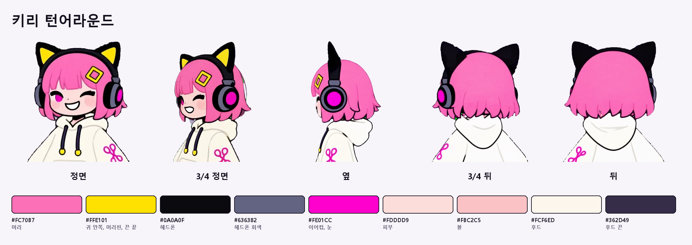
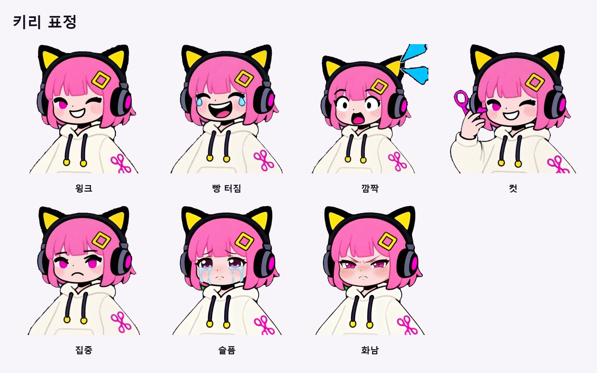
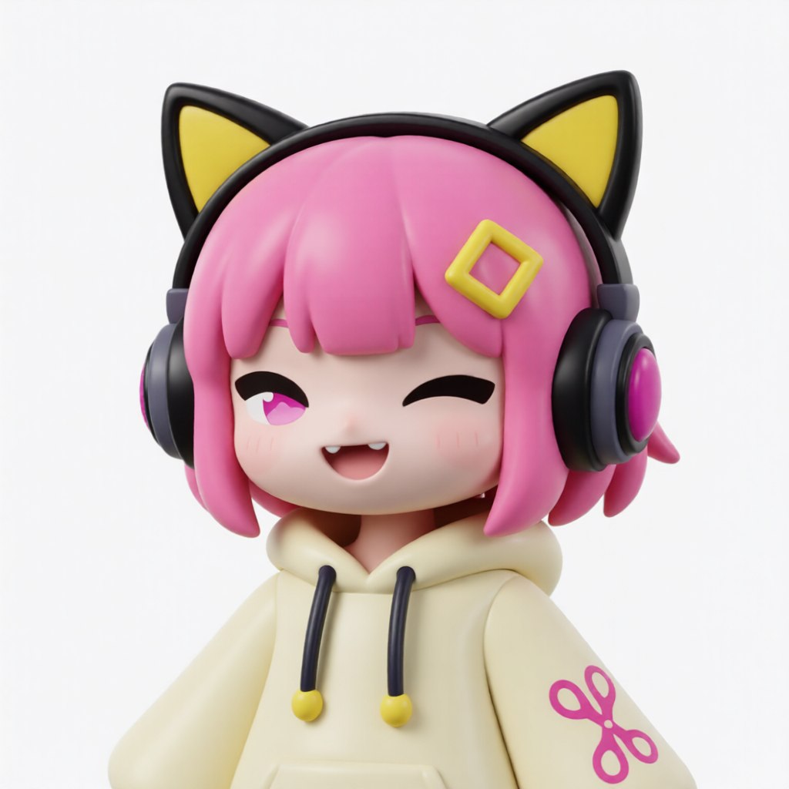
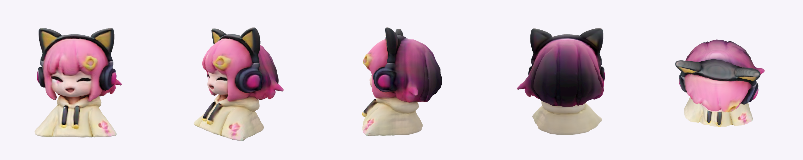

# 마스코트 디자인 레퍼런스

마스코트 키리의 2D, 3D 디자인 기준과 그 레퍼런스를 만드는 모델 구성. 앱에 쓰는 이모트와 제작 절차는 [assets/brand/mascot/README.txt](../assets/brand/mascot/README.txt), 레퍼런스 파일은 [assets/brand/mascot/design](../assets/brand/mascot/design/manifest.json)

## 캐릭터 기준

| &numsp;&numsp;항&NoBreak;목&numsp;&numsp; | 내용 |
|:---:|---|
| 머리 | 분홍 단발, 앞머리, 노란 마름모 머리핀(왼쪽 앞머리) |
| 헤드폰 | 검은 고양이 귀 헤드폰. 귀 안쪽 노랑, 이어컵 바깥 마젠타, 연결부 회색 |
| 옷 | 크림색 후드, 끝이 노란 남색 끈, 왼쪽 소매(보는 사람의 오른쪽)에만 분홍 가위 무늬 |
| 그림체 | 굵은 검은 외곽선, 단색 채색, SD 비율 상반신 |
| 뒷모습 | 단발의 뒷머리가 목을 덮고 후드 모자가 등에 내려앉은 모양. 고양이 귀는 뒤에서 보면 검은색만 |

| &numsp;&numsp;&numsp;&numsp;&numsp;&numsp;&numsp;&numsp;부&NoBreak;위&numsp;&numsp;&numsp;&numsp;&numsp;&numsp;&numsp;&numsp; | 색 |
|:---:|---|
| 머리 | `#FC70B7` |
| 귀 안쪽, 머리핀, 끈 끝 | `#FFE101` |
| 헤드폰 | `#0A0A0F`, 회색 `#636382` |
| 이어컵, 눈 | `#FE01CC` |
| 피부, 볼 | `#FDDDD9`, `#FBC2C5` |
| 후드, 후드 끈 | `#FCF6ED`, `#362D49` |

- 색은 정면 원본(`source/reference/kiri_wink_green.png`)에서 추출

## 레퍼런스

| &numsp;&numsp;&numsp;&numsp;&numsp;종&NoBreak;류&numsp;&numsp;&numsp;&numsp;&numsp; | 파일 | 만든 방법 |
|:---:|---|---|
| 턴어라운드 | `design/sheet_turnaround.png` | 정면과 3/4 정면은 기존 이모트, 옆, 3/4 뒤, 뒤는 외부 Qwen-Image-Edit-2511과 Multiple-Angles LoRA(시드 7) |
| 표정 | `design/sheet_expressions.png` | 기존 이모트 5종과 외부 Qwen-Image-Edit-2511의 슬픔, 화남(Anime LoRA, 시드 7) |
| 3D 피규어 렌더 | `design/3d/kiri_figure.png` | 외부 Qwen-Image-Edit-2511로 2D 그림을 피규어 질감의 3D 렌더로 변환. 굿즈, 3D 아바타의 질감 기준 |
| 3D 메시 | `design/3d/kiri_figure_triposr.glb`, `_views.png` | 피규어 렌더를 로컬 TripoSR로 변환(꼭짓점 색, 74,891개). 정면, 3/4, 옆, 뒤, 위에서 본 그림 포함 |
| 의상 시안 | `design/outfits/raw_winter.png` | 로컬 LCM Dreamshaper(강도 0.7, 시드 7). 빨간 목도리 추가, 캐릭터 일치도는 낮음 |









- 파일마다 도구, 모델, 라이선스, 입력, 지시문, 시드를 `design/manifest.json`에 기록
- 레퍼런스는 디자인 기준용. 앱의 이모트(`kiri_*.png`)는 기존 절차(`packaging/build_mascot.py`)로만 변경

## 모델 구성

| &numsp;&numsp;&numsp;&numsp;&numsp;&numsp;&numsp;용&NoBreak;도&numsp;&numsp;&numsp;&numsp;&numsp;&numsp;&numsp; | 모델 | 실행 위치 | 라이선스 |
|:---:|---|---|---|
| 각도, 표정, 의상 편집 | Qwen-Image-Edit-2511(4단계), Multiple-Angles LoRA, Anime LoRA | Hugging Face Space `prithivMLmods/Qwen-Image-Edit-2511-LoRAs-Fast` | Apache-2.0 |
| 3D 모델 | TRELLIS(image-large) | Hugging Face Space `trellis-community/TRELLIS` | MIT |
| 2D 변형 시안 | LCM Dreamshaper v7(OpenVINO, 4.3GB) | 이 PC의 Intel 그래픽 | CreativeML OpenRAIL-M |
| 3D 형태 | TripoSR(1.7GB) | 이 PC의 CPU | MIT |
| 배경 제거 | rembg `isnet-anime`(176MB, TripoSR 입력용) | 이 PC의 CPU | Apache-2.0 |
| 3D 모델 그림 | three.js 0.170.0(jsDelivr) | 헤드리스 Chrome, Edge | MIT |

- 로컬 모델과 패키지는 저장소 밖 `~/.cache/stream2clip/mascot`의 별도 Python 3.13 가상환경에 설치. 모델은 리비전 고정
- 제외: Hunyuan3D-2(라이선스가 한국 제외), rembg 기본 모델 BRIA RMBG 2.0(비상업 라이선스, 1GB)
- 외부 Space는 이 PC의 Hugging Face 로그인으로 실행. 무료 계정은 하루 GPU 사용량이 작아 편집 10회 안팎, TRELLIS 1~2회

## 사용법

```powershell
python packaging/mascot_lab.py setup
```

```powershell
python packaging/mascot_lab.py angle back -o assets/brand/mascot/design/turnaround/raw_back.png
```

```powershell
python packaging/mascot_lab.py edit "Change only her facial expression to sad" -o assets/brand/mascot/design/expressions/raw_sad.png
```

```powershell
python packaging/mascot_lab.py trellis assets/brand/mascot/design/3d/kiri_figure.png -o assets/brand/mascot/design/3d/kiri_trellis.glb
```

```powershell
python packaging/mascot_lab.py views assets/brand/mascot/design/3d/kiri_trellis.glb
```

```powershell
python packaging/mascot_lab.py sheets
```

| &numsp;&numsp;명&NoBreak;령&numsp;&numsp; | 내용 |
|:---:|---|
| `setup` | 가상환경, 패키지(약 1GB), TripoSR 코드, 로컬 모델(약 6GB) 준비 |
| `angle` | 외부: 다른 카메라 각도(정면, 3/4, 옆, 뒤 등 8방향) |
| `edit` | 외부: 같은 캐릭터의 표정, 의상, 소품 편집 |
| `trellis` | 외부: 한 장 또는 여러 장으로 텍스처가 있는 3D 모델(GLB) |
| `sketch` | 로컬: 기존 그림에서 출발한 변형 시안(Intel 그래픽) |
| `mesh` | 로컬: 한 장으로 대략의 3D 형태(CPU) |
| `views` | 3D 모델을 정면, 3/4, 옆, 뒤, 위에서 본 그림(헤드리스 브라우저의 three.js) |
| `sheets` | 턴어라운드, 표정 시트 |

## 확인 내용

- 턴어라운드: 8방향 중 3/4 정면은 거의 돌지 않았고, 3/4 뒤(왼쪽)는 가위 무늬가 반대 소매에 나타나 시트에서 제외
- 표정: Anime LoRA가 눈을 원본보다 세밀하게 그림. 원본처럼 단순한 눈이 필요하면 이모트 제작 시 지시문에 명시
- 3D: 평면 채색 그림을 그대로 넣으면 TRELLIS와 TripoSR 모두 판에 그림을 붙인 형태(뒤가 검거나 비어 있음). 2D 그림을 먼저 3D 피규어 렌더로 바꾼 뒤 변환하면 앞, 옆, 뒤, 위가 있는 흉상. 뒷머리 색은 모델의 추정이라 앞보다 어두움
- 로컬 2D 시안: 강도 0.5는 의상이 바뀌지 않고, 0.7은 의상은 바뀌지만 머리핀이 사라지고 선이 가늘어짐. 같은 캐릭터 유지가 필요한 표정, 의상은 외부 편집 모델, 로컬은 방향을 넓게 보는 시안용
- 이 PC(i7-1165G7, Iris Xe, RAM 16GB)의 시간: 로컬 2D 시안 1장 약 3분(첫 실행은 그래픽용 변환 포함 약 10분, 변환 결과 2.1GB 보관), TripoSR 3~28분(다른 작업과 겹치면 느림), 외부 편집 1회 10~30초, TRELLIS 1회 40초 안팎
- 무료 계정의 하루 GPU 사용량을 모두 써서 TRELLIS의 피규어 렌더 변환, 표정 2종(당황, 감동), 외부 모델의 의상 편집은 다음 날 실행 필요

## 유의 사항

- 모든 레퍼런스는 AI 생성물. 방송 플랫폼이나 굿즈에 쓰기 전 플랫폼의 AI 생성물 정책과 각 모델의 라이선스 확인
- 외부 Space는 운영자가 바꾸거나 내릴 수 있어 같은 시드로도 결과가 달라질 수 있음
